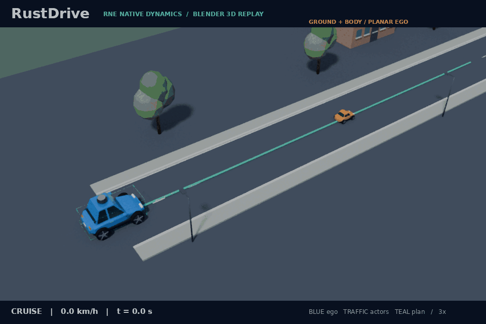

# RustDriving





Autonomous driving research in Rust. Recorded simulations, including optional
sensing modes.

## Quick start

Requires [Rust 1.90.0](https://rustup.rs/) (pinned in this repository).

```sh
cargo run --release --locked --bin rustdriving -- run \
  --scenario scenarios/mission.json --seed 7 --output artifacts/demo

cargo run --release --locked --bin rustdriving -- replay \
  --log artifacts/demo/sensors.jsonl --output artifacts/replay
```

## Docs

- [Architecture](docs/architecture.md) · [Capabilities](docs/capabilities.md)
- [Native RNE](integrations/rne/README.md) · [Demo reproduction](docs/japanese-city-demo.md#reproduction)
- [Development](docs/development.md) · [Validation](docs/validation.md) · [Contributing](CONTRIBUTING.md)
- [Maturity and roadmap](docs/maturity.md)

[Apache-2.0](LICENSE) · [Third-party licenses](THIRD_PARTY.md) · [OSM data: ODbL 1.0](maps/osm/SOURCE.md)
