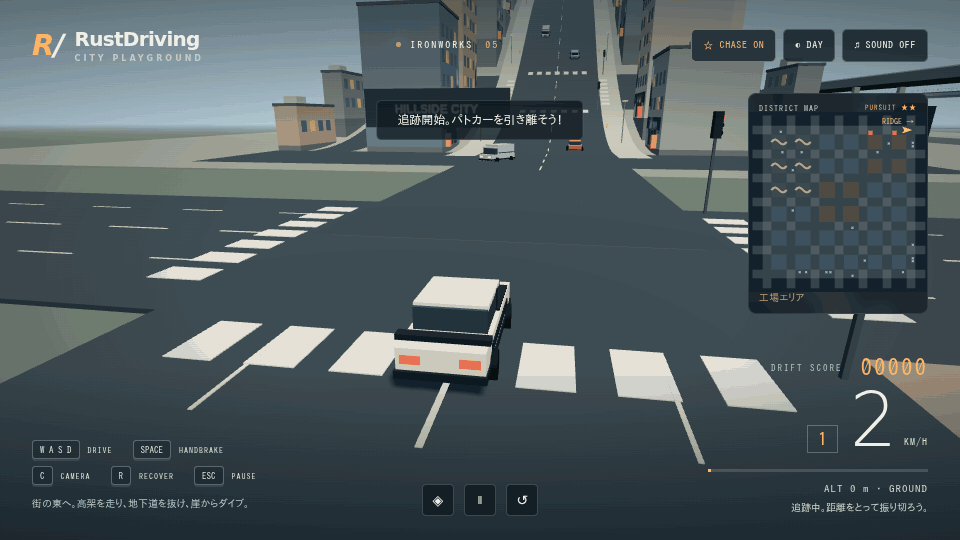
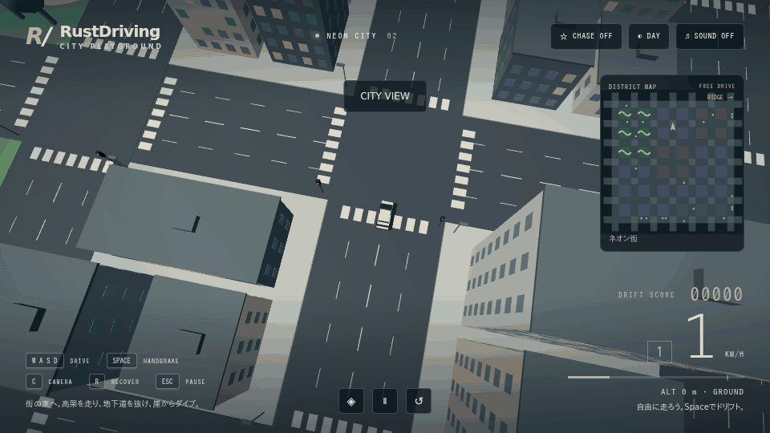
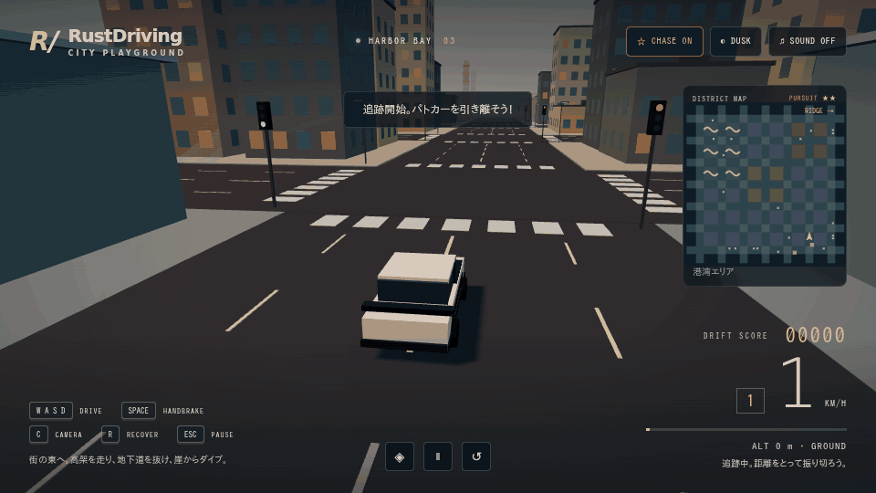
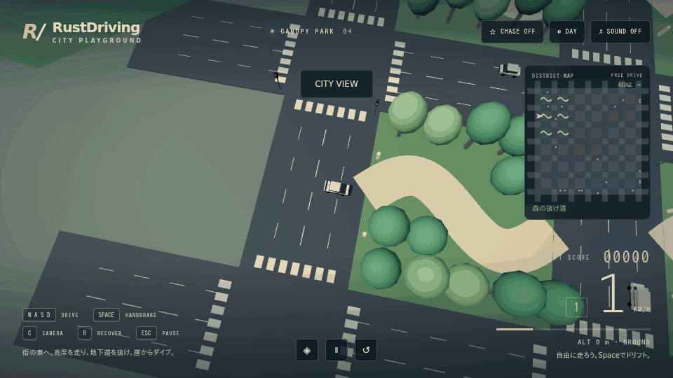
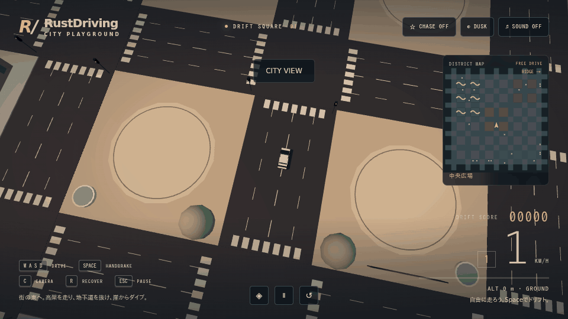
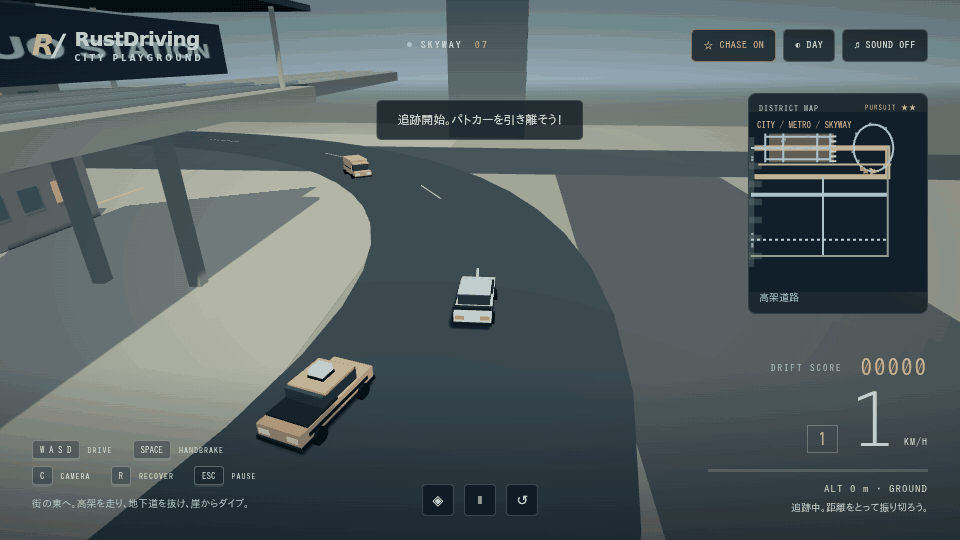
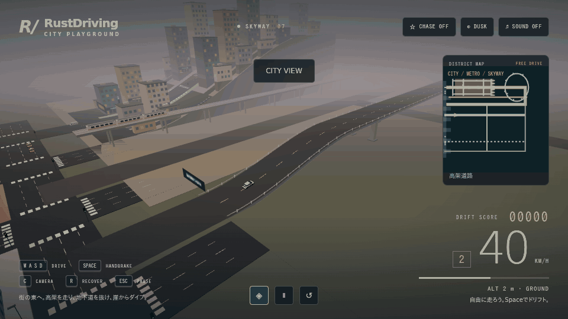
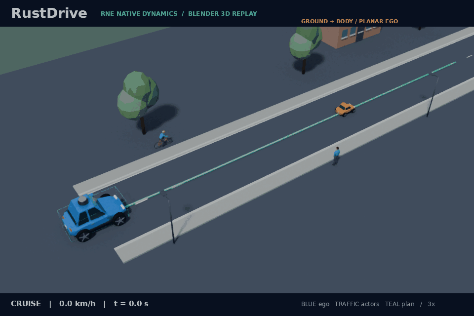

# RustDriving



[🎮 Play City Playground — 自分で運転・ドリフト・カーチェイス](https://rsasaki0109.github.io/rust_driving/)

<table>
  <tr>
    <td width="33%"><br>Daytime intersections</td>
    <td width="33%"><br>Harbor pursuit</td>
    <td width="33%"><br>Forest shortcuts</td>
  </tr>
  <tr>
    <td width="33%"><br>Dusk drift</td>
    <td width="33%"><br>Station curves</td>
    <td width="33%"><br>Elevated / underground</td>
  </tr>
</table>

<details>
<summary>Autonomous-driving simulations</summary>

<table>
  <tr>
    <td width="33%"><br>Japanese city</td>
    <td width="33%"><br>Braking and recovery</td>
    <td width="33%"><br>Stop sign</td>
  </tr>
  <tr>
    <td width="33%"><br>Priority crossing</td>
    <td width="33%"><br>Pedestrians and cyclists</td>
    <td width="33%"><br>Inclined 3D LiDAR</td>
  </tr>
</table>

</details>

Autonomous driving research in Rust, with recorded simulations and an optional
[manual-driving browser playground](docs/browser-playground.md).

## Quick start

Requires [Rust 1.90.0](https://rustup.rs/) (pinned in this repository).

```sh
cargo run --release --locked --bin rustdriving -- run \
  --scenario scenarios/mission.json --seed 7 --output artifacts/demo

cargo run --release --locked --bin rustdriving -- replay \
  --log artifacts/demo/sensors.jsonl --output artifacts/replay
```

## Docs

- [Architecture](docs/architecture.md) · [Capabilities](docs/capabilities.md)
- [Native RNE](integrations/rne/README.md) · [Hero reproduction](docs/browser-playground.md#hero-recording)
- [Development](docs/development.md) · [Validation](docs/validation.md) · [Contributing](CONTRIBUTING.md)
- [Maturity and roadmap](docs/maturity.md)

[Apache-2.0](LICENSE) · [Third-party licenses](THIRD_PARTY.md) · [OSM data: ODbL 1.0](maps/osm/SOURCE.md)
