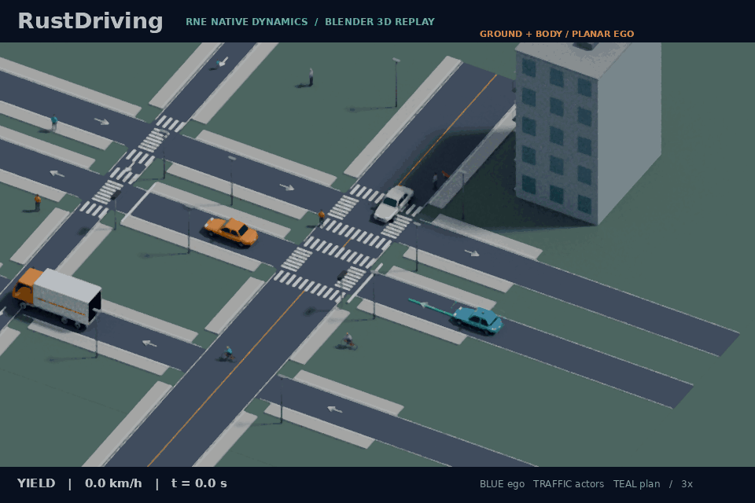
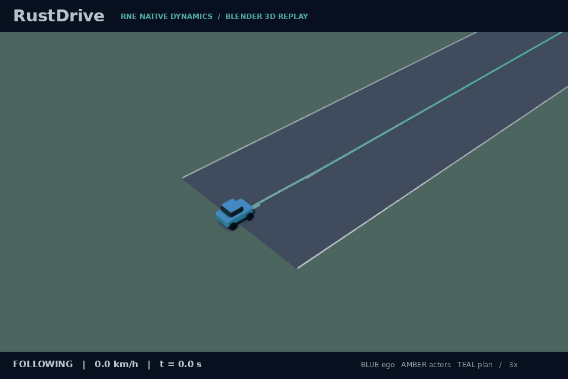
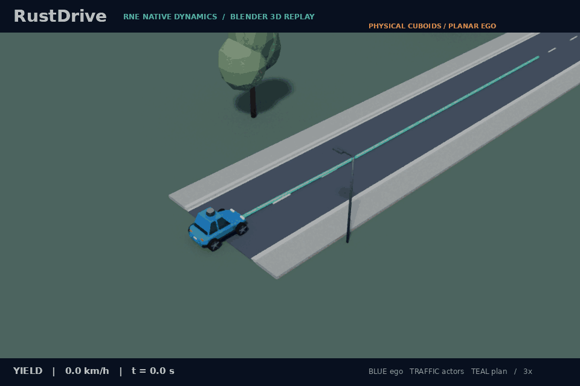
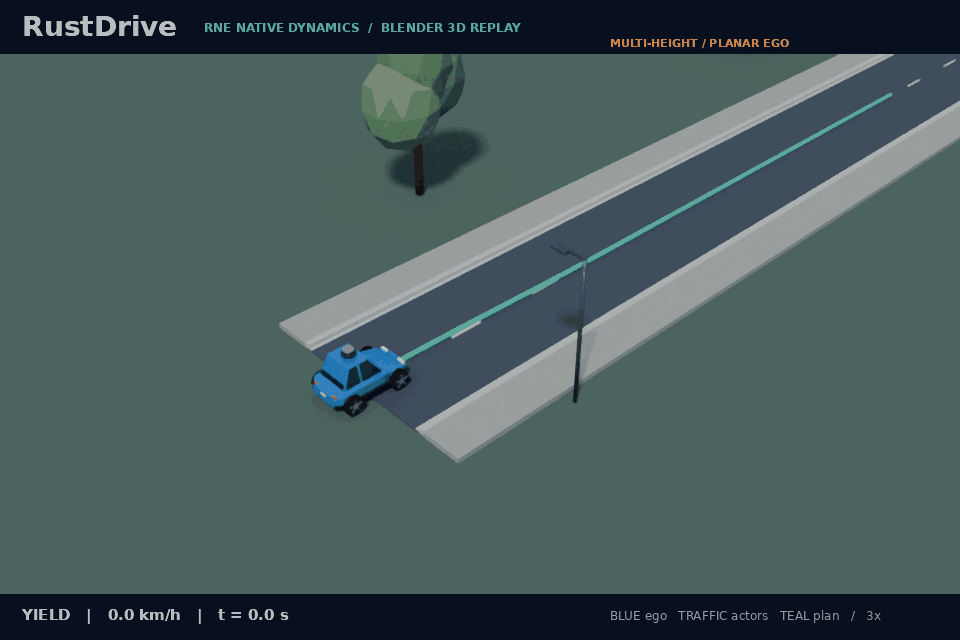
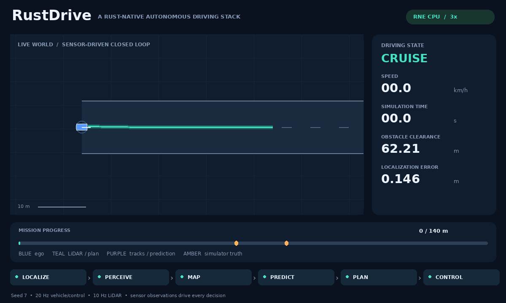
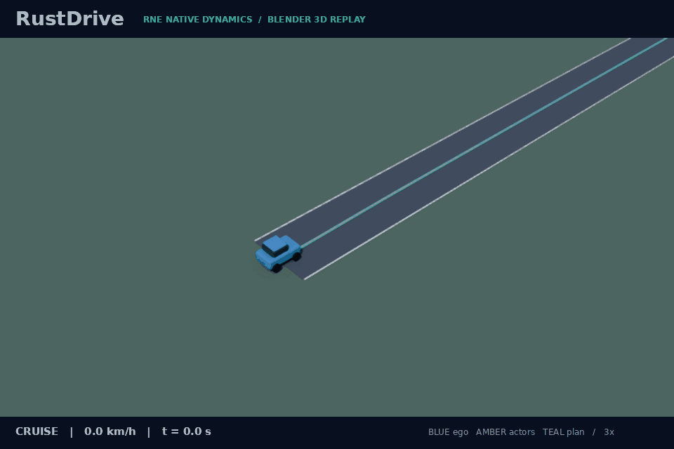
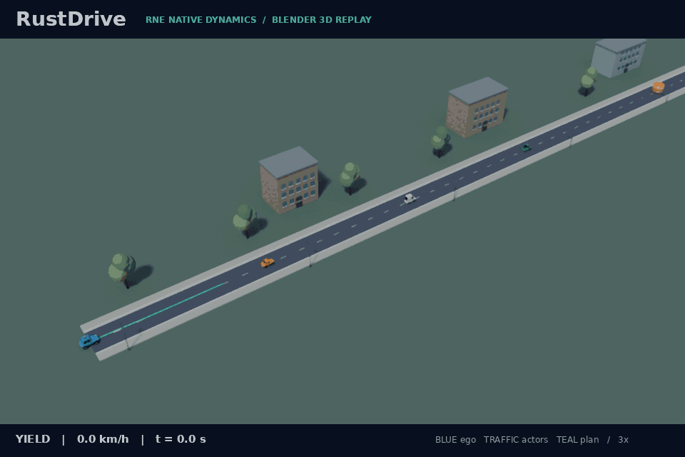
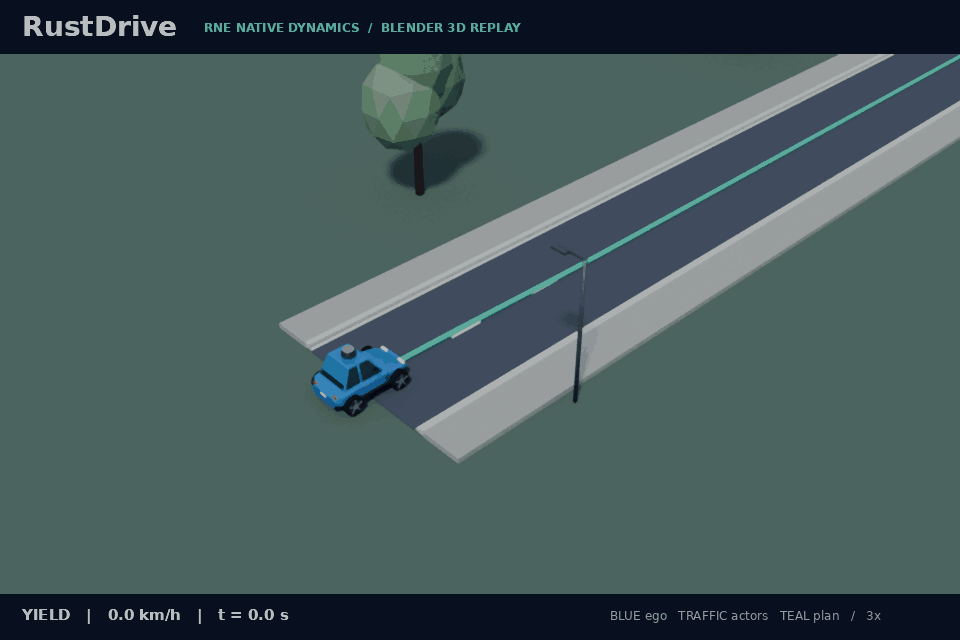
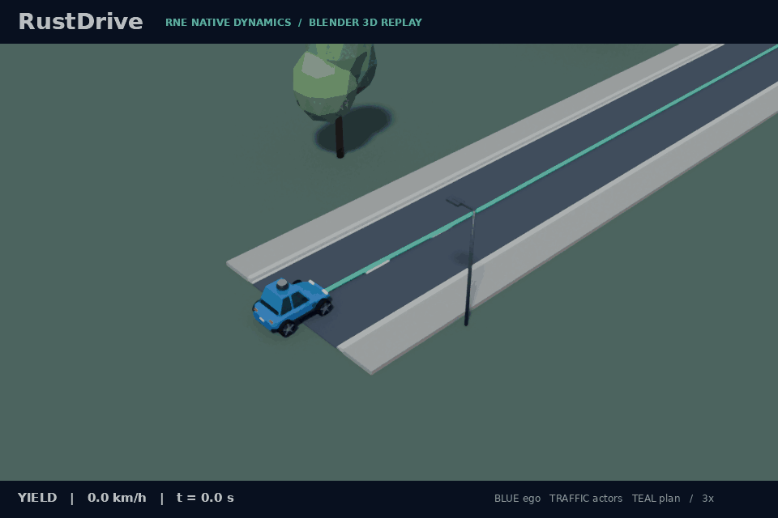

# RustDriving

**A Rust-native autonomous driving stack.**

Current comparative engineering maturity is **about 29%** (subjective), with
the 30% waypoint still open. [Assessment and remaining gates](docs/maturity.md).
Optional [pose covariance in forecasts](docs/pose-forecast-envelope.md) now covers
the range-dependent world-position error from current localization uncertainty.
All 48 supported comparisons retain preceding gates; forecast-coverage failures
fall 21 → 8 and strict qualification improves 16 → 28/48. All 48 pass the 0.2 s
coverage gate and goal arrivals stay 20. Cold moving-object forecasts and the
eight original incomplete missions remain open; the option stays off by default.
Optional [observed obstruction detours](docs/observed-detours.md) now propose
alternate graph routes from fresh acquired blocker evidence, then switch only
after stopped confirmation. Eight new authored route pairs reach their goals
versus zero disabled controls. All twelve negative pairs preserve operational
bytes and physical frames. However, those eight detours add forecast-coverage
failures: regression/default adoption fail, strict qualification is 16/44 and
the option stays off. The eight original single-route mission failures remain.
Optional [acquired progress status](docs/planning-progress.md) reports prolonged
stationary forecast blocking after fresh two-second evidence. Applications can
observe why the current lattice keeps a checked stop; driving policy stays fixed.
All 32 comparisons preserve operational bytes, physical frames and prior scores;
all eight incomplete original missions are detected and remain incomplete.
Optional [recent acquired motion fits](docs/recent-track-motion.md) improve
moving-object tracking while retaining ordinary static/slow filtering and a
bounded stopping-support clock. All 32 final comparisons retain prior gates;
forecast misses fall 25 → 13 and finite-difference velocity errors above 0.3 m/s
fall 545 → 99. Twelve static conditions preserve exact prior outputs/frames.
The first ungated regression is retained; goals remain 16, strict qualification
stays 0/32 and the option stays off.
Optional [sparse circle fitting](docs/sparse-circle-fits.md) now fits supported
three/four-return planar arcs before dense observations arrive. All 32 physical
comparisons retain their preceding gates; acquired forecast misses fall 60 → 25
and coverage failures 28 → 26. Goal arrivals remain 16 and strict qualification
remains 0/32. Fixed original samples reduce mean sensor-local center error from
0.617277 to 0.029549 m, retaining seven physical-shape misses. The option stays off.
Optional [complete-sweep recovery](docs/clear-sweep-recovery.md) records actual
planar beam outcomes and requires fresh complete empty sweeps with synchronous
stopped motion before retiring a disappeared forecast-fault identity. Capture
preserves all 32 preceding operational outputs and physical frames. The 32 enabled
conditions restore goal completion from 5 to 16 and remove all 11 disappeared-ID
holds without new failed gates against the preceding guard. Forecast coverage
still fails and the eight original missions remain incomplete; default stays off.
The preceding [measured forecast braking](docs/forecast-consistency.md) detects new
acquired proxy discs outside earlier predictions and requires fresh measured
confirmation before recovery. All 32 supported conditions pass the monitor/brake
contract, but goal completion falls from 16 to 5 and 12 conditions gain strict
failures. Regression/adoption fail; the option stays off by default.
Optional [planning decision records](docs/planning-diagnostics.md) now identify
candidate rejection reasons, forecast conflicts, checked stops and acquisition
confirmation. All 44 capture comparisons preserve every operational output byte
and physical frame. Thirty-two discarded planning trials complete none of the
eight original missions; those failures remain open and the trial changes are
excluded from the delivered runtime.
Optional [confirmed intermediate lateral paths](docs/refined-lateral.md) add six
complete checked proposals inside the width-fitted sides. Eight authored
corridor cases now meet the 1 m physical-clearance and goal gates; their paired
three-target controls all miss clearance. All 28 supported parent comparisons
retain their gates. The original eight incomplete obstacle missions remain
failed, and the option stays off by default.
Optional [acquisition-time heading fusion](docs/heading-latency.md) now supports
up to 200 ms of heading delivery delay through measured GNSS/map history.
All 18 enabled simulation cases meet the fixed accuracy, clearance and goal
gates, including six sensor-fault stop/recovery cases. Ten disabled/unsupported
controls remain stopped and retain their original mission failures. The option
stays off; measured calibration and the preceding obstacle-mission failures remain open.
Optional [acquired-disc preservation](docs/measurement-enclosure.md) prevents
radius smoothing from losing newly measured geometry. All 52 fixed comparisons
retain their original gates; measured-disc containment failures fall from
11,067 to zero. Strict qualification remains 20/52, with original forecast and
mission failures retained. The option stays off by default.
The [standalone follow-up](docs/standalone-enclosure.md) verifies shape preservation
without initial-motion confirmation: all 52 comparisons retain their gates and
all 17,056 acquired discs retain geometry. Two coverage failures pass against
the original unconfirmed controls; strict qualification stays 20/52.
Optional [confirmed initial track motion](docs/track-initialization.md) separates
early shape refinement from velocity estimation. All 52 fixed comparisons retain
their original gates; two forecast-coverage failures pass. Strict qualification
remains 20/52, eight mission goals are still missed, and 15 horizon comparisons
worsen. The option stays off by default.
Optional [heading-event history](docs/heading-history.md) now composes synchronous
absolute heading with delayed GNSS and map correction replay. Fourteen enabled
simulation cases pass; eight paired comparisons reduce position RMSE by at least
92.8%, and six fault cases stop and recover. Longer delays, relocalization,
measured sensor calibration and prior failed qualifications remain open.
Optional [earlier obstruction-stop search](docs/stop-search.md) now retains a
checked stopping position across replans. All 40 fixed comparisons pass; eight
mission conditions reduce emergency steps from 355 to 3 while retaining standstill.
Overall qualification is 20/40: original goal, forecast-coverage and heading
failures remain scored, and the option stays off by default.
Optional [synchronous absolute heading](docs/absolute-heading.md) adds an acquired
ENU body-heading input, full-covariance fusion and required-observation braking.
Five viewed native heading failures pass with the additional declared sensor;
four incomplete missions, a new forecast-coverage failure and biased-sensor
controls remain recorded. The mode stays off by default; older no-heading
recordings retain exact outputs.
On straight routes, [yield duties can now survive a measured localization reset](docs/yield-relocalization.md),
with retained entry ownership and new clear-scan confirmation before uncommitted entry.
Optional [motion error envelopes](docs/forecast-envelope.md) preserve nominal
forecasts and constant-velocity continuation with acquisition-origin error growth.
Their declared budgets require calibration; the experimental policy is off by default.
All forty paired recordings replay exactly; four experimental missions miss
their original deadlines, so the new policy does not qualify default adoption.
Optional [obstruction stop settling](docs/obstruction-stops.md) prevents a
completed collision stop from restarting on another partial blocked approach;
only a complete clear candidate can release it. All 48 enabled policy regressions
pass in both plants; eight release/fault cases resume and reach their goals.
Existing forecast calibration, native heading and four mission failures remain
recorded, and the new policy stays off by default.
Optional [road-width side candidates](docs/road-width-planning.md) fit the
existing lateral choices inside narrower supplied corridors while preserving
the original collision and road checks. Passing continuity now repairs the
native right-pass clearance failure: 0.845780 → 1.250174 m. All 18 narrow-road
cases meet the physical passing requirements and all 32 policy pairs pass.
Strict qualification remains 23/32 due to heading and inherited mission failures;
the option stays off by default. Scenario validation rejects malformed inputs
before driving, and the native CI matrix includes the repaired seed.
[Acquisition-time GNSS fusion](docs/gnss-latency.md) now reduces delayed-fix
errors in both reference and native RNE driving, with bounded history,
fault-stop recovery and independent covariance reconstruction.
It can now [retain synchronous map corrections during GNSS replay](docs/gnss-map-history.md),
including bounded outage support and conservative refusal of conflicting updates.
An additional [delayed-map mode](docs/delayed-map.md) reconstructs the scan's
acquisition pose and replays intervening GNSS corrections in either arrival order.
[Directed mid-edge navigation](docs/mid-edge-routing.md) now supports origins
and destinations inside unchanged road maps, retaining legal turns, closures,
speed caps and stopped handover in both plants. Its complete fixed qualification
passes 41/48 episodes; seven native launch-heading failures remain recorded.
An optional [explicit initial pose covariance](docs/initial-pose-covariance.md)
now supports declared startup uncertainty and complete posterior replay.
Physical heading perturbations also exposed and repaired incomplete local
side-path tracking in both plants; the original failed protocols remain recorded.
An experimental [ENU GNSS covariance calibration](docs/gnss-covariance.md) now
handles directional and correlated observation errors through GNSS/map replay.
Its 32 ordinary/map episodes pass; without the separate recovery policy, all 16
persistent-bias episodes fail the frozen stop/accuracy requirements.
An optional [bounded GNSS recovery guard](docs/gnss-recovery-guard.md) now repairs
those 16 failures, confirms recovery with new observations and keeps expired
holds stopped. All 64 positive episodes pass, including map compositions and
new-seed confirmation; uncertainty calibration and general bias detection remain open.
Optional [GNSS antenna mounting calibration](docs/gnss-antenna.md) now models
the antenna's displacement from the vehicle pose through delayed GNSS/map fusion.
All 80 calibrated episodes pass; eight uncalibrated comparisons retain their
failures, with at least 71.7% paired maximum-position-error reduction.
The default [motion-continuity guard](docs/motion-continuity.md) now invalidates
scene history after an uncovered wheel/gyro interval and holds braking until
external pose reinitialization. Eight healthy controls reach their goals and
28 motion-loss controls stay stopped; all 24 dropout localization failures remain
recorded and do not qualify current-pose accuracy.
An optional [stopped regional map recovery](docs/regional-relocalization.md)
now restores a measured pose/covariance after motion loss and starts a new
localization epoch. All 12 recovery cases reach their original goals, four
healthy controls pass and 12 negative controls stay stopped in both plants.
The first revision's 12 budget failures and every invalid-epoch accuracy failure
remain recorded. Recovery requires a supplied map, synchronous XY LiDAR, fresh
stopped motion observations and, by default, a later fresh GNSS fix. An explicit
[map-only grace window](docs/relocalization-map-only.md) can use new accepted map
observations for at most five seconds from the reset, with separate actual GNSS
clocks and an absolute stopping deadline. Global initialization remains open; fixed stop signs, signals and
[yield intersections](docs/yield-relocalization.md) require separate explicit preservation options.
All 24 map-support cases pass the feature protocol in both plants: handoff cases
travel 13.798–13.932 m before GNSS returns, matching defaults hold, and eight
loss/expiry cases stop. Four paired goals finish 3.90–4.25 s earlier. Global
invalid-epoch accuracy failures remain recorded; all 498 previous logs retain
exact replay outputs. [Results and boundaries](docs/relocalization-map-only.md).

An optional [confirmed GNSS handoff](docs/confirmed-gnss-handoff.md) now arms the
configured recovery confirmations at that measured reset. Returning fixes stay
transactional until confirmed; the reset-anchored deadline brakes even before
any fix arrives and stays expired after late GNSS returns. Twenty guarded/healthy/
expiry cases pass; four paired controls retain their unconfirmed-handoff failures.
All 522 previous logs retain exact replay bytes. This strengthens the existing
simulation domain; that revision kept comparative maturity at about 28%.

An explicit [navigation-preserving reset](docs/navigation-relocalization.md)
now retains the destination, active detour, accepted closures and original speed
policy after measured relocalization. Route admission and three new healthy
stopped observations protect handover. All 32 fixed cases pass: 20 recovered
goals, four recovered closed-mission stops, four healthy goals and four disabled
holds. First checker exceptions and all invalid-epoch errors remain recorded;
546 previous logs retain exact replay bytes. This expands the authored mission
recovery scope; comparative engineering maturity is now about 29%.

Optional [braked handover confirmation](docs/navigation-handover.md) retains
braking while three fresh stopped observations confirm a pending route change,
including after measured recovery and through navigation-fault recovery. All
32 individual cases pass; twelve handovers take 0.20 s at standstill. Arrival
improves 1.90–2.85 s, with 5/12 pairs meeting the frozen two-second criterion.
That comparison remains unmet; comparative maturity stays about 29%.
All 578 preceding and 32 current recordings retain exact final-runtime replay.

Optional [stop-sign preservation through measured reset](docs/stop-sign-relocalization.md)
now retains served stops behind the measured front and requires a new two-second
healthy stop for unfinished or rearmed signs. Inadmissible recovery keeps emergency
braking through later GNSS. Fixed stops also compose with native chassis/local-route
calibration while retaining original surveyed stop coordinates. All 32 follow-up
cases pass; the original two reference coverage misses and native launch failures
remain recorded. All 646 preceding/current physical recordings retain exact replay.
Comparative maturity stays about 29%; automotive sensing and calibration remain open.

Optional [signal preservation through measured reset](docs/signal-relocalization.md)
now retains committed lines behind the measured front and requires newly acquired
permission for remaining lines. Old/reset-time green cannot release a hold; invalid
admission keeps braking through fresh green and GNSS. All 28 fixed cases pass in
both plants, including curved routes and mixed stop signs; 646 preceding logs retain
exact replay bytes. Missing-motion accuracy failures remain scored. Maturity stays
about 29%; independent automotive sensing and uncertainty remain open.



An original, modular driving stack with a working, deterministic closed-loop simulation. The vehicle processes synthetic LiDAR, fuses noisy GNSS and odometry, tracks and predicts obstacles, and plans steering and braking. The opening GIF records CPU-only Robot Native Engine (RNE) driving on the left side of an authored Japanese urban street: two intersections, horizontal signals, storefronts and a guarded construction site. Twenty-three recorded road users include seven passenger vehicles, three trucks, eight pedestrians, four bicycles and a leashed dog, with a child, parent pushing a stroller, elder with a cane and construction worker. Ego waits at red, resumes on green and completely exits both intersections. Vehicles use fixed SI display dimensions and a fixed-scale camera. Original meshes visualize recorded positions; their articulated animation is cosmetic, while physical actors use capsule/circle proxies. Blender Cycles renders the 46-second episode at 3× playback. The work-zone cuboid is physical, but is occluded by traffic in this recording; construction recognition and negotiation are unimplemented. [Checks, meshes and limitations](docs/japanese-city-demo.md); [reproduce the GIF](#reproduce-the-gif).

The project is now **RustDriving**. Cargo packages and commands use `rustdriving-*` / `rustdriving`; the GitHub repository currently remains `rsasaki0109/rust_drive`. The requested repository rename to `rust_driving` remains pending because GitHub’s administration API returned 403; the commands below use the current repository. Historical recordings and versioned schema identifiers retain their original spelling.

**Status: simulation research prototype, v0.1.** The verified operating domain is known planar road corridors with circular obstacles, including a directed road-network fork, merge and stopped handover after a live closure notification. Bounded OSM import supplies external road geometry; optional native cuboid scenes add actual XYZ sensing, measured local ground removal and research-body clearance. A CPU-only Robot Native Engine (RNE) adapter runs the same pipeline with native Ackermann dynamics and Rapier queries. This is the starting point for an independent stack, not a replacement for mature driving systems or a system for use on public roads. CARLA, ROS 2, 3D SLAM, general intersection/priority reasoning, and real vehicle interfaces are not implemented. Optional offline Rust-native CPU camera inference runs separately from driving; camera-based control is not implemented. Mapped signal stops use timestamped infrastructure observations; camera signal recognition is not implemented. See the [capability matrix](docs/capabilities.md).

Optional research additions include [density-aware measured terrain evaluation](docs/adaptive-ground.md), [recorded RGB-D relative-motion evaluation](docs/recorded-rgbd.md), [measured-depth odometry and fixed-map localization](docs/recorded-motion.md), [measured keyframe localization](docs/recorded-keyframes.md), and [Rust-native CPU ONNX detection](integrations/onnx/README.md). Keyframes repair the viewed short fixed-map rejection case, but the frozen longer temporal trial accepts 33/35 updates and meets root accuracy gates on only 13/35; its accumulated drift remains a failed protocol. The [real urban-camera diagnostic](docs/road-camera-evaluation.md) uses six independently annotated photographs and retains every missed object and false positive. Their documented failures and dataset limits remain part of the evidence; these additions do not establish automotive perception accuracy.

The separate [measured fused-submap localizer](docs/recorded-submaps.md) now maintains bounded voxel means in a fixed camera origin, with independently reconstructed map generations. Its first desk recording accepts 29/35 updates but scores only 8/35 accurate; a separately frozen office/camera recording accepts 7/35, scores 5/35 accurate and latches loss. An [original BDD dashcam diagnostic](docs/bdd-road-evaluation.md) runs unchanged Rust CPU inference on eight new frames: 35 detections match 138 references, with 103 misses and 25.4% recall. These adapters run offline and retain their failed accuracy evidence; neither supplies driving controls.

The additional [RGB-D visual odometry](docs/recorded-visual-odometry.md) uses
original Rust image features and measured depth correspondences. Its viewed
desk recording improves to 24/35 root-accurate updates; the office recording
still scores only 9/35. An independent pixel reconstruction and separate SVD
fitter verify matching, motion and rejected observations. Repeated RGB images
cannot renew tracking. A separately frozen sitting sequence scores 31/35
root-accurate updates, retaining three consensus rejections and one repeated
image. This remains offline indoor research, with complete
accuracy/availability failures retained.

An additive [pixel reprojection refinement](docs/recorded-reprojection.md)
uses measured landmarks and current image pixels to refine camera motion:
the viewed office result improves to 32/35 accurate updates with maximum
position error 0.042368 m. The original algorithm and first trial remain reproducible;
the new path retains bounded computation and rejects failed refinements.
The separate first Freiburg 2 trial rejected malformed motion-capture labels;
its input failure is archived without an accuracy claim.

The separate [metadata-qualified room trial](docs/qualified-recorded-motion.md)
checks the complete source timestamps before image decoding. With unchanged
estimator and accuracy gates, its first frozen 1.1684-second indoor interval
passes all 35 updates (maximum root errors 0.075700 m / 0.084661 rad).
The source archive, independent pixel audit and exact viewed reproduction are
retained. Longer-duration and automotive localization remain unverified.

The [continuous room extension](docs/temporal-recorded-motion.md) retains that
same prefix and runs 180 frames without a reset. Over 5.973 seconds it accepts
58/179 updates, meets root accuracy on 52/179, and then loses tracking. The
failed first result, independent audit and error plot are retained; passing a
short interval does not establish reliable sustained localization.

The opt-in [depth-supported matching comparison](docs/depth-supported-matching.md)
adds one accepted update but reduces root-accurate updates to 49/179. Its
failed outcome is independently verified; it remains a viewed research variant.

The opt-in [pairwise pyramidal image tracker](docs/pyramidal-recorded-tracking.md)
performs real measured-patch tracking but regresses to **6/179** accepted and
accurate updates in the same viewed recording. Its unchanged first failure,
auditor-only test repair and exact replay are preserved. Synthetic controls
also expose accepted wrong correspondences on repeated textures; this variant
is not promoted to the original path.

The [independent recording protocol](docs/independent-recorded-motion.md)
fixes a separate TUM desk2 recording and the original estimator before reading
new data. Its first official-source trial accepts and accurately scores only
**16/179 updates** before tracking loss. An additive calibration-schema repair
lets the independent auditor verify all 179 outcomes while preserving the
original estimator, report and failed auditor. This is another recording of the
same desks, without automotive generalization or a maturity increase.
[Authoritative data license and attribution](docs/tum-source-provenance.md).

An optional [bounded multiscale feature comparison](docs/multiscale-features.md)
improves accurate adjacent-pair fits on the viewed room recording from 138 to
165 of 179 and desk2 from 124 to 154 of 179, while maximum pair errors increase.
It retains original FAST/BRIEF and pose-fitting math; continuous trajectory,
tracking permission and vehicle integration are unimplemented for this frontend.
The original room 52/179 and desk2 16/179 root-accuracy failures remain unchanged.
Independent audits verify all 179 pairs in each recording; maturity remains
about 20%, with the 30% and 50% goals unmet.

The subsequent [continuous multiscale comparison](docs/multiscale-temporal.md)
retains one origin and all 179 updates, but root-accurate counts regress from
52 to 49 in the viewed room and 16 to 15 in desk2 despite more accepted fits.
All branches lose tracking. Independent audits verify every retained frame;
adjacent-pair improvements do not transfer to continuous accuracy. Complete
repeat validation reproduces both failed outcomes. This offline comparison
does not increase the about-20% maturity estimate or supply driving integration.

An explicit [registered-grid camera-model comparison](docs/registered-grid-camera.md)
uses TUM's recommended uncalibrated default intrinsics without additional
undistortion or depth rescaling. Root-accurate counts improve to room native
56/179, room multiscale 54/179 and desk2 multiscale 17/179; every branch still
loses tracking. Complete independent audits and regression replay confirm those
failed outcomes. The separate [YOLOX-S CPU camera comparison](docs/yolox-s-camera.md)
raises matches from 35 to 55/138 on the same viewed BDD frames, but recall
**39.86%** fails the fixed 60% gate, with no motorcycle or traffic-light matches.
Complete replay confirms detections and the failed quality outcome.
Neither addition supplies driving integration or meets the 30% maturity goal.

The optional [one-command image analysis tool](docs/camera-analysis.md) combines
the tiled detector and ambiguity-preserving vehicle rule, preserving original
proposals alongside final hypotheses. It publishes complete bounded JSON
without overwriting output files. Its repeated eight-image regression retains
78/138 matches and 31 false positives; accuracy gates still fail.

An independent [image-space tracking library and CLI](docs/image-tracking.md)
now associate timestamped camera detections with motion prediction, global
one-to-one matching and explicit coasting/expiry. Synthetic crossing and
failure controls pass; real-sequence identity accuracy remains unverified.

The [recorded-image sequence CLI](docs/camera-sequence.md) now connects image
loading, detection and tracking in one process, reusing one CPU model plan.
An eight-frame recorded indoor slice exactly reproduces the separate tools;
independent object-identity accuracy and driving integration remain unverified.

The [camera-result freshness CLI](docs/camera-freshness.md) now separates
acquisition time from delivery/poll time, excludes stale or pre-fault results
and requires consecutive fresh images to recover. Synthetic controls and
injected faults on saved real reports pass; actual sensor-fault rates and
automotive availability remain unmeasured.

The [complete offline camera pipeline](docs/camera-pipeline.md) now runs image
analysis, tracking and freshness in one command with one CPU model plan. Clock-
excluded images skip inference; repeated actual-image runs reproduce the
separate tools. Delivery clocks are supplied replay metadata, with no live
camera or measured end-to-end latency claim.

The [measured camera replay](docs/camera-latency.md) now evaluates the same
images with actual host processing time and original acquisition intervals.
This CPU takes 2.27–2.31 seconds for the first four-view image, failing the prior
200 ms age limit; seven queued images then skip inference and all results stay
held. These retained local timing failures do not establish live-camera timing.

The optional [parallel fixed-view camera mode](docs/camera-parallel.md) now
reduces the same CPU processing from 2.26–2.39 s to 0.58–0.63 s, about 3.9×
faster. Sixteen real images run twice with identical per-view and final
detections. The 200 ms deadline and existing accuracy gates still fail.

An optional [CPU-specific build comparison](docs/camera-cpu-build.md) adds an
isolated O3/ThinLTO/native build with binary/source/CPU receipts. The same
16 images twice retain exact detections. Two paired timings average 5.94%
less processing time, but one pair regresses; a consistent speedup is not
established and all 200 ms gates still fail. Normal release remains the default.

The optional [guarded Resize optimization](docs/camera-operators.md) replaces
two nearest-neighbor expansions with standard tract operators. Raw model
outputs match bit for bit on 16 images twice. Parallel processing falls from
0.65–0.67 s to 0.60–0.63 s in the latest two local pairs (7.14% less time on average).
The 200 ms deadline and original quality gates remain unmet.

The [dense-depth and OpenCV diagnostics](docs/projective-depth-diagnostics.md)
retain six development variants and a pinned OSS reference on the same viewed
recordings. Projective depth fusion improves desk2 to 161/179 accurate roots,
while room reaches 64/179; complete accuracy still fails. Independent scoring
and exact reference replay preserve both improvement and failure. The
subjective maturity estimate remains about 20%.

The optional [Rust projective-depth library](docs/projective-depth-rust.md)
now implements that fused-depth method without OpenCV. It reproduces the
viewed prototype's trajectories and accuracy counts, with explicit failed-fit
atomicity, bounded work and latched expiry. Independent analytic and recorded
checks validate the port; both recorded accuracy protocols still fail.

The maintained Rust tracker now supports explicit policy configuration and a
[continuous regression gate](docs/native-depth-regression.md). Four native
candidate changes fail the fixed adoption criteria; default trajectories remain
unchanged at 64/179 room and 161/179 desk2 accurate updates.

The additional [explicit-clock supervisor](docs/projective-depth-supervision.md)
expires cached depth poses during sensor silence and withholds them after faults.
Only successful post-fault acquisitions can clear a hold; expired tracking
cannot silently restart. These temporal checks preserve the estimator's known
accuracy failures and remain separate from vehicle driving.

The [raw-depth reconstruction audit](docs/projective-depth-raw-audit.md)
now checks those original odometry reports against PNG-derived correspondences,
normal equations and projective fusion. All 7,219 reported iteration/final
equations and discrete fusion counts agree; this strengthens mathematical
validation while retaining the known physical pose-accuracy failures.

The optional [multi-reference RGB-D experiment](docs/multireference-rgbd.md)
adds raw-keyframe fitting and phase-qualified image residuals. Independent
synthetic pixels verify the added motion information, but neither the image
variants nor the published-intrinsics comparison improves both viewed records.
All failures are retained; the fused-depth default and approximately 20%
subjective maturity estimate remain unchanged.

The separate [joint-keyframe pose comparison](docs/joint-keyframe-depth.md)
adds an optional NumPy experiment that adjusts several measured-depth camera
poses together. Synthetic reference errors are corrected, but the viewed
room/desk2 results score only 72/179 and 51/179 accurate updates and both lose
tracking. Independent raw/state checks retain the failure; the Rust default
and about-20% maturity estimate remain unchanged.

The optional [marginalized keyframe comparison](docs/marginalized-keyframe-depth.md)
adds derived quadratic factors for observations whose views leave the active
window. Unique factor ownership avoids counting retained raw observations
twice, and independent QR, quaternion and failure-injection checks validate
the mathematics and atomic state updates. Both viewed recordings now accept
all 179 updates without expiry, but accuracy remains 70/179 room and 74/179
desk2. These physical failures remain retained; the Rust default and about-20%
subjective maturity estimate remain unchanged.

The subsequent [subpixel depth-factor comparison](docs/subpixel-keyframe-depth.md)
tests bilinear inverse-depth interpolation with the same retained-information
engine. It accepts every update but scores only 69/179 room and 74/179 desk2
accurate, with larger maximum errors than the preceding retained control.
Independent raw/state audits preserve this failed comparison; the Rust default
and about-20% subjective maturity estimate remain unchanged.

The [symmetric measured-normal comparison](docs/symmetric-keyframe-depth.md)
adds a prior-influence diagnostic and uses both measured surface normals with
their rotation derivatives. It accepts all 179 updates per recording, improves
room accuracy from 70 to 72/179 and keeps desk2 at 74/179; maximum position
errors shrink to 0.173 m and 0.240 m. Complete accuracy remains unmet, so the
Rust default and about-20% subjective maturity estimate remain unchanged.

The [Tukey depth-weight comparison](docs/robust-keyframe-depth.md) adds measured
residual/normal-disagreement diagnostics and a minimum weight-mass check.
It accepts every update but scores 71/179 room and 74/179 desk2 accurate.
Desk2's maximum position error falls to 0.198 m while room worsens to 0.263 m;
the tradeoff and independent audit are preserved, with unchanged Rust default
and about-20% subjective maturity estimate.

The [local-plane normal experiment](docs/patch-keyframe-depth.md) fits 5×5
measured-depth patches, checked separately with centered-patch SVD. It reduces
normal error in a fixed noisy-plane fixture, but accepts only 142/179 room and
120/179 desk2 updates before both recordings lose tracking; physical accuracy
is 77/179 and 75/179. The failed full tracking outcome is retained;
the Rust default and about-20% subjective
maturity estimate remain unchanged.

The [selective depth-level comparison](docs/selective-keyframe-depth.md) advances
past inadmissible coarse proposals while preserving strict finest-level and
returned-pose guards. It restores 179/179 accepted updates without loss in
both viewed recordings, from 142/179 room and 120/179 desk2 in the patch-normal
control. Physical accuracy is 77/179 room and 76/179 desk2, so complete
accuracy remains unmet; the Rust default and
about-20% subjective maturity estimate remain unchanged.

The [reciprocal pixel comparison](docs/reciprocal-keyframe-depth.md) checks that
each selected target point projects back to its original sampled source pixel.
A short known-noise control and fixed-pose image diagnostics precede the full
recorded comparison. Both tracks remain active, with 176/179 room and 179/179
desk2 updates accepted. Room accuracy rises from 77 to 88/179, while desk2 falls
from 76 to 75/179; complete physical accuracy remains unmet. This optional
experiment preserves the Rust default and about-20% subjective maturity estimate.

The [finest-level continuation diagnostic](docs/depth-convergence.md) tests ten
additional updates at ten saved reciprocal fits. None reaches the existing
convergence thresholds; RMS decreases in only four cases, with changing sample
populations. Independent raw-system and termination checks retain the complete
traces. This local diagnostic supplies no new trajectory accuracy result, and
the estimator's iteration caps remain unchanged.

The [frozen-correspondence update control](docs/descent-keyframe-depth.md) adds
bounded backtracking over the measured Huber objective and transported prior.
An independent target-frame objective checks pixel identities, every attempted
step length and resulting poses. This optional NumPy path retains the full
proposal guards and convergence thresholds, with unchanged Rust defaults.
All 7,427 recorded steps already pass at full width; states and physical scores
remain identical to the reciprocal control, at 88/179 room and 75/179 desk2
accurate. Both complete accuracy protocols remain unmet.

The [pixel correspondence diagnostic](docs/depth-correspondence.md) replays
100 saved continuation updates. All lower their fixed-pair cost, while fresh
pixel selection raises the population-dependent cost above its starting value
in 49 cases. Independent pixel-ID and cost accounting covers 960 raw pair
transitions. This adds diagnosis without fitting new poses or changing the
estimator, its physical accuracy evidence or the about-20% maturity estimate.

The [fixed-pair local refiner](docs/fixed-depth-refinement.md) rebuilds the
nonlinear system without changing its measured correspondences. All ten saved
windows converge on that fixed population in 1–5 corrections; fresh associations
leave all ten unconverged. The predeclared progression condition fails, so this
checked research tool supplies no new full trajectory or default-estimator change.

The [alternating local refiner](docs/alternating-depth-refinement.md) refreshes
correspondences after up to three fixed-pair corrections, with ten corrections
allowed in total. It repairs the rendered same-start convergence case, while
all ten recorded windows still exhaust their budgets without fresh convergence.
Independent checks cover 220 new and 20 control systems. The progression rule
fails; tracking defaults and the about-20% maturity estimate remain unchanged.

The [thirty-correction diagnostic](docs/budget-depth-refinement.md) exactly
reproduces those first ten corrections, then extends the same local solver
without relaxing convergence or guard thresholds. Fresh convergence remains
**0/10** at twenty and thirty corrections; checkpoint correspondences keep
changing. Independent checks cover 670 reported systems, including 220 replayed
controls, and 288 pair transitions. The larger budget is not adopted by tracking.

The [continuous local residual experiment](docs/continuous-depth-refinement.md)
freezes source observations and metric weights while bilinearly sampling
target inverse depth. It converges on a rendered warm start but fails all ten
viewed real windows through support/search guards. Independent candidate replay
shows that losing only 1–4 source occurrences can block the smallest search
step. The failed comparison is retained; tracking defaults stay unchanged.

The [initial-margin comparison](docs/margin-depth-refinement.md) qualifies
source observations at nine neighboring projections before freezing them.
The unchanged solver still converges on 0/10 viewed real windows: missing
support rises from one to seven windows as the combined selection retains only
10.78% of initial source occurrences. Independent checks retain this failed
tradeoff; no tracker or driving default is changed.

The [sampling-domain comparison](docs/sampling-depth-refinement.md) keeps
geometric matching at initialization and requires interpolation support during
the frozen attempt. Against both predecessors, local guard stops fall from
10/10 to 5/10 and 54 tentative corrections are applied, while convergence
remains 0/10. Original-discrete fresh checks, source populations and all failed
outcomes are retained; the Rust default stays unchanged.

The [fixed-observation budget extension](docs/long-depth-refinement.md) preserves
the same initial sources, weights and prior for up to thirty corrections.
All ten complete cap-10 reports exactly match the preceding control; two desk2
windows reach continuous-objective convergence at corrections 16 and 19.
Eight windows retain guard failures, and original-discrete fresh convergence
remains 0/10. No new trajectory accuracy or default-estimator adoption is claimed.

The [bounded-search diagnosis](docs/depth-search-diagnostic.md) replays four
saved failures and probes smaller steps without continuing optimization.
All four admit a decreasing step beyond the original bound: three at 1/256,
the invalid-sampling control at 1/1024. Independent directional and domain
checks support a deeper-search experiment; the latest convergence and physical
trajectory results remain unchanged.

The [deeper bounded-search comparison](docs/deep-search-depth-refinement.md)
extends only the candidate range through 2^-20, preserving the thirty-correction
cap. All old trace prefixes match exactly; search stops fall from four to one,
but three windows exhaust their budget and convergence stays 2/10. Two tiny
cost increases allowed by the unchanged numerical slack are retained. This
local experiment supplies no new physical trajectory score or default adoption.

The [conditional damped-direction comparison](docs/damped-depth-refinement.md)
tries eight alternative numerical directions after a very short or exhausted
GN search, preserving the original full-proposal guards and convergence.
It selects 32 alternatives but keeps convergence at 2/10, retains all three
budget stops and slightly worsens their final objectives. The failed result,
nine slack-permitted tiny cost increases and independent checks are retained;
this branch is not adopted by tracking.

The [cell-transition slope diagnosis](docs/depth-cell-slopes.md) identifies a
local barrier at the six budget-stopped states across those two methods.
Each direction's slope reverses when one fixed source changes interpolation
cell, contributing at least 99.967% of the slope jump; both methods encounter
the same source pixel per window. Independent checks retain all 152 probes.
This read-only result narrows the stall mechanism without granting convergence
or identifying physical outliers.

The [C1 cubic comparison and frozen margin follow-up](docs/cubic-depth-refinement.md)
remove interpolation-derivative jumps within valid stencils. Cubic center
support retains every initial source but converges on 0/10 viewed windows
because of later support loss. The separately frozen initial-margin version
converges on room source 240 after nine corrections, while retaining only 49.94%
of sources and converging on 1/10 overall. Both failed progression results are
retained; neither replaces the bilinear control or the native default.

The [measured-normal four-corner Hermite variant](docs/normal-hermite-depth-refinement.md)
keeps every initial observation and improves local convergence to 4/10 viewed
windows, compared with 2/10 for bilinear. Room gains three successes while desk2
loses one. Freshly associated convergence remains 0/10 and room fresh RMS
regresses, so the frozen progression rule fails and the native default stays.

The [local measured-normal completion experiment](docs/local-normal-depth-refinement.md)
reconstructs absent sampling normals only from fully measured, plane-qualified
3×3 patches. It opens 20/21 previously blocked room candidates and preserves
all initial observations, but convergence stays 4/10. Nine entire control
reports remain equal; the changed room window still loses support and its
fresh residual regresses. The failed progression result is retained.

The [depth-derived C1 comparison](docs/depth-slope-refinement.md) preserves its
first failed 3/10 result, then freezes a one-sided depth-slope extension. The
follow-up retains all initial observations and converges on 5/10 windows,
versus 4/10 for measured-normal sampling. All 97 applied corrections are full
steps. Freshly associated convergence remains 0/10, with four initial-support
stops and one correction-budget stop; physical accuracy remains unscored.

The [extended fixed-source correction budget](docs/extended-slope-refinement.md)
reproduces all 97 original corrections and every complete cap 30 report, then
converges on desk2 source 160 after 39 corrections. Local convergence reaches 6/10
with all initial sources retained. Four selected-support guards and 0/10 fresh
convergence remain; the changed window's fresh residual worsens. This bounded
offline continuation adds no physical trajectory score or native default change.

The [fitted-field admission experiment](docs/slope-admission-refinement.md)
aligns initial neighborhood probes with the depth field actually used for
fitting. It keeps all previous sources and original weights, restoring current
support in three desk2 windows and increasing local convergence from 6/10 to 9/10.
One room window still fails the unchanged 200-point center requirement; fresh
convergence stays 0/10. The additional selected residuals come from existing
frames, without new physical accuracy scoring or native/default adoption.

The [terminal objective diagnosis](docs/depth-objective-bridge.md) explains the
gap between fixed and fresh convergence at those saved poses. An independently
checked five-term gradient bridge separates source membership, residual
influence, Jacobians and target reassignment. Even reselection within the same
continuous model gives 0/10 converged proposals, with no new pose updates or
physical score. Fixed-objective convergence remains 9/10.

The [bounded reselection comparison](docs/reselected-slope-refinement.md)
then performs up to three continuous selection-and-refit rounds, with 90 total
corrections allowed per window. Fresh convergence remains 0/10, terminal fixed
convergence falls to 8/10, and both fresh-residual medians worsen. Every first
round exactly reproduces the preceding control. Two unresolved exact-grid
identity admission disagreements are retained; the failed variant is not adopted.

The [conservative boundary-support variant](docs/boundary-slope-refinement.md)
resolves those two authored admission disagreements by requiring supported cells
around each projected query, without snapping C1 interpolation coordinates.
Both implementations agree on 939 identity sources. On the ten recorded windows, every
complete fit/checkpoint exactly reproduces the original 9/10 control, retaining
all 60,288 initial source occurrences. Fresh convergence remains 0/10; physical
trajectory accuracy and native/default adoption remain unestablished.

The [fitted-center union](docs/fitted-center-refinement.md) retains all those
observations and their original metric values while admitting 20,140 additional
occurrences from the same frames. Local fixed-objective convergence reaches
10/10, repairing the remaining room support stop without relaxing the 200-source
minimum. Both fresh convergence checks remain 0/10 and desk2's median fresh RMS
worsens, so the progression rule still fails and the variant is not adopted.

The [bounded fitted-center reselection](docs/reselected-center-refinement.md)
preserves every first-round report and then performs up to three fixed-source
fits. Both median fresh residuals improve, but fresh convergence stays 0/10 and
terminal fixed convergence falls from 10/10 to 7/10. A selected-support line-search
stop and two inner-budget stops remain explicit; this variant is not adopted.

The [two-pixel admission comparison](docs/interior-center-refinement.md)
traces that support stop to one measured source crossing a missing cell after
1.07 pixels of image motion. Wider initial probes retain 99.08% of initial
sources, remove all unsupported trials and improve terminal fixed convergence
to 8/10. Every fresh check remains 0/10 and both median fresh residuals worsen
against the preceding outer control, so this variant is also not adopted.

The optional [KITTI calibration projection tool](docs/kitti-projection.md)
accepts provided calibration and Velodyne files, retaining the complete
rectified projection chain for cameras 0–3. Its controls are authored analytic
geometry, independently checked across four cameras with byte-identical
projection replay; no real KITTI data or automotive accuracy has been evaluated.

The separate [sparse-depth tool](docs/kitti-depth.md) turns those projected
points into occupied camera-pixel cells, selecting the nearest axial depth
and retaining all point assignments and winning source indices. Four-camera
analytic checks cover raster collisions, exact ties and adjacent floating-point
depths. Missing cells remain unobserved; image fusion and driving integration
remain future work.

The [recorded Argoverse sparse-depth experiment](docs/argoverse-sparse-depth.md)
processes 278,790 actual points and their log's camera calibration through an
explicit format bridge. All in-frame projections and raster selections agree
independently; the initial all-pixel trial passes only 1/3 scans due to near-zero
off-canvas depth conditioning, and that failure is retained. No physical depth
reference is available. The [KITTI depth evaluator](docs/kitti-depth-evaluation.md)
is ready for supplied authorized inputs; no real KITTI accuracy is claimed.

## Build and run

The shared pipeline, CPU RNE adapter and recorded 3D demos are available on `main`.

Rust 1.90.0 is pinned in `rust-toolchain.toml`. No ROS, GPU, Docker, models, simulator download, Python, or credentials are required for the Rust demo.

```sh
git clone https://github.com/rsasaki0109/rust_drive.git
cd rust_drive
cargo test --workspace --locked
cargo run --release --locked --bin rustdriving -- run \
  --scenario scenarios/mission.json --seed 7 --output artifacts/demo
```

First-time users without Rust can run `bash scripts/setup.sh` (requires Bash, curl, Internet access, and a supported host). Then `source scripts/env.sh` exposes the locally installed tools. On Windows, install [rustup](https://rustup.rs/) and use the Cargo commands above; helper shell scripts require Bash.

The command prints acceptance results and writes `run.json`, `summary.json` and `sensors.jsonl`. Exit status is **0** for passed scenario criteria, **1** for failed criteria, and **2** for invalid inputs or I/O errors. Time is simulated; the executable does not sleep or actuate hardware.

## Replay recorded sensors

```sh
cargo run --release --locked --bin rustdriving -- replay \
  --log artifacts/demo/sensors.jsonl --output artifacts/replay
```

Replay creates a fresh pipeline and recomputes localization, tracks, predictions, trajectories and commands from observations. It compares every output with the recording, rejects corruption/truncation, and writes `replay.json` only after successful verification. `verified=true` establishes repeatable computation; physical goal/collision acceptance remains in `summary.json`. See the [log contract](docs/sensor-replay.md).

## CPU-only Robot Native Engine demo

The opening 3D GIF replays actual native vehicle dynamics, steering lag and inclined physical-scene LiDAR queries against native road support and twenty-three road-user proxies, including crossing pedestrians, bicycles, traffic vehicles and a walking dog. A separate closure-detour recording below uses the default planar sweep. Blender Cycles renders the road, vehicle proxies and recorded planned trajectories on CPU. The shared RustDriving pipeline drives it. No GPU, graphics context, ROS, Docker, CARLA server or pretrained model is required.



Original hatchback, sedan, van and pickup display models include glazing, mirrors, lights, grilles and alloy wheels, with suburban pavements, trees, streetlights and campus buildings. [Model generation and editable Blender scenes](docs/3d-demo.md#models-and-suburban-scenery). These cosmetic models remain display-only; separately authored physical ground/obstacle cuboids enter the optional native scene's sensing and evaluation.

An opt-in native scene now adds actual upright 3D cuboids to Rapier sensing. A ground barrier causes a LiDAR-driven stop; raising the same barrier allows passage underneath. Separate diagnostic scans at three heights and a conservative capsule guard distinguish these cases. The vehicle still moves on a plane, and the extra diagnostic scans do not enter planning. A low slab missed by the operational scan is explicitly rejected after the run. [Scene format, reproduction and limitations](docs/native-scenes.md).



```sh
bash scripts/setup-rne.sh
source scripts/env.sh
cargo +1.95.0 run --release --locked --manifest-path integrations/rne/Cargo.toml -- \
  --scenario scenarios/native-scene-ground-stop.json --scene scenes/ground-barrier.json \
  --plant dynamic --seed 7 --output artifacts/native-scene
bash scripts/check-native-scenes.sh
```

The optional `--multi-height` mode feeds synchronized measured planes into the shared pipeline. Calibrated height selection and XY projection detect the low slab missed by the default scan, while excluding overhead returns. An incomplete or invalid bundle holds braking until a new complete post-fault acquisition arrives. Sparse horizontal planes still leave gaps in height coverage. [Sensor contract, reproduction and remaining blind zones](docs/multi-height-lidar.md).



```sh
cargo +1.95.0 run --release --locked --manifest-path integrations/rne/Cargo.toml -- \
  --scenario scenarios/native-scene-low-stop.json --scene scenes/blind-low-slab.json \
  --multi-height --plant dynamic --seed 7 --output artifacts/multi-height
```

The opt-in `--lidar-3d` mode acquires actual native XYZ returns from 720 azimuth columns and 16 inclined elevation rings. Validated beam ordinals, ranges and directions precede height selection and projection into the existing planar pipeline. This observes a beam between the earlier horizontal scan heights; finite elevation coverage still leaves blind zones. [Contract, independent checks and limitations](docs/lidar-3d.md).


```sh
cargo +1.95.0 run --release --locked --manifest-path integrations/rne/Cargo.toml -- \
  --scenario scenarios/native-scene-mid-stop.json --scene scenes/midbeam-barrier.json \
  --lidar-3d --plant dynamic --seed 7 --output artifacts/lidar-3d-mid
bash scripts/check-lidar-3d.sh --output artifacts/lidar-3d --compact
```

```sh
bash scripts/setup-rne.sh        # Fetch pinned RNE beside this checkout; Rust 1.95.0
# Activate the Pillow venv below; install Blender for 3D rendering.
bash scripts/rne-3d-demo.sh      # Historical closure-detour GIF
# The diagnostic top-down renderer remains available:
bash scripts/rne-demo.sh dynamic
# Or: bash scripts/rne-demo.sh kinematic
```

The integration has its own lockfile and does not enlarge the default workspace dependencies. It uses RNE's native vehicle integrator and Rapier as a ray-query scene; independent circular/swept evaluation scores collisions, with a separate height-aware capsule guard for opt-in cuboids. It does not use Rapier contact response or establish full 3D driving support. Setup preserves existing checkouts and stops if their revision differs. Detailed commands, coordinate conversion and engine fixes: [RNE integration](integrations/rne/README.md).

### Measured ground and a rectangular research body

The additional ground mode installs actual road surfaces in native LiDAR queries. A bounded plane fit uses measured XYZ points and local support to remove ground; insufficient support holds braking. The optional body mode adds an authored 4.2 × 1.8 × 1.5 m cuboid, conservative swept-box clearance and actual force-free Rapier overlap witnesses. The planner retains a conservative circular envelope and planar motion. These are research dimensions and broad near-flat support fixtures, without suspension, contact response or general terrain classification. [Contracts, independent checks and remaining failures](docs/ground-lidar.md).

```sh
bash scripts/check-ground-scenes.sh --compact --output artifacts/ground-scenes
```

### Roads from OpenStreetMap

The Rust importer converts bounded local Overpass JSON into the ordinary directed ENU road graph. A pinned genuine OSM extract includes attribution, ODbL terms and reproducible source conversion. Imported coordinates supply the map; noisy GNSS and odometry still supply localization. Missing width tags use explicit simulation calibration. Unconditional motorcar node-via turn restrictions now constrain route search; unsupported relevant restrictions fail explicitly. Lane topology and HD-map accuracy remain outside this importer. [Legal-turn checks and limits](docs/turn-restrictions.md). [Build, import and drive the external-data route](docs/osm-import.md).

```sh
cargo run --release --locked --bin rustdriving -- import-osm \
  --input maps/osm/german-road-extract.json --output artifacts/osm/map.json \
  --origin-lat 48.136 --origin-lon 10.0695 --default-half-width 3 \
  --scenario-output artifacts/osm/scenario.json \
  --start osm-node-7119017425 --goal osm-node-274969423
cargo run --release --locked --bin rustdriving -- run \
  --scenario artifacts/osm/scenario.json --seed 7 --output artifacts/osm/run
cargo run --release --locked --bin rustdriving -- replay \
  --log artifacts/osm/run/sensors.jsonl --output artifacts/osm/replay
```

The opt-in local-route mode now completes the tested imported sharp branch and authored detour in both reference and native dynamic plants across three seeds. Explicit chassis-reference prediction and course-based steering repair the native turning mismatch; roads, widths and deadlines retain their original values. Short emergency interruptions and narrow sampled margins remain. [Measurements, calibration and limits](docs/chassis-reference.md).

```sh
python3 scripts/check-local-corners.py --backend all --compact --output artifacts/local-corners
```

## Measured-data baselines and bounded GPS loss

Rust ground extraction and XYZ object components now run on SHA-pinned measured point clouds. Independent evaluation preserves their current failures: held-out ground F1 is **0.2592**, six sites have F1 zero, and the natural apartment scan pair cannot be aligned by the local matcher. Four accurate pose cases use explicitly imposed transforms and warm initialization. [Data, licenses, reproduction and limitations](docs/datasets.md).

The same local matcher also feeds a joint pose EKF correction in an optional driving mode. Fresh accepted scans can bridge at most ten seconds since a genuine GPS fix; stale or rejected matching and sensor loss restore braking. Reference and CPU RNE regressions exercise moving five-second GPS loss, recovery and failure controls, with full sensor-only replay. Their fixed map is an authored simulation prior. [Contract and measurements](docs/map-localization.md).

An experimental `--lidar-3d --terrain-objects` mode clusters actual native XYZ surfaces into measured AABBs before supplying planar obstacle envelopes. One independently checked moving-lead stop passes with dense acquisition and a declared research height interval. The initial sparse acquisition failure is preserved as a replayable sensor recording. [Reproduction, calibration and blind zones](docs/terrain-objects.md).

```sh
python scripts/fetch-datasets.py
cargo run --release --locked --bin rustdriving-dataset-eval -- \
  --python python --output artifacts/datasets/report.json
python scripts/check-datasets.py --report artifacts/datasets/report.json
python scripts/check-map-localization.py --backend reference --output artifacts/map-localization
```

## Hazard scenario regression suite

```sh
bash scripts/check-hazards.sh
```

After RNE setup, this CPU-only command runs occlusion, lateral crossings, multiple blocked alternatives, low-friction avoidance and low-friction stopping across seeds 1, 7 and 42. It checks physical outcomes and recomputes every sensor log. All **276 positive local runs** pass (135 reference / 141 native RNE), retaining the preceding 264 and adding twelve original and delayed late-crossing episodes. The full sweep independently checks current-time forecasts and GNSS innovation holds, alongside varied crossing geometry/speed, 5 Hz observations, 50/100 ms LiDAR delivery and temporary acquisition failure. These include live navigation, GNSS faults, reactive traffic, infrastructure signals, stop-sign holds and basic fixed-route yielding. Fixed minimum-clearance floors also guard the fixtures. The planner computes bounded acceleration profiles, uses their arrival times for circular sweeps, and rechecks retimed stops and stationary holds. The suite also checks profile kinematics independently. [Current intersection evidence](docs/intersections.md); [observed-braking results](docs/observed-braking.md); [reactive-traffic baseline](docs/reactive-traffic.md); [terminal-stop baseline](docs/terminal-stopping.md); [GNSS gating baseline](docs/gnss-robustness.md); [tracking improvements](docs/tracking.md); [earlier swept-check regressions](docs/swept-planning.md).

The original short follower fixture now completes its eight-second goal residence within 65 s in both plants across all three seeds. Two additional RNE cases with a five-meter follower sensing range fail the unchanged 1 m clearance floor and remain excluded from the positive count. [Measured changes and limitations](docs/observed-braking.md).

The original late second-crossing fixture now passes the unchanged **1 m** waiting-margin gate: current-time forecasts and a slower clear approach repair its previous **0.267 m** failure. The fixture itself is unchanged; an additional 100 ms delivery case exercises the same actors and crossing geometry. The two short-range follower rejections remain required outside the positive count. [Repair and timing boundaries](docs/intersections.md#repaired-late-conflict).

The previously failing GNSS burst with scheduled traffic now reaches the goal without collisions. An additional fixture keeps evaluation running for 16 seconds after arrival, while the lead actor catches up to the endpoint. [Actual RNE recording, measurements and limits](docs/terminal-stopping.md).



The tracking baseline produced 9/8/7 emergency ticks across the three seeds, compared with 73/83/80 in the preceding implementation. Both the scenario and physical acceptance criteria are unchanged. See the [measured comparison and RNE demo](docs/tracking.md).

## Reactive traffic and observed braking



This actual CPU-only RNE run finishes the original follower fixture at 64.25 s, including eight seconds stopped at the goal, within its unchanged 65 s deadline. The GIF is a Blender 3D replay of recorded telemetry at 3× playback speed. Driving physics remain planar. [Reproduce this 3D run and GIF](docs/3d-demo.md#reproduce-the-follower-gif).

Optional simulator actors now follow their route with bounded acceleration, braking and finite-range proximity observations. Both plants exercise waiting for a stopped lead, resuming, braking behind ego during a GNSS outage and forming a stopped queue. The ego stack uses sustained observed braking for at most one second, then coasts; conservative repeated stops near a narrow-road goal remain visible. [Measured prediction improvement](docs/observed-braking.md). [Actual RNE GIF, actor sensing boundary, measurements and failures](docs/reactive-traffic.md).

```sh
cargo run --release --locked --bin rustdriving -- run \
  --scenario scenarios/traffic-lead-stop.json --seed 7 --output artifacts/traffic
```

## Multiple traffic vehicles



An amber sedan, ivory van and green pickup drive ahead of blue ego, brake behind a static obstacle and form a stopped queue. This is a 3× Blender CPU replay of the complete 65-second native RNE episode, with all 1301 sensor ticks verified. The traffic camera keeps ego and the three active vehicles in view. The three traffic participants use finite-range observations and bounded acceleration in the shared route-following simulator; vehicle types select display meshes, with shared circular footprints rather than separate van/truck dynamics. [Measurements, editable scene and reproduction](docs/vehicle-fleet.md).

```sh
# Activate the Pillow environment and install Blender first.
bash scripts/rne-3d-demo.sh artifacts/fleet/demo.gif \
  scenarios/traffic-fleet-queue.json artifacts/fleet \
  --traffic-models sedan van pickup --camera traffic \
  --scene-output artifacts/fleet/scene.blend
```

## Traffic signals and stopping rules

Mapped signals now stop ego before red, yellow or unknown lines and release it on fresh green. Expired green observations cannot authorize crossing; a restored feed can resume driving. Six fixtures pass in reference and native RNE plants across three seeds, with independently checked physical crossings, continuous standstill and full sensor replay. The feed is synthetic infrastructure state, not camera recognition. [Commands, native 3D preview, measurements and limits](docs/traffic-signals.md).

```sh
cargo run --release --locked --bin rustdriving -- run \
  --scenario scenarios/signal-red-green.json --seed 7 --output artifacts/signals
```

## Stop signs and healthy standstill



Ego now holds near a mapped stop line for two continuous healthy seconds before restarting. Distant/rolling stops and sensor-fault time cannot satisfy the measured stop timer. Five fixtures cover one/two stops, a red signal, a sensed blockage and GNSS recovery in both plants across three seeds. Independent actual-front/actual-speed checks reject crossings without a complete physical stop. Map signs are known configuration; camera sign detection and general right-of-way reasoning remain future work. [Commands, GIF provenance, measured results and limits](docs/stop-signs.md).

```sh
cargo run --release --locked --bin rustdriving -- run \
  --scenario scenarios/stop-sign-single.json --seed 7 --output artifacts/stop-signs
```

## Yielding to priority cross traffic



Known map conflict rectangles now constrain ego's fixed route when LiDAR-derived predictions enter the priority crossing. Fresh healthy sensing and a continuous clear interval release the constraint; predicted traffic may block entry even before it physically reaches the junction. The existing collision planner remains active after release. This is basic mapped yielding, with no arrival-order negotiation, traffic-light recognition or priority decisions by other actors. [Run, physical acceptance, GIF provenance and limitations](docs/intersections.md).

Delayed body-frame LiDAR now uses its acquisition-time EKF pose for detections and occupancy rays. Bounded history accepts covered scans up to 0.35 s old; the yield permission age remains 0.15 s. Motion forecasts now separately propagate acquired tracks to the current control time; the one-second observed-braking interval remains anchored at acquisition. Optional [declared motion error envelopes](docs/forecast-envelope.md) propagate acquisition-age position/velocity/acceleration budgets; calibrated uncertainty and full delayed-sensor fusion remain open. [Timing configuration and replay](docs/sensor-replay.md#bounded-acquisition-time-lidar-reprojection).

```sh
cargo run --release --locked --bin rustdriving -- run \
  --scenario scenarios/intersection-crossing.json --seed 7 --output artifacts/intersection
```

## Late cross traffic and current-time forecasts


Before committing to a clear crossing, ego limits its planned approach speed using a response and braking distance budget. A newly observed actor can then restore the existing stop-line constraint. This CPU replay shows the complete native seed-7 episode with two priority crossings. The low-speed creep floor permits clear entry, so the approach policy does not guarantee a reserve against arbitrary late or hidden traffic. [Measured results and reproduction](docs/intersections.md#repaired-late-conflict).

Repeated GNSS innovation rejection now causes a brake hold until a new fix is accepted. A single outlier does not enter that hold; rejected and duplicate fixes cannot authorize recovery. The existing accepted-fix freshness and localization-error gates remain in force. [Validation](docs/validation.md#current-time-forecasts-and-repaired-late-crossings-2026-10-09-jst).

## Mapped destinations and closure detours

The same five-node map supports an eastern destination, a southern branch and a known-closure detour. Route search supplies a centerline to local planning. Live closure snapshots can trigger a stop before the fork and a detour handover; a reopened detour can resume a no-route hold. Mapped signals, stop signs and basic priority yielding operate on fixed routes; general priority negotiation and control remapping during live handover remain future work.

```sh
cargo run --release --locked --bin rustdriving -- run \
  --scenario scenarios/route-handover-fast.json --seed 7 --output artifacts/route-handover
# Also try scenarios/route-no-path.json and scenarios/route-reopen.json.
```

[Live handover, measured results and retained failures](docs/handover.md); [map format](docs/routing.md).

## What actually runs

| Component | Implementation |
|---|---|
| Perception | Unlabeled first-return planar LiDAR, range-adaptive clustering, bounded circle fitting, alpha-beta tracking |
| Localization | Three-state extended Kalman filter with wheel-speed / gyro prediction, joint GNSS innovation gate, Joseph covariance correction and acceptance diagnostics |
| Mapping / navigation | Validated directed road graph, deterministic Dijkstra, live closure snapshots, stopped detour handover and destination selection; ray-updated log-odds occupancy grid |
| Prediction | Constant-velocity baseline with a low-speed deadband; sustained observed braking for at most one second, then coasting; planning adds a time-dependent margin |
| Planning | Three lateral candidates, smooth route geometry and quintic maneuvers joined from the estimated position / heading, synchronized circular sweeps, reachable acceleration / local curvature speed profiles, retimed stop/wait/resume and goal behavior |
| Control | Interpolated pure pursuit, acceleration feedforward with bounded PI speed feedback, steering-rate limit, independent freshness / numeric guard |
| Pipeline / replay | Transport-independent timestamped observations, health checks, full-output JSONL verification |
| Simulation | Reference bicycle or optional RNE native Ackermann ego plants; noisy sensing, optional reactive route-following traffic, swept ego/traffic acceptance |

The occupancy grid is built and exported for inspection; the current planner uses the supplied route and tracked obstacles, not the occupancy grid. Initial heading and route are supplied calibration / navigation inputs. Runtime simulator obstacle labels and ground-truth poses are used by sensing, rendering, and evaluation, never by planning.

Surveyed fixed-route speed intervals now anticipate lower limits and restore
cruise after passing them. Short and overlapping intervals, a stop sign and a
northbound route have independent physical scoring and sensor-only replay.
[Configuration, reproduction and limits](docs/route-speed-zones.md).
The optional `lane-route --local-speed-limits` exporter derives these intervals
from the selected lanes' mapped speeds. [Map-to-driving contract and checks](docs/lane-speed-zones.md).
It also supports one fixed lane-change connector with observed-gap admission,
using both lanes' lower limit while changing. [Speed mapping and validation](docs/lane-change-speeds.md).
An opt-in early return now retains a separate mapped speed cap until it stops
in the original lane. [Return behavior and limits](docs/lane-return-speeds.md).
A bounded retry after that stop now preserves the connector limit and the
original target-tail limits. [Retry speed mapping](docs/lane-resume-speeds.md).
Optional road-edge speed limits now follow stopped route switches after known
closures. [Mapped navigation speeds](docs/navigation-speeds.md).

## Reproduce the GIF

Python and Blender are optional visualization tools. Install Blender (4.3.2 verified locally; Cycles CPU requires no GPU), then:

```sh
python3 -m venv .venv
. .venv/bin/activate
python -m pip install -r scripts/requirements-demo.txt
bash scripts/setup-rne.sh
source scripts/env.sh
cargo +1.95.0 run --release --locked --manifest-path integrations/rne/Cargo.toml -- \
  --scenario scenarios/native-japan-city-demo.json --scene scenes/japan-city-construction.json \
  --lidar-3d --ground-segmentation --vehicle-body --precise-capsule-rays \
  --plant dynamic --seed 7 \
  --output artifacts/japan-city-demo/seed-7
cargo run --release --locked --bin rustdriving -- replay \
  --log artifacts/japan-city-demo/seed-7/sensors.jsonl --output artifacts/japan-city-demo/seed-7/replay
python3 scripts/render_demo_3d.py artifacts/japan-city-demo/seed-7/run.json \
  --native-scene artifacts/japan-city-demo/seed-7/scene.json \
  --output artifacts/japan-city-demo/demo.gif --samples 12 --threads 3 \
  --environment urban-japan --camera street --dog-pairs 17=18 \
  --actor-models 0=sedan 1=pedestrian 2=cyclist 3=van 4=pedestrian \
    5=cyclist 6=pedestrian 7=sedan 8=hatchback 9=pickup 10=truck \
    11=truck 12=cyclist 13=cyclist 14=elder 15=child \
    16=parent_stroller 17=pedestrian 18=dog 19=sedan 20=hatchback \
    21=worker 22=truck
```

Open `artifacts/japan-city-demo/demo.gif`. The renderer emits a PNG and [provenance JSON](assets/japan-city-demo.json), auditing recorded body and actor poses, road/obstacle meshes and measured sensor consistency. The published GIF is 960 × 640 pixels. To refresh the README asset intentionally, use `--output assets/japan-city-demo.gif` in the render command. [Independent intersection and road-user checks](docs/japanese-city-demo.md); [ground-classification limits](docs/ground-lidar.md); [editable models and older demo reproduction](docs/3d-demo.md).

GIF bytes may differ between Blender/Pillow/font versions; sensor replay is deterministic on the same binary/platform. The reference GIF remains reproducible with `bash scripts/demo.sh`.

## Validation

The required check uses Python 3's standard library for independent forecast-evidence tests. No additional Python packages are needed for those tests.

```sh
bash scripts/check.sh
cargo run --release --locked --bin rustdriving -- run \
  --scenario scenarios/blocked.json --seed 7 --output artifacts/blocked
cargo run --release --locked --bin rustdriving -- run \
  --scenario scenarios/lidar-fault.json --seed 7 --output artifacts/lidar-fault
```

CI checks formatting, Clippy, the workspace test suite, release builds, and the closed-loop demo on Linux, macOS, and Windows, plus GIF generation and the pinned CPU-only RNE integration on Linux. All five jobs passed for the preceding acquisition-time LiDAR revision `0928be3` in [run 37926106405](https://github.com/rsasaki0109/rust_drive/actions/runs/37926106405). The RNE job also renders real mission, three-vehicle fleet, signal-stop, stop-sign, priority-crossing, delayed-recovery and repaired late-crossing frames in 3D on CPU and exports editable scenes. See [validation and limitations](docs/validation.md) for the checks actually executed and the initial infrastructure/toolchain failures.

## Architecture and contributing

Ten small Cargo crates share transport-independent, serializable contracts. Algorithm implementations are ordinary synchronous Rust libraries. No custom executor or networking middleware is required. The optional RNE adapter and future ROS 2/CARLA bridges translate at the boundaries rather than become dependencies of the algorithms.

- [50% maturity goal, capability waypoints and evidence requirements](docs/maturity.md)
- [Mapped signal stops, stale-feed recovery and measured rule acceptance](docs/traffic-signals.md)
- [Stop signs and measured healthy standstill](docs/stop-signs.md)
- [Mapped priority crossings and independent temporal separation](docs/intersections.md)
- [3D RNE GIFs, CPU rendering and reproduction](docs/3d-demo.md)
- [Observed braking, repaired deadline and current regression results](docs/observed-braking.md)
- [Reactive traffic, stop/resume and historical deadline failures](docs/reactive-traffic.md)
- [Terminal stopping, post-arrival evaluation and repaired traffic regression](docs/terminal-stopping.md)
- [GNSS rejection, stopping/recovery and historical traffic failure](docs/gnss-robustness.md)
- [Avoidance continuity and the repaired 6 m/s regression](docs/avoidance-continuity.md)
- [Live closure handover, baseline results and retained failures](docs/handover.md)
- [Road networks, closure detours and regression results](docs/routing.md)
- [Architecture and design decisions](docs/architecture.md)
- [Reference OSS research and license analysis](docs/research.md)
- [Implemented and planned capabilities](docs/capabilities.md)
- [Development and scenario authoring](docs/development.md)
- [Roadmap with acceptance gates](docs/roadmap.md)
- [Contributing](CONTRIBUTING.md)

RustDriving code is licensed under [Apache-2.0](LICENSE). The included OpenStreetMap data and derived road database retain [ODbL 1.0 attribution and provenance](maps/osm/SOURCE.md). Reference projects are studied, not vendored or ported. Dependency licensing is documented in [THIRD_PARTY.md](THIRD_PARTY.md).
