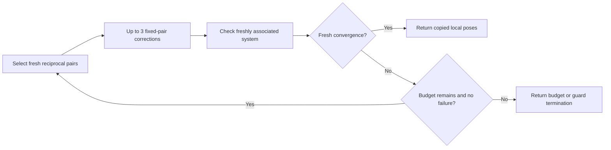

# Alternating pixel association and local refinement

This optional NumPy solver alternates fresh reciprocal pixel association with
short batches of nonlinear fixed-pair refinement. It uses at most **ten applied
corrections in total**, with at most **three per association batch**. Only a
freshly associated system can establish global local convergence.

The [single-population refiner](fixed-depth-refinement.md) converged on all ten
saved fixed populations while leaving all ten freshly associated systems
unconverged. This experiment adds an outer association loop and compares it
with the archived always-refresh continuation from the same starting poses
and incoming priors. Both have the same maximum of ten applied corrections;
this is not a runtime comparison.

## Recorded outcome

| Five saved windows per recording | Room | Desk2 |
|---|---:|---:|
| Alternating fresh convergence | 0/5 | 0/5 |
| Always-refresh control convergence | 0/5 | 0/5 |
| New / control applied corrections | 50 / 50 | 50 / 50 |
| Fixed-pair batches | 29 | 31 |
| Batches reaching fixed convergence | 25 | 23 |
| Windows ending at the update budget | 5/5 | 5/5 |
| Guard failures | 0 | 0 |
| Fresh RMS at most 0.03 m | 5/5 | 5/5 |

All ten windows use their full ten-correction allowance. Batch sizes vary
from one to three applied corrections; one desk2 window refreshes after every
single correction. The new median fresh RMS is **2.4649 mm** room and
**2.7658 mm** desk2, versus **2.4643 mm / 2.7685 mm** for the controls. Maximum
node translation proposals at the new returned poses range from
**0.161–1.105 mm** room and **0.089–2.110 mm** desk2, above the unchanged
strict stop rule. Those local quantities do not measure absolute pose error.

The predeclared progression rule fails: fresh-converged counts remain zero
in both cases. No full-trajectory comparison or tracker integration follows.
The working rendered result does not transfer to fresh convergence on these
viewed recorded windows within this budget. This does not prove every larger
budget or association policy fails. The latest full reciprocal trajectory
scores remain **88/179 room** and **75/179 desk2** accurate; this experiment
supplies no new physical-accuracy measurement. The Rust default and subjective
**about-20%** maturity estimate remain unchanged.

## Bounded solver contract

At each batch start, select the original reciprocal pixel pairs from the
current local poses. Require at least 200 measured samples per admitted raw
pair. Preserve that batch's exact measured points/normals and pixel hashes for
up to three corrections. Rebuild the symmetric residual, rotating-normal
Jacobian, Huber weights and nonlinear incoming-prior transport at every pose.
Each equation counts a raw factor once; repeated optimization does not add
duplicate measurements or commit a posterior prior.

Use the existing scaled positive-definite Cholesky solve and condition limit
**1e6**, without damping or rank fill. Full proposals retain the **0.10 m /
0.15 rad** node bounds. Each applied step uses the first passing Armijo
multiplier among **1 through 1/128** on its fixed-population Huber-plus-prior
objective. The full unscaled proposal determines convergence, so a shorter
multiplier cannot manufacture convergence.

End a batch when its full proposal falls strictly below **10 micrometres /
10 microradians** on every non-origin node, its correction cap is reached,
or a guard fails. Then rebuild a fresh reciprocal system and remaining
proposal at its returned poses. Fixed convergence alone never stops the
global solver. Fresh convergence, a reproduced guard/no-progress failure,
or ten total applied corrections ends the experiment. A zero-update batch
without fresh convergence is a failure rather than an infinite loop.



The last batch receives only the remaining correction allowance. At least
one correction must occur before another unconverged batch, so there are at
most ten association batches. Every batch records its starting poses, frozen
population, full before/after systems and search receipts, fixed final system,
and fresh final system. The first optical origin stays fixed. The local tool
copies poses and changes no node roots, tracker cache, clock, keys or prior.
It performs no Schur elimination and is not a full tracker admission.

## Independent verification

The inner batch differs from the preceding frozen solver only in its bounded
one-to-three correction allowance; a source comparison checks that fact. Its
verifier retains the separately reconstructed SVD normals, relative-camera
pixel selection and objective, normalized-normal matrix derivative, incidence
blocks, quaternion prior coordinates, spectral solve and Rodrigues increments.
The new outer verifier independently checks remaining budgets, exact pose
chaining, fresh population at each new anchor, termination reasons and the
prohibition on later batches after success or failure.

A rendered same-start comparison exercises the difference: the single-frozen
method has no fresh convergence, while the alternating method reaches fresh
convergence after **three corrections and two batches**. Its final position
and rotation errors are approximately **0.0261 mm / 0.0000372 rad**, within
4 mm / 4 mrad bounds. Truth generates and scores images; a measured-data
tracker supplies the starting poses. A declared perturbation exercises local
recovery without using truth to initialize the operational fit.

Identity stops without a correction. Missing measurements and a planar scene
stop through the original support/observability guards. Separate scheduling
fixtures verify the worst-case `[3, 3, 3, 1]` allowance and no-progress failure;
these fixtures are not image-derived matrix evidence. Ten corrupted alternating
reports are rejected, including budget changes, unexplained early stops,
stale anchors, wrong populations, false fresh convergence, bad steps and work
after convergence. Thirteen new rendered systems and four same-start
single-frozen systems are independently checked. The inherited fixed controls
also pass ten systems, twelve objective-gradient axes and nine corruptions.

## Recorded protocol and reproduction

The [design](../assets/alternating-depth-refinement-v1/design.json) and source
archive freeze **49** source/context members before recorded fitting. Use the
same saved source indices **120, 160, 200, 240, 279** in each already viewed
recording, and exactly the same incoming priors and initial accepted poses as
the preceding control. This is local fitting at ten saved windows, not a new
continuous trajectory. Numeric real reference labels never enter this trial.
The recorded comparison uses the finest level, scale 1; it does not change the
tracker's coarse-to-fine schedule.

The predeclared progression rule requires both cases to improve their
fresh-converged count, have no guards, pass all fresh RMS gates at 0.03 m, and
have fresh median RMS no worse than the control. The rule governs whether to
advance to a full-trajectory comparison; it is not a physical-accuracy test.
RMS under changing populations cannot establish better absolute poses.

All **220** newly reported systems are independently checked: **100** applied
iteration systems and **60** fixed plus **60** fresh batch-final systems.
Another **20** archived control systems at the initial and control-final poses
are reconstructed separately. These are matrix checks on reused measurements,
not counts of new independent observations. The
[statistics](../assets/alternating-depth-refinement-v1/statistics.json) retain
each window's exact batch sizes and remaining proposals.

The mandatory core check passes **371** Rust tests and **49** scenarios with
full sensor-log replays. All **245** deterministic core outputs, **379**
previous evidence files and 16 pinned preceding native sources retain their
hashes. CI includes the new controls and syntax checks.

Use the pinned optional NumPy/Pillow environment and original hash-pinned TUM
inputs. Output directories must be fresh:

```bash
OPENBLAS_NUM_THREADS=1 python scripts/check-alternating-depth-refinement.py \
  --output artifacts/alternating-refinement-controls-replay
OPENBLAS_NUM_THREADS=1 python scripts/evaluate-alternating-depth-refinement.py \
  --output artifacts/alternating-refinement-recorded-replay
```

Commands return zero for integrity success, including an unmet progression
condition. The packet's [report](../assets/alternating-depth-refinement-v1/summary.json),
[validation](../assets/alternating-depth-refinement-v1/validation.json) and
[manifest](../assets/alternating-depth-refinement-v1/files.json) retain full
pose/system certificates, control results and source/input hashes. Original
images and physical reference files are not redistributed;
[TUM attribution and terms](tum-source-provenance.md).
