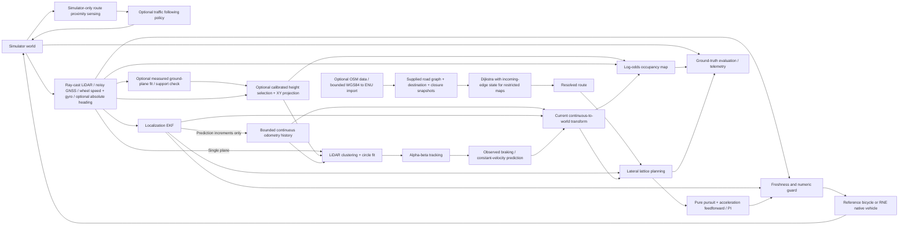

# Architecture

## Goal and first operating domain

RustDriving aims to become an independent Rust autonomous driving stack. Version 0.1 first establishes a small executable baseline: a vehicle follows a known curved route, avoids sensed objects, yields on a blocked narrow road, and brakes when required sensing becomes stale. The reference simulator is intentionally 2D, CPU-only, deterministic, and small enough to exercise in ordinary CI. These properties make a useful algorithm development harness; they do not establish physical or operational validity.

The optional [camera graph optimization](camera-operators.md) replaces only
two validated nearest/asymmetric/floor 2× Resize nodes with standard tract
axis/broadcast/reshape operations. An independent original plan verifies every
raw output bit; a distinct parallel producer uses the same measured-clock
controller. This offline path improves local processing time but still misses
the 200 ms budget and does not enter the driving dataflow.

## Current dataflow

Ground truth never flows into obstacle prediction or planning. The simulator initializes heading at a known spawn calibration, exposes the configured route, and synthesizes noisy measurements from the world. Optional absolute body-heading observations use a separately declared noisy sensor; its physical settings and fault schedule remain outside the driver. Separate evaluation observes truth to detect collisions, road violations, and localization error.

The optional RNE `--scene` input installs upright yaw-rotated cuboids in native Rapier queries. By default, the existing 0.6 m horizontal LiDAR plane remains the sole operational scan. Two additional horizontal planes and 200 Hz native positions are recorded only in `scene.json`, outside the sensor-only replay contract. A post-run conservative vertical-capsule evaluator adds physical scene failures to acceptance; it cannot command the vehicle. An independent Python slab-ray and rectangle-edge oracle checks the evidence. Native ego motion remains planar, without contact forces or suspension. [Scene contract](native-scenes.md).

With the additional explicit `--multi-height` option, all three measured horizontal planes enter `SensorFrame.multi_height_lidar`; the ordinary scan is absent. The sensor-only header supplies bounded plane-height calibration and the vehicle's vertical collision interval. After validating the entire synchronized bundle, the pipeline selects relevant calibrated heights, removes duplicate XY cells and uses continuous acquisition-time odometry poses plus the current world transform for planar perception and mapping. Malformed or failed bundles latch braking until a strictly newer complete acquisition after the fault epoch. Delay, cadence and failure injection transport the entire bundle atomically. Scene labels and geometry remain outside the driver. This is sparse measured-height projection, without volumetric object reconstruction or coverage between planes. [Contract and limits](multi-height-lidar.md).

## Crates and ownership

The additional `--lidar-3d --ground-segmentation` mode installs physical road surfaces in the native query world and fits a bounded local plane from validated measured XYZ returns. Global angular support and local residual-cell support determine removal; insufficient support holds braking. Scene ground labels stay outside operational sensing. The 180 × 16 acquisition grid is specific to this mode; the earlier 720 × 16 mode is unchanged. The accepted fixtures assume broad near-flat support surfaces. [Ground contract and limits](ground-lidar.md).

With `--vehicle-body`, an authored rectangular research body adds actual force-free Rapier overlap witnesses and a separate swept upright-box evaluator. The driver uses its circumscribed planar radius and a calibrated vertical clearance interval. Native Ackermann dynamics remain the sole motion integrator; this does not add tire contact response, suspension or six-degree-of-freedom motion. Recorded road and obstacle geometry remain simulator-only evaluation inputs.

The optional OSM importer resolves bounded WGS84 coordinates to local ENU, retains shared junctions and directed way geometry, and emits the ordinary road graph. Imported road widths are explicit simulation calibration, not measured lane boundaries. Dataset attribution and ODbL terms are separate from the Rust implementation's license. [Import contract and provenance](osm-import.md).

Unconditional `no` and `only` junction rules now constrain directed transitions.
Restricted search retains the incoming edge at each node, so a shorter forbidden
arrival does not hide a longer legal arrival. Closures remain independent;
restricted-map sensor replay reconstructs search from the header. The OSM
importer supports bounded motorcar node-via relations and rejects relevant
unsupported semantics. Navigation and fixed-route mapped stop controls remain
separate configurations. [Turn contract and evidence](turn-restrictions.md).

Optional `local_route_geometry` uses bounded steering-radius corner fillets and a shorter pursuit preview for sparse external roads. Its internal planning arc differs from the original map arc; candidate containment and physical evaluation still use the supplied unchanged corridor. Impossible/overlapping fillets fail validation. Fixed signal/sign constraints truncate the original surveyed route before local fitting, preserving their endpoint; state admission and physical evaluation retain the original coordinates. Straight priority-zone routes also preserve their original surveyed arcs. Optional `rear_axle_offset_m` calibrates low-speed chassis odometry prediction and temporary planning/control course while retaining body yaw for sensors. The native dynamic local mode selects its declared rear-axle distance. Local side paths now use the existing standard road preview with wheelbase/lever-arm floors in both plants; local centerline turning retains the short preview. Point/rear-axle reference side paths also retain the original maneuver completion arc when reanchoring tracking error, with wheelbase and configured lateral-acceleration recovery bounds. Native chassis/course tracking retains its preceding joined prefix except for completed narrowed width-fitted side paths, whose passing intent and residual recovery are now preserved through temporary braking. [Tracking failure and repair](initial-pose-covariance.md). [Reference contract and evidence](chassis-reference.md).

| Crate | Responsibility | Depends on |
|---|---|---|
| `rustdriving-core` | SI contracts, planar transforms, route interpolation and projection, algorithm traits | serde |
| `rustdriving-routing` | Validated directed maps, shortest-distance routing, edge closures and bounded OSM import | core, serde |
| `rustdriving-localization` | State/covariance estimation, innovation gating, bounded local SE(2) fixed-map registration | core |
| `rustdriving-perception` | Point clustering, circular-object fitting, track identity/velocity, bounded XYZ terrain/components | core |
| `rustdriving-mapping` | Bounded occupancy grid and ray updates | core |
| `rustdriving-prediction` | Time-indexed observed braking and constant-velocity baseline | core |
| `rustdriving-planning` | Candidate selection, maneuver persistence, braking / goal modes | core |
| `rustdriving-control` | Longitudinal and lateral actuation, freshness guard | core |
| `rustdriving-pipeline` | Sensor-only orchestration, freshness/health, versioned recording and replay | core + algorithm crates, serde / serde_json |
| `rustdriving-sim` | Reference sensors/plant, backend interface, independent evaluation and CLI | core + pipeline, serde / serde_json |
| `rustdriving-dataset-eval` | Bounded PCD/LZF/VTK readers, measured-cloud evaluation and explicit semi-synthetic pose scoring | core + perception + localization, serde_json; Python SHA verification |
| `rustdriving-rne` (optional standalone workspace) | RNE world/vehicle/sensor adapter | core + pipeline + sim, renderer-independent RNE crates |
| `rustdriving-kitti-depth` (optional standalone workspace) | Sparse axial-depth cells from projected LiDAR reports, with all source-row assignments | serde, serde_json with float_roundtrip, sha2; no algorithm/runtime dependencies |
| `rustdriving-projective-depth` (optional standalone workspace) | Dense optical-depth odometry and bounded projective keyframe fusion; offline research | serde; CLI adds serde_json with float_roundtrip; no OpenCV/runtime dependencies |

Unsafe Rust is forbidden at workspace level. There is no global message bus, custom scheduling runtime, ROS dependency, model download, or external service. Algorithm crates can be embedded into another application; the simulator is the current application, not a universal runtime.

## Coordinate and timing contract

- Length in meters, speed in m/s, acceleration in m/s², time in seconds, angles in radians.
- World frame is planar ENU (`x` east, `y` north), right-handed yaw positive counterclockwise.
- LiDAR points are body-frame (`x` forward, `y` left). Internal detection, tracking and motion-history coordinates use a continuous wheel/gyro frame, excluding absolute localization corrections. Published tracks/predictions, route points and trajectories use world coordinates; `tracking_frame` records the continuous-to-world transform. [Tracking frame contract](tracker-localization-frame.md).
- Timestamps refer to one monotonically advancing simulation clock. Duplicate/out-of-order observations cannot refresh health. Clock regressions fail before mutation; clock gaps over 0.25 s brake. LiDAR detections and map rays use a bounded acquisition-time pose estimate, described below; general delayed-sensor fusion is absent.
- Vehicle/control and EKF prediction: 20 Hz. Default LiDAR/perception/tracking/map: 10 Hz. GNSS: 5 Hz. Prediction and planning: 20 Hz. Simulator-only timing injection can thin delivered LiDAR observations and delay them without changing their acquisition stamps or body-frame points.
- Lidar scan timestamps are checked independently of an empty scan: no returns are a valid observation, not a sensor failure.
- `sensors.jsonl` has a separate version-1 sensor-only header/tick/count-footer contract, including calibrated route and expected outputs. Replay feeds observations to a fresh pipeline; expected outputs are comparison evidence only. [Contract and failure behavior](sensor-replay.md).
- `run.json` has `schema_version = 1`, includes traceable inputs, output commands, estimates and evaluation truth, and is intended for developer inspection. It is not yet a stable external transport schema.

## Shared application boundary

Optional `fit_recent_track_motion` fits a bounded recent suffix of raw associated
detections in continuous wheel/gyro coordinates. The fit needs actual temporal,
shape and residual support plus the existing 0.7 m/s moving cutoff. Stopping
support expires 0.6 s after the last moving acquisition; gaps over 0.35 s discard
it. Unsupported/static updates retain ordinary alpha-beta correction. The policy
requires acquired-disc enclosure and excludes separate cold-track confirmation.
Dense batch reconstruction checks the fit and its acquisition clocks independently.
Future motion and world-pose error remain uncalibrated.
[Contract, first regression and final comparison](recent-track-motion.md).

Optional `fit_sparse_circles` admits three/four-return circular hypotheses in the
planar detector when original point spread, curvature, radius, residuals and
near-surface geometry support the fit. It retains every cluster return and the
acquisition-time continuous-frame pose. Dense fits and rejected sparse proxies
retain their preceding behavior; multi-height/3D configurations are excluded.
The independent centered 2×2 oracle checks raw acquired geometry without actor
truth. Shape padding remains heuristic, with physical coverage and default
adoption unqualified. [Contract and retained failures](sparse-circle-fits.md).

Optional `forecast_consistency_guard` checks new measured proxy discs against
bounded older predictions in continuous wheel/gyro coordinates. It requires
declared error envelopes and acquired-disc preservation, and brakes through
`InconsistentForecast` health when the measured boundary escapes. Recovery needs
three fresh complete acquired checks spanning 0.2 s after the fault cutoff;
cached scans and disappearing responsible identities cannot clear it. Missing
motion invalidates the reference epoch. Upstream sensor/localization health
governs admission; downstream navigation/rule faults retain their own braking.
Diagnostics are omitted by default. All 32 supported physical conditions pass
monitor/brake checks but retain failed availability/adoption qualification.
[Contract, independent audit and complete failures](forecast-consistency.md).

Optional `clear_sweep_recovery` supplies a separate acquired negative-sensing
basis for a forecast-fault hold. `LidarScan.sweep` binds all commanded ray outcomes
to original measured points; unavailable rays reject acquisition before map and
tracker admission. Full empty rays with synchronous stopped measured motion must
independently confirm three acquisitions spanning 0.2 s. Positive and negative
support cannot mix. Calibrated angular/range resolution remains conditional on
the declared planar circular-body model. Release records responsible identities
without clearing tracks, planner duties or other faults. Native acquisition records
actual query outcomes before return processing, with a distinct angular pattern.
[Acquisition, clock and recovery contract](clear-sweep-recovery.md).

Optional `record_planning_diagnostics` captures at most nine per-candidate
decision summaries without entering selection or control. Records identify the
first conservative nominal forecast conflict, accepted profile, chosen index,
refinement acquisition support and obstruction-stop duties. Final pipeline
faults/rules retain command ownership. Supplied-route progress and relative plan
times remain explicit, including local-route/prefix distinctions. Default
omission preserves prior output bytes. [Contract and retained experiments](planning-diagnostics.md).

Optional `enclose_track_measurements` retains the minimum radius at the corrected
track center enclosing both the normal smoothed disc and the newest measured
disc. It changes measured extent without changing position/velocity correction
or declared future-motion budgets. It can emit raw `track_measurements` without
the initial-motion confirmation option. Missing/rejected scans cannot renew
extent; rigid world reprojection preserves containment. This is measured proxy
geometry, with physical shape and forecast accuracy still conditional on sensing
and calibration. [Contract and complete comparison](measurement-enclosure.md).
Both tracker policies are independently checked against the frozen sensor-only
header. `--initialization legacy` qualifies enclosure without initial-motion
confirmation using the original unconfirmed controls; the default checker mode
retains confirmation. An enabled option cannot mask a missing required policy.
[Standalone evaluation](standalone-enclosure.md).

Optional `confirm_track_initialization` holds cold-track velocity at zero until
at least three stable-radius acquired detections span 0.2 seconds. A bounded
centered least-squares fit uses every measurement in its at-most-0.6-second
window, then hands current position/velocity to ordinary alpha-beta tracking.
Rejected scans preserve fit state atomically; other tracks and cached scans
cannot renew support. Enabled `track_measurements` retain raw associated centers
in the continuous frame and their original acquisition stamps. These heuristic
shape/fit thresholds do not calibrate uncertainty or establish that an
unconfirmed object is stationary. [Contract and retained failures](track-initialization.md).

Optional `lateral_candidate_margin_m` fits the three center/left/right planning
choices to the supplied road half-width minus the circular vehicle radius and
an extra target reserve. Wide roads retain ±3.5 m; small unusable side corridors
retain only center. All geometry, motion, collision and containment checks stay
mandatory. Omitted/null preserves the original candidate set. This is bounded
constant-width fitting; continuous lateral optimization remains open.
For narrowed local chassis/course candidates, a blocked center braking prefix
retains the passing anchor. After its original completion arc, residual error
recovers over the wheelbase / declared lateral-acceleration span, which may
extend for a larger residual. Clear returns and side changes replace the intent;
route resets clear it. All candidate feasibility checks remain mandatory.
[Contract and fixed paired evaluation](road-width-planning.md).

Optional `refine_lateral_candidates` requires that width calibration and adds
`±0.875L, ±0.75L, ±0.5L` inside the fitted `±L`, for at most nine choices.
Only complete clear additions can win; their forecast reserve is at least
1 m and never replaces a larger existing motion reserve. Original stopping
choices retain their policies. Added choices require three distinct healthy
accepted scene acquisitions spanning 0.2 s; cached scans do not renew support,
and faults or route resets clear it. Local chassis tracking preserves the
intermediate passing anchor through temporary braking. This bounded lattice
stays off by default. [Contract and retained failures](refined-lateral.md).

`DrivingPipeline::step(&SensorFrame)` owns EKF, perception/tracking, occupancy, predictor, planner and controller state. Input contains only a monotonic clock, optional timestamped odometry/GNSS/body-frame LiDAR/absolute ENU body heading, and explicit LiDAR acquisition failure. Output contains estimate, tracks, predictions, trajectory, command, health diagnostics and separate GNSS/heading observed/accepted timestamps, decisions, NIS and counts. It has no simulator object/pose inputs. Configuration supplies route, initial pose calibration, vehicle dimensions and optional calibrated forward/braking/lateral acceleration limits; this is a known-route demonstration.

Optional `absolute_heading_fusion` requires acquired body yaw and
angular variance, with a wrapped one-dimensional NIS gate of 9 and full Joseph
covariance correction. A required heading older than 0.35 s, invalid input or
rejected innovation brakes; only a new accepted acquisition releases a fault.
Heading never refreshes GNSS freshness or covers missing rigid motion.
Combining it with GNSS history now retains admitted heading events, ordered
after equal-time GNSS and before map observations. Rewinds preserve original
diagnostic ownership and atomically refuse a conflicting accepted observation.
Heading is synchronous by default. Additional `heading_latency_compensation`
requires GNSS history and permits at most 0.2 s of delivery delay. It conditions
the acquired prior and atomically replays later admitted corrections, retaining
the original acquisition clocks and fault latches. Missing rigid motion cannot
be bridged. Measured relocalization remains excluded.
[Heading contract](absolute-heading.md); [history composition](heading-history.md).
[Delayed-heading contract and fixed qualification](heading-latency.md).

Missing/stale odometry, LiDAR or GNSS, invalid samples, excessive covariance and acquisition failure select finite emergency braking. Healthy empty LiDAR is accepted; a failed acquisition brakes immediately. An invalid clock returns `Err`; callers must stop rather than reuse a command. The reference and RNE backends implement observation/advance boundaries and share the same independent evaluator. Runtime truth stays inside sensor synthesis and evaluation/rendering.

An uncovered post-initial wheel/gyro interval additionally latches
`MotionDiscontinuity`. It invalidates scene history and prohibits subsequent
GNSS/LiDAR/map admission. Pose, speed, covariance and GNSS diagnostics retain
their last covered values and cannot be treated as current estimates. Later
healthy sensors cannot reconstruct the missing rigid motion or clear the stop;
external pose calibration and a new pipeline instance are required. The existing
0.15s accepted-motion cache grace and short malformed-input recovery remain
while predictions cover every interval. Simulation-only motion delay/dropout
transport preserves raw acquisition stamps/values and stays out of the header.
[Epoch diagnostic, fixed stop protocol and limitations](motion-continuity.md).

An explicit `relocalization` policy can construct that new instance from a
bounded measured scan-to-map pose/covariance after fresh stopped wheel/gyro
observations and three consistent scan confirmations. A shared comparison
budget and distinct-fit ambiguity check reject incomplete/ambiguous proposals.
The confirming frame brakes, old GNSS/LiDAR acquisitions cannot renew freshness,
and `localization_epoch` scopes new scene identities. This supports fixed routes
and synchronous XY scans; lane changes and XYZ/multi-height
configurations are rejected before driving. Live navigation, fixed stop signs,
traffic signals and straight yield entries need separate explicit preservation options below. New GNSS is
required by default after reset. An explicit `map_only_grace_s` can qualify new
synchronous accepted map corrections for at most five seconds from that measured
reset. Their actual acquisition stamps reach health and final control freshness
guards; GNSS clocks/counters remain separate. Scans cannot renew the deadline;
motion/GNSS faults interrupt permission and expiry brakes until ordinary GNSS
recovery. [Reset contract](regional-relocalization.md);
[bounded support and failure evidence](relocalization-map-only.md).

An additional `confirm_gnss_handoff` option arms the configured GNSS recovery
policy at that measured reset. Full returning-fix proposals remain withheld
until the configured fresh confirmations pass. Actual observation/NIS counters
record held fixes; accepted clocks, posterior and history remain transactional.
The `max_hold_s` budget starts at reset even without a GNSS delivery.
`GnssHandoffExpired` brakes after that absolute deadline and stays latched through
late fixes. [Configuration, comparisons and retained checker failures](confirmed-gnss-handoff.md).

Explicit `preserve_navigation` additionally retains the live graph, original
endpoint request, accepted closures/revision, actual active plan, switch count
and its mapped speeds. The measured pose must fit the active route with body
clearance and heading bounds; failed admission latches navigation braking.
Pending/blocked routes are recomputed from the measured pose. Stop votes reset
and three new healthy stopped acquisitions are needed to switch routes. Existing
navigation faults persist. [Ownership, independent checks and outcomes](navigation-relocalization.md).

Optional `navigation.hold_for_handover` latches brake retention at the first new
healthy stopped handover vote. Interruptions clear votes while retaining the
hold; a successful switch or accepted cancellation to the active route releases
it. A measured localization reset discards the pose-dependent hold and votes.
The existing final command path requests at most -0.5 m/s² while holding, with
ordinary -6 m/s² health-fault braking. False/omitted keeps preceding behavior.
[Contract and qualification](navigation-handover.md).

Explicit `relocalization.preserve_stop_signs` retains served fixed-route stops
behind the measured front, rearms served stops now ahead, and resets every
unfinished dwell and its acquisition watermark. A new full healthy two-second
stop is required. Corridor/heading admission or an unserved margin below 0.5 m
latches `InvalidStopSignRecovery`; fresh GNSS cannot clear it. Fixed stops also
support local route fitting: truncate in original surveyed arc coordinates
before fitting, retain that endpoint, and evaluate stop geometry on the original
route. Signals and straight yield entries need their separate preservation options; live
navigation with controls remains excluded.
[Ownership, physical evaluation and retained first failures](stop-sign-relocalization.md).

Explicit `relocalization.preserve_traffic_signals` preserves committed lines
behind the measured front and rearms those now ahead. Reset clears all accepted
colors and their acquisition clock; only a complete snapshot strictly newer than
the reset can establish fresh permission. Current green cannot prove past lawful
passage. Invalid geometry or an unserved margin below 0.5 m latches
`InvalidTrafficSignalRecovery`, retaining emergency braking through fresh
green/GNSS. The independent 0.5-second signal age and malformed-snapshot fault
remain active. Signal prefixes also retain original surveyed arcs through local
route fitting and compose with explicitly preserved stop signs.
[Contract, raw-input audits and physical results](signal-relocalization.md).

Optional `initial_pose_covariance` supplies a finite, symmetric positive definite
ENU x/y/yaw matrix (m², m·rad, rad²). It is external initialization calibration.
When present, output records every full posterior and replay checks it; absent
or null retains the original prior and serialization. Physical initial heading
perturbations are simulation inputs and never enter operational configuration.
[Validation, composition and research limits](initial-pose-covariance.md).

Optional `gnss_antenna_offset_m` supplies the GNSS antenna displacement from
that estimated body reference in forward/left meters. The EKF predicts the
rotated antenna position and includes yaw sensitivity in the observation
Jacobian and full covariance update. Acquisition-time GNSS/map history retains
this calibration, and recovery bounds still apply to the complete current body
pose. Simulation-only `gnss_antenna_mount_m` controls physical synthesis
independently and stays outside the operational header.
[Observation model, checks and limits](gnss-antenna.md).

## Algorithms

Optional fixed-map localization registers synchronous measured body-XY scans to an offline supplied world map, fuses accepted XY/body-yaw poses and preserves genuine GNSS timestamps. Fresh accepted map scans bridge only bounded post-fix outages; stale/rejected scans and the ten-second maximum restore normal braking. [Timing, covariance assumptions and failures](map-localization.md).

Optional XYZ terrain/components keep calibrated raw-beam validation and measured AABBs before planar detection envelopes. Sparse support faults retain braking; local geometric support is not road semantics. A separate measured-data evaluator keeps labels and imposed pose transforms outside algorithm input. Its held-out terrain failure and rejected natural alignment prevent claiming general 3D perception or real-motion localization. [Inputs and scores](datasets.md).

Separate offline research adapters now compute recorded-depth 6DoF pair odometry
and local pose against a fixed first measured cloud, and run Rust CPU ONNX
detection on real urban photographs. Pose labels are parsed only after all
depth fits; image reference labels enter only independent scoring. Neither
adapter feeds the driving EKF, planner or control. Rejected and unscorable
fits remain in their denominators; uncertainty allowances are provisional.
[Recorded-motion contract](recorded-motion.md); [urban-camera diagnostic](road-camera-evaluation.md).

**Localization.** State `(x, y, yaw)` and a full 3×3 covariance. Wheel speed and gyro propagate pose and the covariance Jacobian; GNSS position first passes a joint two-dimensional NIS gate using the full x/y innovation covariance and threshold 36, then receives independent scalar corrections with Joseph covariance updates. Invalid, duplicate/older or excessive innovations are rejected. Received but rejected fixes do not refresh accepted-GNSS health. Two consecutive strictly new fixes rejected by the innovation gate also activate `GnssInnovationHold` and braking, before the existing 0.75 s accepted-fix-age bound when applicable. A single outlier does not activate this additional hold. Only a newly accepted correction resets the private streak; missing, duplicate, old or invalid fixes neither add to it nor clear it. Good fixes can recover after a bounded outage without resetting estimator state. [GNSS baseline](gnss-robustness.md) and [current replay health contract](sensor-replay.md#gnss-acceptance-diagnostics). This conservative sustained-rejection policy is not a bias-estimating 3D inertial navigation filter or a general estimator-validity guarantee. Initial yaw is configured rather than estimated from GNSS at rest.

**Perception.** A 720-ray first-return LiDAR has a 45 m range and ±0.015 m bounded range noise. Connected components use a range-adaptive point distance. Components smaller than three returns are discarded. At least five points allow an algebraic circle fit with residual and radius bounds; other clusters use an inflated surface envelope. Circular objects are the demonstrated shape class; semantic classification is absent. Alpha-beta tracking expires observations after 0.6 s, bounds inferred velocity, and updates on accepted scans, normally at 10 Hz. Within the strict 3 m distance gate, component-wise global association maximizes the number of matched existing tracks, then minimizes total predicted-to-measured distance. Deterministic tie ordering preserves established-track results under detection permutations. Association limits reject the complete scan and activate existing health braking; clustering remains quadratic in hit points. This distance objective does not qualify physical object identity. [Assignment, independent oracle and limits](tracker-global-assignment.md).

**Acquisition-time LiDAR transform.** The pipeline retains at most 64 continuous wheel/gyro poses over a 0.35 s lookup window, keeping one predecessor for interpolation at the age boundary. History begins at the first pipeline step and advances only by accepted EKF prediction increments. Exact acquisition timestamps use the stored pose directly; intermediate timestamps interpolate position and the shortest wrapped yaw arc between estimates no more than 0.25 s apart. The pipeline never extrapolates before history or across an uncovered clock gap. A new scan older than 0.35 s or without a covered pose is invalid and cannot update continuous-frame tracks, map rays or accepted-LiDAR age. Detection association and braking-history samples retain continuous coordinates. The current localized world transform projects published tracks, predictions and occupancy ray origins; velocity vectors rotate without acquiring pose-correction velocity. Acquisition timestamps remain the tracker observation times, including during cached world-coordinate reprojection.

This avoids transforming delayed body-frame returns with the delivery-time body pose and avoids interpreting GNSS/map correction jumps as object motion. This LiDAR history does not correct odometry drift within its retained frame, rebuild historical occupancy cells, fuse delayed odometry, deskew individual rays or propagate pose covariance. Acquisition-time GNSS and synchronous map corrections are handled by the separate optional filter history below. Motion prediction separately advances acquired tracks to the current control time without changing their observation stamps. These bounded steps do not establish complete latency compensation or general delayed-scene safety. [Sensor contract and reproduction](sensor-replay.md); [tracking frame and evidence](tracker-localization-frame.md).

**Mapping.** A 0.5 m world-aligned log-odds grid records ray free-space and hit endpoints. It exports occupied cells for debugging. No-return beams are not exported by the sensor and therefore do not clear the entire sensing horizon. Dynamic-object ghost cells and repeated discretized ray cells remain limitations. The grid does not supply the current planner's collision geometry and does not perform SLAM or route discovery.

**Optional inclined XYZ acquisition.** The native `--lidar-3d` adapter uses RNE's existing 16-ring sensor with 720 azimuth columns and ±15° elevation. Each actual return enters `SensorFrame.lidar3d` as an ordinal and a point in body-forward/body-left/road-datum-up coordinates. Bounded `PipelineConfig.lidar3d` calibration defines the ring geometry, ranges, mount height and collision-height interval. Unique ordinals, finite points, measured range and beam direction are checked before height filtering; deterministic ordinal order keeps one point per 5 cm XY cell. The resulting planar cloud uses the ordinary acquisition-pose lookup, clustering, mapping, tracking and planning path. No cuboid dimensions or simulator truth enter that projection. Atomic delivery and the advanced-scan fault latch require a complete valid acquisition newer than the fault control time before recovery. Ordinary, horizontal multi-height and XYZ inputs are exclusive. The sensor assumes a flat road and yaw-only mount; acquisition is instantaneous. Authored scenes have no physical road/ground collider, and ground segmentation is absent: ground returns inside the height window would project as obstacles. Actual XYZ sensing does not establish volumetric objects, general vertical coverage, terrain driving or suspension/contact dynamics. [Contract and independent acceptance](lidar-3d.md).

**Prediction.** Eight seconds of motion forecasting at 0.2 s spacing, starting at the current pipeline output time. Acquired tracks keep their original positions and stamps; forecasts evaluate observed motion at acquisition age plus each future offset. `ObservedBraking` keeps at most 0.8 s / 32 samples per present track. Three 0.2 s observation intervals must each show at least 0.3 m/s² deceleration with direction agreement at least 0.98. It uses half the weakest observed deceleration, capped at 2 m/s², for at most one second from acquisition; then it coasts at the reduced speed, without reversal. Elapsed acquisition age consumes the same braking budget, rather than restarting it each control tick. Insufficient evidence, a fresh non-decreasing speed sample, direction changes or observation age over 0.15 s select constant velocity advanced to the current clock. Duplicate timestamps do not extend evidence; absent tracks lose history. Invalid or future-stamped motion yields an empty forecast and downstream braking. This is a single measured-motion hypothesis, not an interaction model or guarantee of future braking. [Time-origin contract](sensor-replay.md#forecast-time-origin) and [braking baseline](observed-braking.md). The default retains the 0.7 m/s static deadband. Experimental `confirm_slow_motion: true` requires four consistently directed position/velocity observations over approximately 0.6 s to confirm motion down to 0.1 m/s; unsupported tracks use the stopping/continuation occupancy envelope described below. Confirmed slow motion can retain the same sustained-braking hypothesis and its one-second acquisition-origin budget. Every intervening acquisition in the selected anchor window must also support the hypothesis: measured speed increases or inconsistent directions withdraw braking; stops, velocity-direction changes or contrary adjacent displacements withdraw slow-motion confirmation. The independent auditor reconstructs these complete windows. [Observation-window contract](prediction-observation-window.md). Default adoption remains withheld pending broader forecast qualification; terminal settling separately repairs the tested follower-deadline regressions. [Evidence requirements and limitations](slow-motion-prediction.md). Planning adds an empirical circular-clearance margin of `0.30 + 0.06 * min(t, 5) + max(0.40 * min(v_perp / 1 m/s, 1), 0.70 * q)` meters. Here `t` is future time from the current planning clock, `v_perp` is the absolute forecast velocity across the candidate segment direction, and `q = v_perp / |v|` for moving forecasts (zero for static forecasts). Static/parallel motion retains the previous reserve. Stationary segments use the estimated ego heading to distinguish crossing traffic from a parallel follower; an unavailable/zero heading falls back to total forecast speed conservatively. The initial point prefers the first nonzero candidate tangent, otherwise the supplied estimated heading. The directional reserve does not vanish for slow crossings and retains the previous transverse-speed envelope. Motion is derived from forecast positions, without actor labels or truth. The same rule applies to normal, retimed-stop and stationary-hold sweeps. This is a tracking/control-error heuristic, not a calibrated probability, covariance or certified error bound; it is separate from the priority-zone rectangle inflation.

Experimental unconfirmed motion from 0.1 to less than 0.7 m/s uses a circular
occupancy envelope covering both the acquired stopped position and continuation
at the measured velocity. `Prediction.additional_radius_m` is optional in JSON:
an empty sequence means zero, otherwise it has one nonnegative finite value per
position, with linear interpolation and endpoint hold. Planning, priority-zone
gates, lane-change entry and return/launch previews consume the occupied radius.
Sweeps split at every forecast knot and use the maximum endpoint radius on each
subinterval. Lane-change rear headway also includes positive occupied-radius
growth in the forward approach-speed bound; shrinking uncertainty never
discounts center motion. [Admission correction and limits](lane-occupancy-headway.md). This envelope adds no evidence of confirmed motion or braking and
is not a calibrated uncertainty bound. The default predictor retains its
established deadband. [Method, comparison and limits](slow-occupancy.md).

Optional `forecast_envelope` retains that nominal occupied disc and a
constant-velocity alternative with extra radius `position_error_m + u *
velocity_error_m_s + u² * acceleration_error_m_s2 / 2`, where `u` includes
acquisition age and future time. Each knot uses the smallest enclosing disc of
both alternatives; interpolation retains conditional coverage within the
eight-second horizon. The operation precedes the current tracking-to-world
transform and uses the existing additional-radius consumers. Caller-supplied
budgets do not estimate covariance, association or ego-pose uncertainty. The
existing endpoint hold does not extend the coverage claim beyond eight seconds.
The policy is off by default pending physical coverage and liveness acceptance.
An evaluation-only scenario flag, `full_rate_recording`, retains every 20 Hz
physical frame without entering the driver header or changing sensor/command
bytes. [Contract, paired comparison and limitations](forecast-envelope.md).

Optional `search_obstruction_stops` requires `settle_obstruction_stops`. After
ordinary collision retiming fails, it checks at most 16 earlier reachable stops
with the same collision sweep and eight-second stationary tail. A selected moving
search arms retention before emergency braking. The selected route-progress
anchor can move earlier, and future blocked candidates cannot extend it. Actual
candidate arc length is converted through the existing uniform progress samples;
heading joins and lateral shifts do not substitute longitudinal distance for arc.
Searched approaches cap profile speed at measured initial speed and the final
guard prohibits positive acceleration. A complete clear nominal candidate can
release the duty; route reset discards the old anchor coordinates while retaining
brake intent. Invalid input cannot clear it. Sampling is finite and may miss a
feasible stopping interval; error-budget calibration and mission completion remain
unresolved. [Fixed comparisons and retained failures](stop-search.md).

**Planning.** The supplied polyline route is parameterized by arc length. Lateral targets are `0`, `+3.5`, and `−3.5` m, filtered by road width and the ego circular footprint. An anchored quintic shift preserves maneuver progress across replans; a fading position/tangent correction joins it from the current estimated position and heading when actual steering lags. The planner penalizes sign changes and avoids jumping to the opposite side once the vehicle is displaced. A small center-return penalty retains an unfinished lateral shift while an observed obstacle still spans the centerline ahead within the horizon. It expires when the anchored shift completes, or when the object is behind the circular footprints or clear of the centerline, and never bypasses candidate feasibility checks. [Policy and measured regression](avoidance-continuity.md). The planner interpolates supplied route knots with quintic Hermite centerline segments sharing position and first/second derivatives, and applies continuous normal offsets. The supplied polyline corridor remains unchanged; generated samples are checked against it. Each candidate starts with 81 geometric samples over up to 40 m. Circular collision envelopes are swept continuously along their connecting segments against linearly interpolated predictions, splitting at every intervening prediction knot. Prediction endpoints remain occupied after the forecast horizon. Malformed forecasts return an emergency trajectory.

Each geometry receives an arc-length speed profile: local circumcircle curvature caps, backward propagation with 20% nominal braking headroom and unchanged hard braking authority, and forward calibrated-acceleration propagation from the measured speed. Cruise overspeed is recovered with bounded deceleration rather than an instantaneous clamp. Arrival times integrate constant acceleration with `dt = 2 * distance / (v0 + v1)`; there is no 3 m/s timing floor. Goal and obstruction stops end at zero speed and include an eight-second stationary hold. A blocked profile is shortened by the existing 4 m contact-distance buffer, retimed, and swept again. Unsafe retiming or an unreachable hard bound rejects that candidate; no remaining candidate produces an empty emergency trajectory. Once stopped at a blocked destination, the vehicle holds until a candidate clears. Goal stopping uses the actual candidate arc length to reach the generated terminal position, including lateral motion, rather than truncating it by route progress. The desired goal remains one meter before the endpoint; an estimate that passes it while moving gets a monotonic reachable stop within the remaining corridor, with the endpoint retained as a hard boundary.

Near the goal (within 41 m), a track moving forward along the route above the existing 0.7 m/s terminal-preference threshold and spanning the centerline within 40 m behind the estimate activates a small center-target cost. If a feasible side is selected, the preference persists through missed tracks and forecast jitter, giving the vehicle room to finish the shift before stopping. It never overrides containment, calibrated speed feasibility or full collision/hold sweeps. This is a heuristic stopping-place preference for the authored corridor, not parking, semantic lane selection or interactive traffic prediction. [Methods, physical residence and limits](terminal-stopping.md).

A candidate aligned within 0.1 rad and 0.2 m of its lateral target, within 0.5 m of the desired longitudinal goal and at no more than 0.2 m/s finishes braking with a zero cruise target. If its complete stop and eight-second hold are feasible, it precedes normal speed/candidate costs. This prevents position noise from restarting a completed stop. The pipeline disables this terminal tolerance for temporary regulatory, lane-change and route-handover stopping prefixes, preserving their approach profiles. A conflicting hold is rejected; other candidates remain available and an empty candidate set still commands emergency braking. No actor intent or physical acceptance state enters this decision. [Terminal settling and retained deadline regressions](terminal-settling.md).

For accelerated segments, the circular sweep additionally covers the deviation from the temporal chord with a `|delta_speed| * segment_duration / 8` radius inflation. Calibrated low lateral authority lengthens proposed quintic shifts; the chosen length persists across replans and sampled speed/curvature bounds still decide feasibility. This is a three-offset, sampled-geometry baseline, not joint tire-force optimization or a controller tracking guarantee. [Current tracking methods and evidence](tracking.md); [previous speed planning](speed-planning.md) and [swept-check evidence](swept-planning.md).

Optional `settle_obstruction_stops` remembers collision-induced emergency braking
while approaches remain blocked. Once a valid estimate is at most 0.2 m/s, it
retains a feasible immediate stop and the complete eight-second hold. Only a
complete unblocked nominal path can release it; a safe lateral escape takes
precedence over a blocked partial approach. Active holds retain at least
-0.5 m/s² requested braking; health failures retain -6 m/s². Route-state resets
preserve this intent, while new localization epochs initialize fresh state.
Default behavior and forecast occupancy are unchanged.
[Contract and independent path certificates](obstruction-stops.md).

**Control.** Pure pursuit uses a shorter speed-dependent preview, an interpolated lookahead-circle intersection, bounded steering and a steering-rate limit. Emergency recovery starts from the emitted zero steering command, including commands substituted by pipeline health checks; longitudinal feedback resets as well. Longitudinal control uses the first segment's acceleration as feedforward plus bounded PI feedback on its initial speed; a stationary hold does not command forward acceleration. The pipeline health checks and control guard substitute a −6 m/s² command for non-finite output, missing/stale/invalid sensors, acquisition errors or excessive position variance. A planner emergency also brakes. The simulation adapters enforce actual authority; infeasible states can trigger repeated emergency fallback. This guards a simulation workflow; it is not a certified safety mechanism or redundant vehicle controller.

**Simulation and evaluation.** A kinematic bicycle with bounded speed, acceleration and steering is integrated every 0.05 s. The ego and obstacles have circular collision footprints; relative swept segments test collision between integration endpoints. Current and terminal overlaps are also scored, and newly active actors receive endpoint checks. Each evaluated tick counts at most one collision; exact continuous activation-time checking remains absent. Road containment uses the ego center plus circular radius against route half-width. Tire friction and actuator lag are outside the reference model. The optional RNE dynamic plant adds a friction limit and steering lag; road elevation, suspension, rectangular collision evaluation, weather, camera imagery and general priority/traffic-law reasoning remain outside the demonstrated operating domain. See the [adapter boundaries](../integrations/rne/README.md). Optional `goal_hold_seconds` keeps the entire loop and independent physical evaluator running after first arrival; leaving the goal or exceeding its speed threshold resets residence. The final truth frame is retained at termination. The 16-second traffic regression observes the lead reaching the endpoint after ego stops. No throughput or real-time guarantee is claimed.

## Acquisition-time GNSS correction

Optional `gnss_latency_compensation` retains at most 0.5 seconds / 64 validated
wheel/gyro prediction intervals. GNSS is gated and corrected at its original
acquisition time, including fractional intervals, before motion and covariance
are replayed to the current clock. Accepted timestamps/counts retain observation
ownership; delivery cannot renew freshness. Uncovered history brakes and requires
a post-fault acquisition. Zero-delay outputs retain existing arithmetic.
Synchronous accepted map-pose/covariance events can also be retained (at most
64) and replayed through their original EKF gates. A conflicting replay refuses
the complete GNSS transaction and latches braking; accepted map clocks remain
owned by their original scans. An additional explicit map option retains GNSS
events too and admits scans up to 0.2 s old, reconstructing their acquisition
priors and replaying corrections in either arrival order. Counts and last NIS
retain original-delivery ownership. Delayed odometry and clock-offset estimation
remain unsupported. [GNSS contract](gnss-latency.md), [synchronous map-event
history](gnss-map-history.md) and [delayed map mode](delayed-map.md).

Optional constant `gnss_covariance_shape` supplies a symmetric positive definite
world ENU 2×2 matrix with trace two. Each raw fix retains its scalar mean
horizontal variance; the effective measurement covariance is variance times
that matrix. The shape survives history snapshots, and requesting it publishes
the full posterior covariance. Simulator noise shape is separate and never
inferred into operational calibration. The 32 ordinary/map cases pass, while
all 16 calibrated persistent-bias cases fail their physical stop/accuracy gates.
This is experimental covariance modeling, without qualified bias rejection or
measured receiver calibration. [Contract and retained failures](gnss-covariance.md).

A separate optional `gnss_recovery` policy guards release after two innovation
rejections. It probes complete current-pose corrections, including delayed event
replay, and commits only the last of several bounded, fresh confirmations. Held
proposals restore the filter/history and preserve genuine accepted clocks;
their NIS/observed clock is recorded as `RecoveryHeld`. Exceeding the configured
hold budget or losing measured-motion coverage latches expiry until external
pipeline reinitialization. All 64 positive reference/native episodes pass;
four expiry controls remain stopped after healthy signals return. The original
covariance-only failures above omit this policy. [Bounds and limits](gnss-recovery-guard.md).

## Fixed-route speed intervals

Optional surveyed `speed_zones` cap candidate segment endpoints over mapped
arc-length intervals, expanded by the circular ego footprint. Overlapping
limits use the minimum, including zones wholly between geometric samples.
The existing reachable speed passes anticipate braking and restore cruise
after release. The same configuration is recorded for sensor-only replay;
manually supplied intervals remain incompatible with live navigation. Fixed
whole-edge map limits now follow stopped closure-driven route handovers.
[Mapped navigation speeds](navigation-speeds.md). An early
return requires a separate surveyed cap over its complete
alternate stopping route. A full-tick physical evaluator rejects excess over
the fixed 0.15 m/s acceptance tolerance. [Contract, independent evaluation and
remaining limits](route-speed-zones.md).

The optional `lane-route --local-speed-limits` compiler derives these intervals
from selected whole-lane boundaries and original map limits. It merges equal
adjacent effective caps and preserves requested cruise. A fixed lane-change
connector uses the minimum of source and target limits over its actual arc,
including with observed-gap admission. An early return uses a separate
surveyed cap over its complete new route. A bounded retry caps its new connector
and rebases the unchanged original tail, retaining that policy during launch
holds. Speed-value updates and an excessive interval budget are rejected.
[Retry contract](lane-resume-speeds.md); [return contract](lane-return-speeds.md);
[connector contract](lane-change-speeds.md). The option-free
exporter keeps its mission-wide minimum. [Map-to-speed contract and independent
reference reconstruction](lane-speed-zones.md).

## Simulator traffic boundary

`TrafficWorld` owns optional route-following actors and is shared by both backends. Actors consume ideal finite-range scalar gap/range-change observations and their own speed/target calibration; IDM-style bounded acceleration integrates speed and route distance at 20 Hz. Each reads the same pre-step scene. Ego truth is used in simulator sensor synthesis, never as an ego planner/localization input. Traffic sensing is ideal route-aligned geometry, not native actor LiDAR or interaction-aware ego prediction. Scheduled actors retain analytic timing and existing endpoint behavior; reactive actors do not clamp to obstacle gaps or hide endpoint overrun. Native RNE dynamics remain the ego plant; actor motion is the common one-dimensional integrator.

Evaluation adds circular sweeps and clearance floors for actor pairs involving a reactive actor, plus reactive road/endpoint bounds. Reactive truth telemetry is retained at 20 Hz only in `run.json`; it never enters the sensor-log header or observations. [Implementation, stops/queues, independent checks and narrow-road deadline failures](reactive-traffic.md).

## Map navigation

An endpoint can also be an explicit directed edge and an interior arc distance.
The partial-route search retains the origin's arrival-edge context and checks
the turn into a partial destination. Traversal intervals clip geometry, speed
caps and stopped-handover boundaries without changing the original map. Both
plants log the original request for recomputation; node-only requests retain
the preceding algorithm and serialization. Automatic live-position map matching
and moving handover remain unimplemented. [Contract and retained qualification
failure](mid-edge-routing.md).

The independent routing crate resolves a directed map and known edge closures before departure. The simulator records selected node/edge IDs and supplies the route to the local pipeline; minimum edge width defines its conservative corridor. Search uses standard-library Dijkstra with deterministic equal-cost choices and rejects invalid or unreachable requests. Authored fork/merge and alternative-destination fixtures run in both plants. Resolved-route replay recomputes the local stack. Map-configured replay additionally recomputes Dijkstra and stopped handover from timestamped closure snapshots. The pipeline preserves estimation/tracking state and steering continuity while resetting route-dependent planner state and longitudinal feedback. [Live handover and retained failure](handover.md). [Map format, actual results and limitations](routing.md).

## Extension decisions

The optional recorded-depth evaluator now uses the reusable
`localization::keyframes3d` library independently of the driving pipeline.
It consumes measured camera-frame XYZ points, acquisition time and frame index;
accepted fits replace one bounded reference cloud after 0.10 s and chain
sensor-to-reference poses into an explicit initial-camera origin. A rejected
fit supplies no pose or map update. Chronological malformed acquisitions still
advance the observed clock, while only accepted fits renew the 0.20 s validity
window. Expiry latches loss until explicit reset to a separate origin. Mocap
labels are parsed after fitting for evaluation only. The localizer has no map
fusion, global relocalization, loop closure, root covariance or vehicle adapter.
Its longer temporal accuracy protocol fails because of accumulated drift.
[Algorithm, independent audit and preserved failure](recorded-keyframes.md).

The separate `localization::submap3d` implementation registers measured scans
directly against a fused map in the fixed first-camera frame. Accepted scans
update deterministic voxel means and observation counts every 0.10 s through
an atomic bounded proposal; rejected fits preserve the map and supply no pose.
The same accepted-pose expiry latches loss. Independent reconstruction checks
every map generation and clock transition. This limits memory and avoids
repeated reference-frame chaining, but does not guarantee accurate alignment:
the first desk trial scores only 8/35 accurate updates. Map updates include
unmatched measured points; dynamic-object filtering, loop closure, global
relocalization and calibrated map uncertainty are absent. Mocap remains
post-fit evaluation data, and this adapter supplies no vehicle controls.
[Fusion, independent environments and failure evidence](recorded-submaps.md).

The independent RGB-D visual path associates measured image features before
fitting metric motion. `perception::image_features` extracts bounded FAST-9
corners and original oriented binary descriptors; mutual Hamming matching uses
a strict ratio test. The optional recorded adapter projects each matched pixel
using its corresponding registered depth, rejecting invalid or discontinuous
3×3 patches. `localization::visual_odometry3d` then fits a proper rigid transform
with deterministic bounded triple hypotheses, consensus refitting, geometric
rank checks and competing-model rejection. Known noncollinear planar
correspondences can determine rigid motion; collinear support cannot.

Only accepted measurements replace the reference and renew its 0.20-second
clock. Repeated RGB timestamps are rejected against the last observed image,
including images whose previous fit failed. Every original depth observation
remains in the evaluation denominator. Accepted-pose expiry latches loss;
motion-capture labels are parsed only after operational fitting. This offline
adapter has no loop closure, moving-object segmentation, map fusion,
calibrated covariance or driving-pipeline integration. Source RGB/depth
registration and short time associations are assumptions, without an
independently measured camera/vehicle calibration.
[Recorded visual-motion evidence](recorded-visual-odometry.md).

The additive `localization::reprojection3d` stage accepts measured previous-camera
landmarks, current pixels, intrinsics and a coarse measured pose. It optimizes
pixel residuals with fixed support, Huber weights, bounded normal solves and
monotonic line search. The separate `--visual-reprojection` adapter chains only
successful refined poses and preserves the reference on failure. It supplies
no driving controls or calibrated uncertainty.
[Pixel refinement and evidence](recorded-reprojection.md).

The unchanged optional Rust CPU detector also runs on eight original BDD
dashcam frames. A separately pinned Python scorer matches canonical legacy
boxes by class and IoU, retains all misses and uses the dataset's research
licence. Camera boxes remain image-space outputs without metric fusion or
signal-colour inference. [Protocol and limitations](bdd-road-evaluation.md).

1. Preserve algorithm crates and shared coordinate/clock contracts. Put frame conversions and external message schemas into adapter crates.
2. Implement and test a CARLA synchronous bridge before claiming CARLA support: sensor callbacks → timestamped Rust inputs → controls → independent CARLA collision/route criteria.
3. Add ROS 2 integration optionally. A bridge should own ROS dependencies; core algorithms should still run in CI without ROS.
4. Add learned perception/prediction behind existing traits, with explicit model provenance, licensing, preprocessing, warmup, inference failure behavior, and benchmark datasets. Classical baselines remain available.
5. Use established channels or a mature transport only when a concrete process-distribution requirement appears. Avoid building middleware as a prerequisite to driving.
6. Grow typed units, calibration, map/route validation, trace schema migration, deadline monitoring, and sensor health models as external adapters are introduced.

## Optional 3D visualization

A separate Blender Cycles CPU worker renders recorded RNE states as a perspective scene. Its scene-transform audit is checked against recorded ego/object poses before GIF packaging. An independent procedural asset module creates detailed hatchback/sedan/van/pickup display meshes and suburban scenery; optional `.blend` snapshots retain editable objects. Procedural vehicle meshes, scenery, markings, illumination and camera poses are decorative and never enter driving inputs, physics or acceptance. The live algorithms and planar driving domain are unchanged; this is a visual replay rather than an RNE renderer or sensor-camera integration. [Reproduction and boundaries](3d-demo.md).

## Mapped signal behavior

Fixed-route map IDs and stop-line arc lengths configure an optional traffic-control state machine. Complete timestamped infrastructure snapshots carry observed colors, with a 0.5-second accepted-age bound; missing/stale permission holds the nearest unpassed line. Malformed new snapshots latch fault braking until a fresh valid snapshot. A temporary route prefix feeds the existing reachable-profile/collision planner and leaves the full route/EKF/tracks intact; fresh green releases the hold. Live route-handover remapping is rejected in this first implementation. The simulator supplies a 5 Hz synthetic feed, while its phase schedules and dropouts remain outside the pipeline/replay configuration. An independent physical-front rule evaluator rejects nonpermissive crossings even when the backend ignores control commands. [Contracts, measured runs and limits](traffic-signals.md).

## Mapped stop signs

Known fixed-route stop lines add a measured-motion state machine beside signal controls. Healthy, aligned, near-line standstill requires both estimated and recent accepted wheel speed; rolling/distant stops and sensor faults reset a continuous two-second timer. The closest unreleased sign or nonpermissive signal supplies the shortest temporary planning prefix. Low-speed brake retention prevents feedback creep while holding. Release preserves route/EKF/tracking and cannot waive signal/collision constraints. Actual front/actual speed independently score physical holds before crossing, with an additional Python trace reconstruction and fixed margin gate. [Contract, five real fixtures and limitations](stop-signs.md). This stop-sign primitive does not provide sign recognition or general intersection negotiation.

## Mapped priority crossings

`PipelineConfig.yield_intersections` supplies fixed-route stop lines, world-ENU conflict rectangles and an exit arc length. These known map entries contain no actor identities, motion schedules or future world occupancy. LiDAR-derived tracks and eight-second prediction sweeps determine whether priority traffic can enter a rectangle, conservatively expanded on each axis by the predicted radius plus 0.5 m. The behavior layer selects a temporary stopping prefix when blocked. It never reads simulator object poses or traffic schedules.

Explicit `relocalization.preserve_yield_intersections` transfers entry ownership
through a measured stopped epoch reset. An already committed entry beyond its
line remains committed; its measured rear determines whether it is still inside
or has passed the exit. Entries ahead are rearmed without old clear permission.
All clear timers, counts and blocker diagnostics reset, and scan credit must be
strictly newer than the reset. Invalid corridor/heading/stopped admission or an
unowned front margin below 0.5 m latches `InvalidIntersectionRecovery`. This
fault prevents new signal passage and stop dwell as well as yield permission,
and keeps final emergency braking through fresh sensing. Straight routes retain
their surveyed arcs with native chassis/local-route calibration; curved yield
routes and live navigation with controls remain excluded.
[Ownership, fixed physical protocol and limits](yield-relocalization.md).

Release requires healthy sensing, accepted LiDAR no more than 0.15 s old, and at least one continuous second of clear observations with distinct acquisitions. Duplicate scans cannot build fresh-clear evidence. Low-speed braking retains the stopped position. Only a healthy aligned estimated permissive stop-line crossing with currently fresh sensing commits entry; the constraint ends after the estimated rear clears the mapped exit. The existing collision-aware lattice planner continues throughout. Signals and stop signs retain their independent constraints, including when combined with a yield entry.

Every uncommitted `Proceeding` zone also limits candidate cruise through an approach envelope, before new traffic revokes permission. `Waiting` retains its existing stop-line route prefix without this additional cruise cap. The bound uses half calibrated braking authority, 0.25 s response allowance and a nominal two-meter estimated-front reserve; the minimum is 0.5 m/s so cleared entries remain traversable. The original stop-line commitment condition remains unchanged, and each committed zone releases its approach cap. The planner's configured cruise is restored after planning, preventing the temporary cap from becoming persistent state. This is a bound on proposed cruise, not an actual-speed guarantee, and retains existing acceleration/braking feasibility checks. Its creep floor and imperfect sensing mean the reserve is not guaranteed for arbitrary late or unobserved threats. [Formula and measured acceptance](intersections.md#driver-contract).

A separate simulation evaluator scores actual circular-body occupancy using true circle/rectangle distance at every 20 Hz tick. Each interval starts at the first inside sample and ends at the first outside sample; rule entry/exit times are not interpolated between ticks. It requires at least two seconds of separation from priority occupancy. Continuous collision sweeps remain a separate check. Rendering uses recorded positions, with cross-traffic heading derived from consecutive recorded positions; decorative perpendicular streets and yield signs do not enter the physical world or sensing. [Contracts, commands and boundaries](intersections.md).

## Metadata-qualified recorded motion

The separate optional `rustdriving-rgbd-qualified` binary requires a hash-bound
qualification proof and independently reconstructs full-source timestamp order,
row arity, original nearest RGB associations and reference brackets before
opening any image bytes. It then runs the unchanged measured feature, robust 3D
consensus and bounded pixel-refinement algorithms. Numeric reference poses enter
scoring only after every operational sensor fit. This is offline indoor research,
without driving integration. [Protocol and first result](qualified-recorded-motion.md).

## Continuous recorded camera motion

The separate temporal binary keeps one accepted reference/root and both clocks
across all 180 measured frames. The viewing-history boundary is metadata only;
it cannot initialize or reset tracking. Accepted-pose expiry latches loss and
all later acquisitions remain rejected in the report. The frozen first extension
fails after orientation error and insufficient depth-supported matches. This
path remains offline, outside driving control. [Evidence](temporal-recorded-motion.md).

The separate `rustdriving-rgbd-supported` calibration binary checks every
original feature's measured-depth patch before both directional descriptor
ratio searches. It retains original feature IDs and unchanged extraction,
rigid/refinement algorithms, clocks and gates. The Python oracle reconstructs
the candidate domains independently from pixels. This viewed variant adds one
fit but worsens root accuracy and still loses tracking; it does not replace the
original path. [Comparison](depth-supported-matching.md).

The additive `rustdriving-rgbd-tracked` adapter follows measured grayscale patches
with an original bounded, bidirectional three-level Lucas–Kanade implementation.
It retains a last accepted measured image/depth/root and reseeds FAST only when
that reference is replaced. Tracked subpixel endpoints have separate identities;
no BRIEF descriptors or persistent landmarks are fabricated. Original depth,
consensus, refinement and expiry gates remain. Synthetic tests expose accepted
wrong matches on repeated textures and substantial rotational errors;
bidirectional consistency is not a uniqueness guarantee. This remains an
offline viewed regression with no calibrated uncertainty or driving fusion.
[Design, full evidence and limits](pyramidal-recorded-tracking.md).

The separate official-source independent-recording adapter reuses the original
descriptor/depth/reprojection mathematics. A bounded archive inventory and
complete timestamp qualification precede image decoding; an independent audit
binds selected source members to the retained compressed archive. The fixed
desk2 window keeps one camera origin across all 179 updates without recovery.
Official archive acquisition succeeded, and the first trial scores only 16/179
root-accurate updates before loss. An additive calibration-schema auditor repair
and exact viewed reproduction confirm that failed outcome while preserving the
original reports and historical access-denial journal. This is offline
camera-motion research, outside driving controls.
[Protocol and provenance](independent-recorded-motion.md).

The additive registered-grid camera adapter interprets pre-registered TUM
RGB/depth pixels with the publisher-recommended ROS default 525-pixel pinhole
intrinsics, no extra undistortion and no second depth-scale multiplier. These
default intrinsics are explicitly uncalibrated, not measured camera/vehicle
extrinsics. The historical secondary RGB K/D document remains provenance only.
Viewed continuous room/desk2 results improve some root classifications, while
all native/multiscale branches still lose tracking. Complete independent audits
and exact non-timing regression replay confirm failed physical outcomes.
[Model, authority and outcomes](registered-grid-camera.md).

The optional YOLOX-S binary is an offline CPU model-specific adapter with pinned
640-pixel/raw-BGR preprocessing and raw grid-head decoding. It retains nano's
argmax/classwise-NMS policy while documenting differences from upstream resizing
and multiclass output. Its fixed eight-frame viewed BDD comparison completes
16 actual CPU inference runs with identical repeated detections: 55 TP, 14 FP
and 83 FN / 138 references. Recall 39.86% fails the fixed quality gate; no
motorcycle or traffic-light reference is matched. Complete replay reproduces
matched reference IDs and failed gates, with raw detection agreement within
absolute tolerance 1e-5; the wrapper retains quality exit 1 despite passing
integrity. Neither learned adapter provides metric depth, signal
color or vehicle controls. [Frozen profile and limits](yolox-s-camera.md).

An additional bounded [multi-view S adapter](yolox-tiles-camera.md) reuses one
pinned plan for the whole image and up to three fixed square crops, with source
pixel transforms, interior-edge rejection and deterministic global NMS. Its
independent pixel/merge checks and repeated native inference preserve improved
viewed recall and increased false positives. Its quality gate still fails;
the optional output remains offline image boxes.

The optional [vehicle-label report adapter](yolox-vehicle-context.md) validates
the original tiled producer's identity and merge before reconciling cross-view
car/bus/truck conflicts. It selects an unchanged original box only when all
eligible full-image proposals support one class. Otherwise it preserves every
hypothesis and exposes ambiguity. This adapter reads JSON only; its image/model
read and inference flags are false. It remains outside driving controls.

The optional [one-command camera analyzer](camera-analysis.md) performs the
same detector and reconciliation in one process. Its report keeps both stages
and explicitly records actual image/model reads and forward passes. It reserves
sibling staging before reading inputs, bounds encoded images and serialized
reports, and publishes completed JSON with a no-replacement hard link. It is
an offline file interface; no camera messages enter the vehicle pipeline.

The separate [image-space tracker](image-tracking.md) consumes those reports
or caller-supplied pixel detections with one camera clock and fixed dimensions.
It maintains bounded correspondence hypotheses using constant-center-velocity
prediction and class-gated global assignment. Missing frames coast without
renewing observations, while explicit failure retires all active tracks.
Its library and JSON CLI have no inference or driving-crate dependency.
Image velocities remain pixels/second, without metric projection or ego-motion
compensation; no tracked image boxes enter vehicle planning.

The optional [recorded-image sequencer](camera-sequence.md) compiles the same
detector and independent tracker sources into one offline binary. It preflights
all image identities, decoded dimensions and clocks before model loading, then
streams verified images through a single CPU plan. Each event retains detector
lineage and tracking state. Original decimal acquisition times are preserved;
depth and reference poses remain outside this path. It neither projects image
tracks into the vehicle frame nor changes driving algorithms.

The optional [camera-result freshness CLI](camera-freshness.md) wraps the
unchanged independent tracker with separate acquisition and delivery clocks.
Polls extrapolate available image hypotheses without renewing observations or
advancing backend acquisition time. Deadline expiry or explicit failure drains
tracks and latches a barrier; only consecutive accepted fresh post-fault
acquisitions restore availability. Each object also has an age bound. These
offline JSON results grant no vehicle-control permission, and clock association
and synchronization remain the caller's responsibility.

The optional [complete camera pipeline](camera-pipeline.md) compiles those same
detector/tracker/guard sources into one offline executable. It verifies all
input images and dry clock/hash admission before opening a model, then detects
only admitted images with one CPU plan and rechecks their bytes before use.
Full detector lineage and every freshness/backend result remain in one bounded
report. Both clocks are explicit supplied replay times; measured inference
duration does not advance them. No live-camera or vehicle interface is added.

The separate [measured camera replay](camera-latency.md) uses original source
offsets to schedule files against a host `Instant` clock. It probes freshness
at processing start, skips expired work, submits detections at actual completion
and polls after tracking to catch deadline crossings. Startup/model load are
measured separately. The final poll and audit-file publication are outside the
reported processing boundary. Its first CPU trials miss the 200 ms limit and
withhold all results; there is no live camera transport or driving connection.

The optional [parallel fixed-view analyzer](camera-parallel.md) shares one
immutable detector/plan across at most four scoped threads, each with separate
tract invocation state. All workers are joined before ordered original-view
results enter the unchanged merge and vehicle rules. Its distinct producer
receipt preserves old serial-report admission. The same measured replay source
can bind this analyzer; local processing is about 3.9× faster with exact
16-image parity, while the 200 ms deadline remains unmet.

The separate [CPU-specific build recipe](camera-cpu-build.md) compiles that
same analyzer with O3, ThinLTO and native CPU features. Build metadata binds
the compiler settings, executable, complete source map and CPU flags, without
rewriting detector provenance. Sixteen images twice retain exact output; two
paired timings show an inconsistent small change and still miss 200 ms. The
normal portable-target release recipe remains the default.

The separate [immutable measured-depth map localizer](projective-fixed-map.md)
fits every acquisition directly to one qualified first-image pyramid with the
last accepted absolute pose as its prior. No map fusion, reference replacement,
pose reset or extrapolation occurs. Its complete viewed trials lose tracking
and retain an inaccurate RPY match; it remains outside the driving EKF.

The optional `rustdriving-kitti-project` CLI reads provided calibration and
Velodyne bytes, with bounded parsing and exclusive JSON output. Its projection
chain is the full selected `P_rect · embed(R_rect_00) · T_cam0_from_velo`;
`A⁻¹b` preserves the complete fourth column and `−A⁻¹b` gives the selected
camera center in shared rectified coordinates. Native K/D and selected
rectification metadata are retained without reapplying them to processed
pixels. All 72 authored point projections across four cameras pass independent
geometry checks and byte-identical replay; malformed source/output controls
fail closed. These are analytic checks, with no real KITTI acquisition,
timing/deskew or operational fusion.
[Authority, coordinate conventions and CLI](kitti-projection.md).

The standalone projective-depth crate additionally exports an optional raw
multi-reference tracker and `rustdriving-multireference-rgbd` transport. It
retains the first optical-camera origin and at most five measured references;
the RGB-D mode combines point-to-plane and phase-qualified bilinear intensity
equations in that root frame. Explicit pixel-knot derivative conventions,
independent raw reconstruction and all failed recorded variants are retained.
This experiment does not replace the fused-depth tracker, inherit its
idle-tick supervisor or feed vehicle controls.

The maintained fused-depth `Tracker` accepts an explicit `TrackerConfig` for
model reprojection, target correspondence, measured-plane residual and normal
estimation policies.
The default remains the original point/forward/target-plane combination. A full
trajectory comparison binds sensor ledgers, unchanged physical gates, reference
scores and independent raw-model reconstruction before default adoption. Four
new native candidates fail that gate, while camera-only default input reproduces
all original outcomes. [Configuration, failures and regression command](native-depth-regression.md).
An additional inverse-depth planar-normal policy preserves coarse and curved
support but regresses to63/179 room and85/179 desk2 accurate updates. Its failed
strict-support predecessor and revised implementation remain source-bound;
central-difference normals remain the default.
An explicit [XYZ model](projective-vertices.md) retains complete transformed
points and averages XYZ into model cells and pyramids. Its known-plane view-warp
control prevents the depth-only resampling deformation. Recorded accuracy is
67/179 room and 85/179 desk2, so depth geometry remains the default. Unsupported
combinations with the other experimental policies reject before acknowledgment.
An optional [fused RGB-D mode](projective-rgbd-fusion.md) adds measured,
phase-qualified intensity systems against a raw color reference. RGB and depth
keep independent acquisition clocks; repeated RGB cannot contribute intensity,
and a reference change without fresh RGB clears its color anchor. The combined
system recovers textured-plane motion absent geometric observability, but its
original viewed 80/179 room and 75/179 desk2 result fails adoption. The maintained
[exposure correction](projective-rgbd-exposure.md) estimates brightness gain and
offset and removes both directions with a Schur complement. Its 84/179 room and
124/179 desk2 result still fails adoption; depth-only remains the default.
It remains outside
vehicle control and the depth-only idle-tick supervisor.
Explicit [fixed-support RGB-D step control](projective-step-control.md) checks
each proposed increment without dropping difficult measurements, shrinks failed
steps and records bounded level halts. It regresses recorded accuracy to83/179
room and67/179 desk2, so step control defaults to disabled; original depth and
ordinary exposure-aware RGB-D trajectories are retained.
Optional [acquisition-time body-motion prediction](projective-motion.md) uses
only two accepted depth poses to initialize ICP at variable frame intervals.
Depth scores67/179 room and159/179 desk2; RGB-D scores75/179 and169/179.
Neither passes adoption, so stationary initialization remains the default.
An additional opt-in [temporal image compensation](projective-timing.md) projects
both RGB samples at their own acquisition times using accepted body motion.
Reference motion stays frozen to its own depth acquisition; unavailable rates
withhold image constraints. Own-time synthetic controls pass, while recorded
accuracy 80/179 room and 171/179 desk2 still fails the maximum-angle adoption gate.
Neither motion option establishes qualified vehicle localization.
Optional [relative axial-depth weighting and standardized robust loss](projective-range.md)
use a bounded fourth-power depth variance hypothesis with the original raw-RMS,
support and accepted-state gates. Both improve viewed room/RPY counts but regress
desk2, so neither changes the default. This is an uncalibrated scalar weighting
experiment, without modeled map/history or association uncertainty.

Optional [visible-surface fusion](projective-fusion.md) averages compatible
splats within the original nearest-surface visibility band. It reduces a signed
selection bias in a prescribed noisy-plane control, while preserving frame
support and accepted-state rules. Viewed scores67/161/74 room/desk2/RPY fail
maximum-error adoption gates; nearest-Z rasterization remains the default.

Optional [measured free-space evidence](projective-visibility.md) reduces support
for old surfaces contradicted by accepted raw depth, before map warp and fusion.
Missing or occluded observations leave support intact. Known disappearing
foreground controls pass, while viewed scores67/161/74 fail room/desk2 maximum
position gates. The default keeps this mode disabled.

An offline [camera correction probe and independent auditor](projective-camera-fit.md)
tests shared focal/depth perturbations before a trajectory trial. Raw-unit loss
normalization prevents noisy pure rotations from inventing depth-scale
information. Viewed training/validation checks reject both attempted corrections,
so the native registered-grid camera and all runtime policies remain unchanged.

Optional [midpoint surface residuals and bidirectional projective matching](projective-surface.md)
separate measured-normal averaging from correspondence search in both directions.
Both retain accepted-state and conditioning guards. Each bidirectional solve and
returned pose requires separate support in both directions, with reported counts
and independently transported reverse-frame equations. Three viewed recordings
fail the fixed adoption rule, so the original target-plane default remains.

A mandatory [physical directional-information guard](projective-information.md)
now checks combined information before diagonal equilibration and again at the
returned pose. It rejects the six weak planar fits previously marked accepted,
with independently reconstructible failure witnesses and unchanged accepted
history. All 1,080 preceding sensor outputs remain identical. A first frozen RPY
trial still scores 74/179 depth and 61/179 compensated RGB-D; conditional uncertainty
and scalar inflation also fail, so the guard is not a calibrated accuracy bound.
[Contract and negative accuracy results](multireference-rgbd.md).

The optional NumPy joint-keyframe evaluator separately optimizes up to five
raw measured-depth camera poses while fixing the first optical-camera origin.
Its full normal system includes source/target cross blocks; a matched control
holds reference poses fixed. Measured reference selection, atomic accepted
state and terminal expiry are independently audited, including failed fits.
Both recorded joint trials fail and lose tracking. This diagnostic supplies
no Rust pipeline or control integration, marginal prior or uncertainty model.
[Fixed experiment, checks and failures](joint-keyframe-depth.md).

The separate NumPy information-retention tracker adds a bounded derived
quadratic when raw depth references are evicted. It eliminates only the
previous prior and currently supported raw factors incident to removed nodes;
retained-retained factors stay active and are excluded from elimination.
Stored first-camera pose anchors define exact local-coordinate transport.
Scaled Cholesky Schur elimination and unique factor identities preserve the
declared linearized information without rank filling. Fitting, admission
and elimination form one accepted-state transaction. The original Rust
estimator, supervisor and driving pipeline are unchanged.
[Marginal factor math, independent checks and limits](marginalized-keyframe-depth.md).

The optional NumPy subpixel comparison uses that same retained-information
engine with only its raw pair-function import replaced. Bilinear inverse axial
depth and its exact projective derivative supply continuous interpolated values;
its local metre normalizer and robust weights are frozen per linearization.
Four measured corners, depth continuity and source/gradient-normal agreement
qualify each factor. The independent oracle uses homogeneous projection and
polynomial interpolation, while retaining the preceding QR/state audit.
This changes raw support as well as interpolation and does not establish
calibrated confidence or supply vehicle controls.
[Subpixel factor, verification and recorded outcome](subpixel-keyframe-depth.md).

The separate symmetric-normal comparison keeps the original nearest-pixel
selection at fixed poses and uses the normalized sum of both measured normals.
Its pose Jacobian includes the rotation of the measured normal, with opposite
source/target blocks. The private independent audit differentiates normalized
normals with matrix products. A preceding algebra-only diagnostic decomposes
archived prior/raw matrices and confirms that new acquisitions have no direct
prior block. These remain optional NumPy tools with unchanged Rust defaults.
[Symmetric factor and prior-influence diagnostic](symmetric-keyframe-depth.md).

The optional Tukey comparison keeps that symmetric residual and derivative,
with scale-dependent redescending weights and a per-pair minimum weight mass.
For admitted pairs, counts and unweighted RMS include zero-weight candidates;
denied pairs supply no equation or RMS contribution. The new acquisition must
still supply a supported measured edge. An image-based diagnostic reconstructs
residual tails and measured normal differences at the symmetric control's saved
poses, without pose fitting or numeric ground truth. These remain offline
research measurements with unchanged Rust defaults.
[Weighting, support contract and recorded result](robust-keyframe-depth.md).

The separate local-plane normal frontend keeps the symmetric Huber factor
and original depth vertices. Each 5×5 patch uses depth-gated points, a minimum
13-sample majority, two-dimensional spread and a fixed planarity test. Its
smallest covariance eigenvector is oriented along the optical view ray;
there is no center-depth smoothing or missing-depth completion. A separate
centered-patch SVD reconstructs the measured normals for the private raw/state
auditor. Only frozen depth decimation, vertices and intrinsics are shared.
The engine differs from the symmetric control by only its pyramid import.
[Normal contract, independent verification and outcome](patch-keyframe-depth.md).

The selective-level experiment changes only the patch tracker's fitting loop.
An inadmissible coarse support, condition or increment proposal is recorded
with unchanged poses, then the next finer level is attempted. Earlier valid
local iterations remain tentative until all final and Schur guards pass.
Finest-level skipping is forbidden. The private independent auditor verifies
each skip's raw system, spectral decision, zero applied increment and exact
level progression. The trace budget includes skips; final pose, prior ownership
and atomic tracker commits retain their original contracts.
[Level diagnostic, verification and result](selective-keyframe-depth.md).

The reciprocal-association experiment changes only the pair import. After
original forward projection and geometry gates, a selected target vertex must
project back to the original sampled source pixel with return Z above 0.3 m.
The operational code carries pixel coordinates; an independent oracle uses
flattened IDs, relative camera matrices and the inverse transform. Exact
rounding preserves at most one reciprocal source per target pixel. Finer
source strides still make sampling asymmetric, and pixel reciprocity does not
establish physical visibility. Residual, prior and selective-level contracts
remain unchanged. [Diagnostic, rules and evaluation](reciprocal-keyframe-depth.md).

The separate convergence diagnostic copies a saved reciprocal fit's accepted
window poses and its original incoming prior. It attempts at most ten additional
finest-level corrections, retaining the original support, scaled condition,
increment and strict convergence thresholds. It commits no tracker state and
performs no Schur elimination. A separate verifier reconstructs SVD normals,
raw systems, spectral solves and Rodrigues updates, and requires either a
reproduced guard failure, convergence, or the complete ten-update budget before
termination. The fresh final system is checked even at budget exhaustion.
[Diagnostic contract and result](depth-convergence.md).

The descent variant preserves raw-factor construction, full-proposal guards
and the 10/7/5 schedule, then freezes that iteration's reciprocal pixel pairs.
It tries multipliers 1 through 1/128 against the nonlinear sum of measured
Huber losses and the original marginal prior cost. The first candidate meeting
the Armijo inequality and fixed roundoff allowance is applied; exhaustion
rejects the fit without committing state. Each trace stores the full unscaled
proposal, sample hashes and all attempted costs. Convergence uses that full
proposal, so shortening a step cannot manufacture convergence. The next
linearization and final admission re-associate the original measurements.
An independent relative-camera objective, SVD normals, spectral solve and
Rodrigues map verify each search. Descent on a frozen population does not
establish descent across changing pixel associations or physical accuracy.
[Rule, checks and measured outcome](descent-keyframe-depth.md).

The correspondence diagnostic replays archived continuation before/after poses
without calling the fitter. It materializes the frozen selectors' target and
source pixel IDs, classifies exact retention, retargeting and source entry/exit,
and distinguishes geometric membership from whole-factor admission at 200
samples. It evaluates the old population before and after movement, then the
new population at the same after poses. The reassociation cost difference
must equal added-pair loss minus removed-pair loss; the transported prior
cancels at the same poses. Dictionary/root-frame accounting is independently
checked with structured arrays, relative-camera residuals and SVD normals.
Counts overlap across pairs and iterations and are not physical outlier labels.
[Result, identities and limits](depth-correspondence.md).

The fixed-pair local refiner selects one admitted reciprocal population at the
provided starting poses. It rebuilds the complete nonlinear raw-plus-prior
system at each new pose and applies at most ten bounded Armijo corrections.
Measurements are counted once in each fresh equation; no prior is accumulated
or committed by repeated solving. It stops on the unscaled proposal and
returns separate fixed-population and freshly associated equations/corrections.
An independent matrix derivative, incidence construction, spectral solve,
relative-camera objective and Rodrigues map verify every update. The tool
copies poses and performs no tracker or Schur commit. Its convergence is a
local optimization property, not tracker admission or physical accuracy.
[Protocol, failed progression condition and evidence](fixed-depth-refinement.md).

The alternating local refiner wraps the fixed solver in fresh-association
batches. Each batch receives at most three applied corrections and only the
remaining share of a ten-correction global allowance. A batch's fixed
convergence permits re-association; only a freshly reconstructed system can
establish global convergence. Guards, no progress or budget exhaustion end
the local attempt without tracker state changes. An independent outer audit
binds each population to its new starting poses, checks exact pose chaining
and remaining budgets, and forbids later batches after termination. The inner
derivative, weighting, line search and prior transport remain unchanged.
[Bounded schedule, rendered success and recorded limit](alternating-depth-refinement.md).

The optional budget diagnostic chains at most three unchanged ten-correction
local calls, retaining the same original incoming prior and copied poses.
Only budget exhaustion permits another segment; fresh convergence or a guard
stops the chain. The complete first segment must equal its archived control.
An independent outer audit checks chaining and termination, while separate
relative-camera selection and array-set accounting verify the final batch's
pixel turnover and exact cost partition at each checkpoint. It neither
accumulates a posterior prior nor commits tracker/Schur state. Increasing
this local allowance alone supplies no physical pose or control admission.
[Thirty-correction protocol and failed convergence result](budget-depth-refinement.md).

The continuous local experiment instead freezes initially qualified reciprocal
source IDs and inverse-depth gradient normalizers for the complete attempt.
Bilinear target inverse depth moves across valid interpolation cells; its exact
projective derivative forms source/target incidence blocks in the first-camera
root frame. Every initial sample must remain qualified. Invalid candidates have
no cost and cannot remove a source to lower the objective; bounded Armijo
exhaustion returns a local guard failure. Returned continuous convergence and
original-discrete fresh convergence are separate fields. An independent
polynomial/relative-camera oracle checks the fixed objective, matrix and search;
a separately sourced post-hoc replay attributes candidate-domain losses without
fitting more poses. It performs no tracker, clock or Schur commit.
[Frozen objective, availability failure and replay](continuous-depth-refinement.md).

The initial-margin variant changes only source selection before that frozen
attempt. It probes the center and eight one-pixel target-image offsets while
holding target optical Z fixed. All nine probes must qualify, and every
admitted factor must still have at least 200 sources. Surviving sources retain
their original center normalizers. The exact preceding solver body and shared
objective/search functions remain unchanged; all candidate-domain guards run.
A separate homogeneous-image stencil and polynomial sampler supply selection
to a private unchanged verifier. Finite probes do not certify the region
between them or later depth/rotation changes. No probe becomes another factor,
and the local experiment commits no tracker or marginal state.
[Selection policy, independent controls and support failure](margin-depth-refinement.md).

The sampling-domain variant preserves center geometric matching, then restricts
the initial nine-probe stencil and candidate checks to interpolation support.
Corner depth, continuity, normal-validity and image/front-facing bounds remain
active; source-normal/distance agreement is qualified initially rather than
repeated inside the fixed objective. Every retained source still contributes,
and invalid sampling rejects a candidate without a cost. The continuous
objective/solve/search bodies and original-discrete fresh reconstruction remain
unchanged. Separate private instances isolate the old initial qualifier and
the new candidate-domain oracle. A defined sampled residual neither establishes
physical correspondence nor grants tracker or vehicle pose admission.
[Joint policy change, verification and recorded limit](sampling-depth-refinement.md).

The extended fixed-observation solver changes only that method's correction
cap to a bounded 10/20/30 setting. One original source population, its center
normalizers and the same incoming prior persist throughout the solve. Checkpoint
reconstruction uses the original selection anchor, requires exact population
metadata and preserves proposal/convergence-before-cap ordering. A search for
the next update cannot retroactively change a shorter cap's budget result.
The complete reconstructed ten-update report must equal its archived control.
Independent endpoint matrices, costs and event ordering supplement the unchanged
fixed-objective audit. Earlier terminal states carry their actual update counts;
no tracker or marginal state is committed by the extension.
[Frozen-objective extension and partial convergence](long-depth-refinement.md).

The read-only search diagnostic reconstructs that original initial population
at four archived terminal poses. It verifies the full guarded proposal and
failed search, then evaluates a fixed signed multiplier grid through 2^-20.
Per-source Huber loss differences and a separate prior difference supplement
full-cost subtraction. Endpoint-cell bookkeeping keeps interpolation changes
visible without dropping sources. Independent relative-camera/polynomial
costs and Rodrigues increments check every probe; no sampled candidate becomes
an applied update or tracker state. [Directional evidence and bounds](depth-search-diagnostic.md).

The deeper-search variant changes only the positive Armijo candidate range to
21 multipliers through 2^-20. Its complete refiner body, fixed observations and
weights, incoming prior, full-proposal guards/convergence and thirty-correction
cap remain unchanged. A private frozen verifier binds an independently coded
search with the same sole range change; the separate old verifier retains eight
candidates. Full old trace equality and replay of each original failed search
bind continuation to the same terminal matrix and proposal. Checkpoint ordering
and actual terminal counts remain unchanged. The report exposes steps depending
on the existing numerical slack, including tiny cost increases, and commits no
tracker or marginal state. [Bounded continuation and convergence limit](deep-search-depth-refinement.md).

The conditional damped variant keeps the original undamped proposal as the
admissibility and convergence gate. An accepted GN multiplier below1/16 or
exhausted GN search triggers eight fixed diagonal-scaled direction solves.
Candidates use the original measured objective, with no damping penalty or
new information. A candidate replaces the incumbent only after a resolved
objective decrease. The unchanged GN fallback can still accept tiny increases
within its recorded slack. The independent spectral audit reconstructs each
diagonal modification and selection; no damping can precede original support,
conditioning or proposal guards. [Bounded policy and failed comparison](damped-depth-refinement.md).

The cell-slope diagnostic retains each original population at saved final poses
and probes a fixed signed grid along its terminal undamped GN direction. It
uses the exact pose-path tangent at nonzero multipliers and separately sums
reported Huber branch slopes and nonlinear-prior slopes. Adjacent endpoint-cell
changes partition that slope difference by exact source identity. Independent
relative-camera calculations check costs, domains, slopes and membership;
numeric cell-choice ambiguities remain explicit. Branch derivatives inside
the integer-snap band are distinguished from differentiating the literal
rounded operation. No probe becomes an applied update or convergence result.
[Local interpolation barriers and scope](depth-cell-slopes.md).

The optional cubic field uses 4×4 inverse-depth Catmull-Rom interpolation and
exact projective derivatives, without integer snapping or a bilinear fallback.
All 16 measured depths/normals and nine overlapping continuity tests qualify
its sampling domain. The original bilinear population and metric weights seed
initial cubic center qualification, then remain fixed during the unchanged
bounded GN solve. An independent Hermite oracle replaces only the privately
bound value/population dependencies of the existing fixed-objective audit.
A separately frozen follow-up intersects nine initial cubic sampling stencils;
private unchanged solver and audit functions bind that population. Selection
probes supply no extra factors, and domain losses retain guards rather than
dropping sources mid-solve. [C1 model, qualification and both failed progression results](cubic-depth-refinement.md).

The measured-normal variant supplies each inverse-depth corner's image slopes
from its existing measured tangent plane. Bicubic Hermite data share corner
values, both slopes and zero mixed derivatives, making jointly supported cells
C1 while sampling four corners. Existing 5×5 normal neighborhoods remain wider
dependencies. Near-zero plane offsets, invalid corners and negative overshoot
reject without clipping or fallback. The original bilinear source population
and metric weights seed center qualification, then remain fixed. A separate
oracle solves polynomial endpoint constraints and homogeneous plane covectors;
unchanged solver and verifier bodies bind the new sampler/population. No local
result commits tracker state. [Protocol, gain and remaining support failures](normal-hermite-depth-refinement.md).

The local support experiment adds a separate precomputed sampling-normal array.
Existing 5×5 normals remain unchanged; absent interior normals may get a 3×3
full-nine-point plane after the original metric rank and plane-ratio gates.
Raw depth, vertices, original source selection and fresh matching keep their
original inputs. The unchanged Hermite sampler reads only the added normal
field. An independent centered SVD constructs the audit field; private unchanged
verification functions bind it without changing the old control. Lost source
IDs and measured patch spectra audit saved failed candidates separately from
applied updates. [Support extension and failed convergence progression](local-normal-depth-refinement.md).

The depth-derived field estimates shared inverse-depth slopes from measured
cardinal neighbors. Same-sign secants use a harmonic limiter; extrema get zero
slope. The first field requires both neighbors per axis. Its separately frozen
extension uses the measured eligible side when the opposite neighbor is absent
or across a depth jump. Choices are cached per vertex before fitting, preserving
all bilateral-valid slopes and C1 continuity on jointly supported cells. Four
measured interpolation corners and depth continuity remain mandatory. Original
normal-based initial selection and fixed metric weights remain separate from
this target field. Independent reciprocal-mean slopes and polynomial basis
constraints bind unchanged objective/solver/checkpoint verification. Neither
variant commits tracking state. [Models, failed first trial and local gain](depth-slope-refinement.md).

The extended-budget module imports the original one-sided field, population,
objective, priors, solve, search and strict convergence unchanged. Its refiner
and snapshot widen only the admitted fixed caps to 10/20/30/60/90 and default
to 90. The original initial observations and metric weights stay fixed through
the whole attempt, without resets at 30 or 60. Reconstructed cap30 reports and
every original trace entry match exactly. Independent verifier bodies only
widen cap admission; the unchanged old verifier separately checks controls.
Checkpoint tests reject a later terminal state substituted at an earlier cap.
[Budget ordering, additional convergence and scope](extended-slope-refinement.md).

The admission experiment retains original raw reciprocal matching and bilinear
center geometry/normalizers, then runs the same nine initial image probes with
the fitted one-sided sampler. Original source coordinates, normals, minimum 200
threshold and retained metric weights remain unchanged; additional sources
come only from the original center-qualified seed. Private unchanged solver
and audit functions bind the new population once per attempt. A separate
independent center selector, legacy probe oracle and homogeneous new probes
reconstruct raw/center/old/new counts even below the admission threshold.
Prior ownership, fixed-source candidate support and checkpoint behavior retain
their original guards. [Aligned admission, restored support and remaining limits](slope-admission-refinement.md).

The read-only objective bridge reconstructs original frozen continuous sources,
initial rounded target assignments and terminal reciprocal pairs. Five ordered
vector terms account for source removal, shared residual influence, shared
Jacobian change, target reassignment and source addition. The common nonlinear
prior cancels; intermediate subsets are never solved or admitted as new factors.
An independent flattened global-incidence construction verifies the per-factor
array computation and three complete endpoint systems per window, including
same-model reselection with its ordinary center normalizers. No update or state
commit follows the diagnostic. [Accounting, correction norms and scope](depth-objective-bridge.md).

The reselected continuous wrapper calls the original admission refiner for at
most three 30-correction rounds. Each inner population and its metric weights
stay frozen; a new center-qualified population and its usual normalizers are
constructed only at the terminal pose between fits. The same nonlinear prior
and prepared fields are reused without accumulation or state commits. Full
source-transition receipts and independent fresh-system checks bind the next
round's population. Fixed-and-fresh convergence, guards and inner/outer budgets
have explicit stop precedence; original discrete fresh checks remain separate.
Exact-grid identity support disagreements are preserved as unresolved auditor
rejections. [Failed comparison, source turnover and evidence](reselected-slope-refinement.md).

The boundary-support variant caches a Boolean validity map for every measured
depth/slope cell. Four endpoint floors of a ±1e−9-pixel query rectangle must
name supported cells before the original C1 sampler evaluates the original
coordinates. A private unchanged objective/search/driver binds this conservative
domain filter in both initial probes and candidate evaluations. Original center
geometry and normalizers remain separate. Sliding-window cell maps and a
homogeneous-projection oracle check the same policy without mutating old
bindings. The two archived identity disagreements resolve through explicit
source loss; all recorded control reports reproduce exactly.
[Support convention, tests and limits](boundary-slope-refinement.md).

The fitted-center comparison takes the union of the original bilinear center
qualification and qualification against the actual boundary-guarded C1 field,
before the unchanged nine domain probes and 200-source whole-factor cutoff.
Legacy qualification retains its original gradient-length metric; only C1-only
sources use an initial C1 gradient length. Raw reciprocal nearest measured-normal
checks remain, while unused target corner normals are unnecessary for the added
C1 branch. Population and metrics then stay fixed through the unchanged fit.
Independent homogeneous projection, polynomial samplers and source-ID unions
check selection; isolated bindings preserve the original solver and audit.
All old admitted source values and metrics survive on the ten viewed windows,
with local convergence 10/10; both fresh checks remain 0/10 and desk2 fresh RMS
worsens. [Selection policy, comparison and limits](fitted-center-refinement.md).

The fitted-center reselection variant privately binds that fixed solver into
the original three-round driver, retaining its exact transition, stop and
refinement bodies. The same population and ordinary metric policy runs at
each round boundary; shared source values remain fixed while membership and
normalizers can change. An isolated original outer verifier binds the independent
fitted-center selector and checks fresh systems, transitions and stop ordering;
additional start/end admission stages expose factor thresholds across rounds.
Every first complete fit and first fresh system reproduce the fixed control.
Later rounds retain all support guards, including an exhausted line search
after selected support is lost. [Failed convergence comparison and scope](reselected-center-refinement.md).

The interior-admission variant filters the original one-pixel center union with
25 integer image-offset samples over ±2 pixels at each round start. It retains
exact source values and metric ownership on the strict subset, then reuses
unchanged fixed and outer solver bodies. Candidate domains stay unchanged;
finite admission probes do not certify an entire optimization path. Independent
homogeneous projection, calibrated image shifts and polynomial samples check
the new filter. A separate original one-pixel terminal system remains alongside
new-policy and rounded-discrete fresh checks, preventing narrower admission
from replacing either original check. [Observed crossing, source losses and limits](interior-center-refinement.md).
