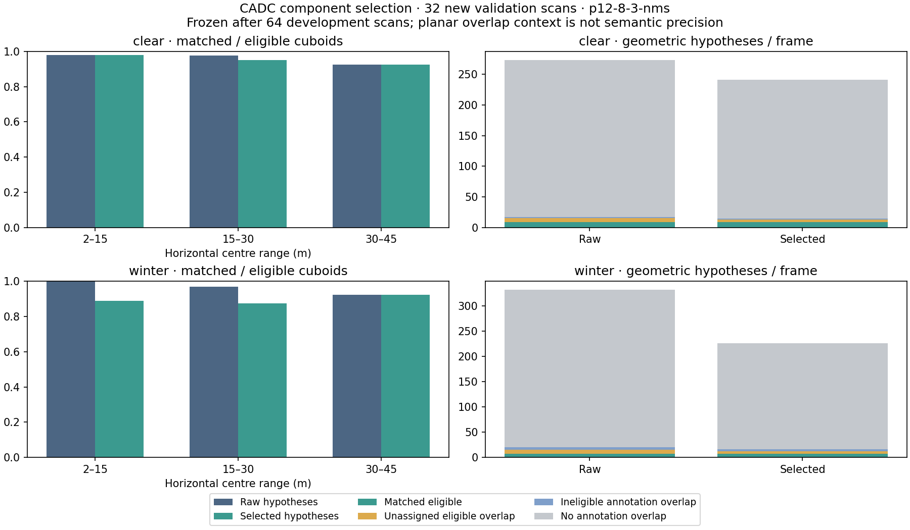

# Measured component selection

This experiment reduces the number of recorded XYZ hypotheses while retaining
geometric object associations. The Rust `select_components` API operates on
measured `ObjectAabb` components, returning original ordinals for kept,
low-support and suppressed hypotheses. It does not delete source returns,
rewrite component bounds or certify free space.

[Summary](../assets/cadc-selection-v1/summary.json) ·
[All decisions and numerical outcomes](../assets/cadc-selection-v1/report.json.gz) ·
[Chosen policy](../integrations/cadc/selected-components-v1.json) ·
[Provenance](../assets/cadc-selection-v1/provenance.json)

## Recorded outcome

The frozen policy is `p12-8-3-nms`: 12/8/3 measured returns at the declared
range breaks, with overlap suppression enabled. On the 32 new validation scans:

| Domain (16 scans each) | Raw → selected hypotheses | Reduction | Retained raw matches | Retained matches at 30–45 m |
|---|---:|---:|---:|---:|
| Clear | 4,380 → 3,862 | 11.83% | 137/138 (99.28%) | 50/50 |
| Winter | 5,314 → 3,618 | 31.92% | 113/119 (94.96%) | 61/61 |

**The declared experimental criteria were not met.** Clear output reduction is
below 30%, and winter overall match retention is below 95%. Winter loses three
raw matches at 2–15 m and three at 15–30 m. The frozen policy remains unchanged
after validation; `qualifiedExperimental` is false. This research API is not
enabled in the default driving path.

Required checks and the complete 96-scan acquisition/audit passed on
[GitHub Actions](https://github.com/rsasaki0109/rust_driving/actions/runs/40113282719).
Check success verifies reproducibility and contracts; it does not change the
failed experimental outcome.

## Selection rule

The support threshold depends on horizontal range of the measured AABB
midpoint, with breaks at 15 and 30 m. Candidate policies use uniform thresholds
3, 5, 8, 12 or 16 returns, or schedules [8,5,3] and [12,8,3]. Each is evaluated
with overlap suppression disabled or enabled, giving 14 declared policies.

With suppression enabled, candidates rank by descending observed return count,
then smallest original return ordinal. A lower-ranked candidate is withheld
only when its XY circular proxy overlaps a retained competitor at IoU >= 0.5
and their measured Z midpoints differ by at most 0.5 m. Both methods use the
previous XYZ proxy rule: AABB XY midpoint, horizontal half-diagonal + 0.65 m,
clamped to [0.85,3] m. This is an uncalibrated hypothesis heuristic, not a
semantic class score, hidden-shape estimate or probability.

The library checks finite ordered bounds, midpoint consistency and sorted,
globally disjoint measured support ordinals. A bounded spatial index avoids
comparing every distant pair. Invalid data or exhausted comparison budgets
return no partial selection. The source components remain immutable; withheld
support is not relabelled as semantic noise or free space.

## Development, freezing and validation

[protocol-selection-v1.json](../integrations/cadc/protocol-selection-v1.json)
fixes the samples, policy grid, scoring and criteria before execution.

The previous four CADC+ sequence pairs provide 64 development scans. The
historical planar model at `57f8b1c65ba151221718fda4d6dad093f1e40a57` and
raw XYZ model at `2d1341cc07147ef1fdf22edd41e44dcd5b16bb26` are compiled
separately from the candidate. All 64 previously published raw XYZ results
must reproduce exactly before being used for policy choice.

A policy is eligible only if it retains at least 95% of raw matched cuboids
both overall and at 30–45 m, separately for clear and winter development
scans. Among eligible policies, the one producing the fewest hypotheses is
chosen; its identifier breaks exact ties. Undefined raw match denominators
do not count as perfect retention. The raw pass-through policy is included.

The exact choice is committed before validation point-cloud acquisition.
Validation evaluates only that one policy on 32 additional scans:

| Winter | Official clear counterpart |
|---|---|
| 2018_03_06/0005 | 2018_03_05/0031 |
| 2019_02_27/0006 | 2018_02_22/0020 |

For each winter date these are the next lexicographic one-to-one official
matches with at least 80 annotation-array entries on both sides. Selection
uses public metadata alone. Every sequence uses frames 0,10,...,70, respecting
the clear training set's sparse annotation cadence.

Validation reports the same 95% overall/far retention checks and a target of
at least 30% fewer hypotheses in each domain. These are experimental geometric
criteria. A failed criterion remains a reported result, not a reason to
suppress a frame or select a different policy after seeing validation scores.

The additional sequences share city and winter dates with development data.
They are not an official held-out split, independent-city validation or a
causal weather experiment. No automatic driving-policy promotion is performed.

## Independent checks and interpretation

The native selector uses analytic circle intersection and an indexed greedy
search. Python independently integrates circle cross-sections numerically and
uses an exhaustive ranked search. Native decisions must match for every
component and policy. Source-return membership, unchanged proxies, complete
candidate partitions, support ties, vertical separation, resource exhaustion
and subset matching are checked. Both native references and the selector run
twice with byte-identical outputs required.

All stages use the previous benchmark's eligibility and planar IoU >= 0.1
matching, including occluded/zero-point cuboids and all classes. The score is
not semantic 3D AP or semantic precision. Withholding hypotheses cannot
increase maximum-cardinality matches from an unchanged candidate set.

Each output is counted in exactly one planar-overlap context:

- Matched to an eligible cuboid.
- Not assigned but overlapping some eligible cuboid.
- Overlapping only annotations outside the frozen eligibility rule.
- Having no annotated overlap at the declared threshold.

The last category can contain unlabelled walls or other real geometry.
Annotation absence does not prove a false object. These categories explain
the output count without equating every unassociated component with an error.

## Reproduce

Use pinned Rust 1.90.0 and Python 3.12:

~~~sh
python -m pip install -r scripts/requirements-cadc-selection.txt
cargo test --locked -p rustdriving-perception component_selection
cargo test --locked -p rustdriving-sim --example cadc_component_selection
cargo build --locked -p rustdriving-sim --example cadc_component_selection
CADC_SELECTION_BINARY=target/debug/examples/cadc_component_selection python scripts/test_cadc_selection.py
~~~

The **CADC component selection** workflow contains the full reproducible
acquisition/build/audit commands. It runs `bash scripts/check.sh`, builds
the two historical models and candidate once, evaluates development shards,
freezes the chosen policy, evaluates new validation shards, then publishes all
96 outcomes with source and executable hashes. Normal PR contracts use small
offline fixtures and download no dataset.

Manual runs on main freeze their choice in an artifact before validation and
return results without modifying main. Feature-branch runs retain the policy
freeze as a separate Git commit, followed by the evidence commit. Provenance
distinguishes tested code, frozen configuration and output identity.

All destinations must be new. The bounded acquisition readers check archive
versions, annotation hashes, selected ZIP member CRC32 and streamed clear
archive hashes. RGB images are read through but not retained. Raw clouds,
annotations and spatial detector outputs remain private to the runner;
published artifacts contain counts, selection ordinals and hashes.

The original CADC is CC BY-NC 4.0. Consult the
[official devkit](https://github.com/mpitropov/cadc_devkit) and
[CADC+ source terms](https://uwaterloo.ca/waterloo-intelligent-systems-engineering-lab/cadc-plus).
The repository code licence does not relicense external data. This research
path establishes no weather calibration, physical safety, real-time or
driving qualification.
