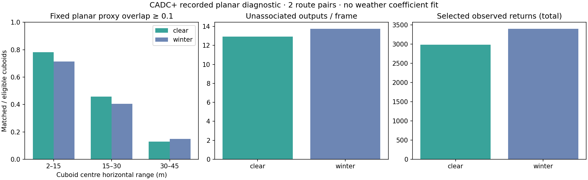

# Recorded CADC+ planar LiDAR diagnostic

This study applies the **unchanged native LidarClusters** detector to recorded
[CADC+](https://uwaterloo.ca/waterloo-intelligent-systems-engineering-lab/cadc-plus)
winter and clear point clouds. It measures the gap between a small planar
detector and real scenes, before fitting any weather coefficients.

[Summary](../assets/cadc-planar-v1/summary.json) ·
[Per-frame numerical results](../assets/cadc-planar-v1/report.json.gz) ·
[Source, input and output provenance](../assets/cadc-planar-v1/provenance.json)

## Frozen sample

[protocol-v1.json](../integrations/cadc/protocol-v1.json) fixes the sample,
projection and association before point-cloud evaluation. The rule selects the
first lexicographic winter sequence with at least 80 frames and a one-to-one
official CADC+ match on each of two dates:

| Winter | Clear counterpart | Published winter road snow cover |
|---|---|---|
| 2018_03_06/0001 | 2018_03_05/0025 | None |
| 2019_02_27/0003 | 2018_04_02/0067 | Covered |

Frames 0, 10, 20, 30, 40, 50, 60 and 70 from each sequence give **32 scans**.
Selection uses the official route metadata and
[sequence mapping](https://wiselab.uwaterloo.ca/cadc-clear/sequence_pairs.yaml),
not detector scores. These are a small diagnostic sample, not an official
held-out benchmark. A winter sequence does not imply heavy active snowfall.

CADC+ counterparts cover approximately the same road on different days.
Traffic, occlusion, surface condition and exact poses differ. These are not
identical scenes or paired rays, so differences cannot identify a causal snow
effect or calibrate extinction coefficients.

## Sensor-only input and independent audit

The [official devkit](https://github.com/mpitropov/cadc_devkit) defines the
little-endian float32 XYZI format. Coordinates are LiDAR-local metres: x
forward, y left, z up. The adapter selects measured points with
**z in [-0.9, -0.3] m and horizontal range in [2, 45] m**. It retains the nearest
observed point in each of 360 azimuth bins, preserving its original XY and
first-row order on ties. This is a fixed sensor-height slab, not a calibrated
height above the road. It is not a complete 3D reconstruction.

The stateless detector receives only the projected scan and identity local
pose. Frame/10 is a nominal input time in seconds, not verified acquisition
timing or deskew. Intensity, annotations and weather labels do not change the
detector. Missing bins remain unknown: **no calibrated sweep certificate** is
created. Recorded clouds are not re-corrupted with the synthetic weather model.

Python independently decodes every row, checks selected row indices and
recomputes clustering with exhaustive directed search and a QR circle fit.
Native outputs must agree within 1e-6 m. Point, annotation, protocol, native
executable and tested-source hashes bind the audit to the actual inputs.
Neither native output nor annotations are used as the independent projection
or clustering reference.

## Declared score

All annotated cuboids whose centres lie in [2, 45] m and whose vertical
interval intersects the slab are eligible, including occluded and zero-point
boxes. No class or point-count filter removes difficult examples.

The [author's CADC loader](https://github.com/mpitropov/OpenPCDet/blob/cadc_support/pcdet/datasets/cadc/cadc_dataset.py)
uses dimensions.y for forward length and dimensions.x for width. We retain
the supplied LiDAR-frame yaw. A native circular proxy is represented by an
inscribed 64-gon and associated with these rectangles at planar IoU >= 0.1,
using maximum-cardinality one-to-one matching. Geometry tests cover rotation,
containment and a greedy-matching counterexample.

Reports include matched/eligible cuboids in 2–15, 15–30 and 30–45 m bins,
unassociated proxies per frame, point thinning and per-frame counts.
**This is not semantic 3D AP.** Unassociated geometric outputs may be walls,
ground or unlabelled objects; they are not demonstrated false objects.
Slab slicing and HDL-32E angular sampling can limit distant coverage even in
clear weather. No performance threshold selects or suppresses poor outcomes.

## Reproduce and data terms

Use pinned Rust 1.90.0 and Python 3.12:

~~~sh
python -m pip install -r scripts/requirements-cadc.txt
python scripts/test_cadc_recorded.py
cargo test --locked -p rustdriving-sim --example cadc_planar_study
cargo build --release --locked -p rustdriving-sim --example cadc_planar_study
python scripts/cadc_recorded.py --protocol integrations/cadc/protocol-v1.json --output /tmp/cadc-data
target/release/examples/cadc_planar_study /tmp/cadc-data/sensor.json > /tmp/cadc-native.json
RUSTDRIVING_SOURCE_SHA=$(git rev-parse HEAD) python scripts/check-cadc-recorded.py --data /tmp/cadc-data --native /tmp/cadc-native.json --binary target/release/examples/cadc_planar_study --protocol integrations/cadc/protocol-v1.json --output /tmp/cadc-audit
RUSTDRIVING_SOURCE_SHA=$(git rev-parse HEAD) python scripts/check-cadc-recorded.py --merge /tmp/cadc-audit/result.json --protocol integrations/cadc/protocol-v1.json --output /tmp/cadc-evidence
~~~

All destinations must be new. Acquisition pins server sizes/ETags and annotation
hashes. Winter ZIPs use strictly checked bounded HTTP ranges and member CRC32;
clear zstd tar archives are streamed in full (about 2.74 GB total compressed)
to compute full archive hashes, retaining only 16 selected clear point members.
Including winter members, fewer than 256 MiB of selected point data can be
retained. No RGB image is retained. Archive names are never extracted to paths.

The original CADC devkit specifies **CC BY-NC 4.0**; consult the
[dataset source](https://github.com/mpitropov/cadc_devkit#license) and
[CADC+ site](https://uwaterloo.ca/waterloo-intelligent-systems-engineering-lab/cadc-plus)
for applicable input terms. This repository publishes aggregate plots, numerical
diagnostics and input hashes; it does not redistribute raw clouds, annotation
files or spatial detector outputs. The code's repository licence does not
relicense those external inputs.

The **CADC recorded LiDAR study** workflow runs the required
`bash scripts/check.sh`, adapter tests, one native build and both route pairs.
It publishes every frame only after independent audit, and leases its output
commit to the tested source. Manual runs on main return an evidence artifact without changing the branch.
The workflow is opt-in; normal CI runs the small
offline acquisition/geometry tests without downloading CADC.

[MuFoRa's record](https://zenodo.org/records/15016480) currently restricts actual
files. Its [2026 paper](https://link.springer.com/article/10.1007/s42979-026-04976-9)
describes controlled rain/fog observations, but no files were requested or
evaluated here. The [synthetic study](lidar-weather.md) remains uncalibrated.
This diagnostic establishes neither real-weather robustness nor driving,
localization, real-time or safety performance.
