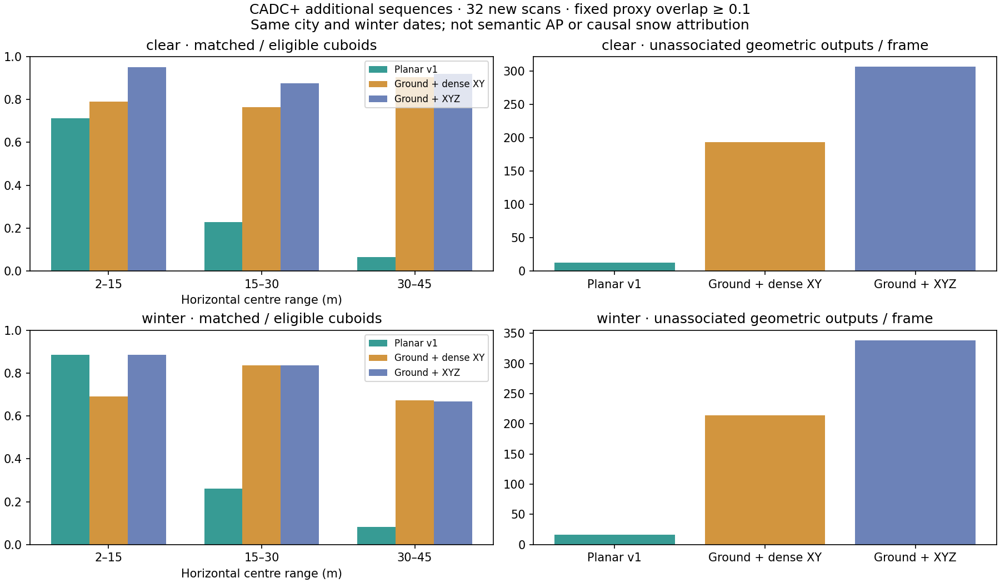

# Recorded CADC XYZ comparison

This follow-up connects the existing native ground and XYZ component algorithms
to measured CADC+ scans. It compares dense XY and XYZ connectivity against the
[frozen planar diagnostic](cadc-recorded-lidar.md), before changing driving
perception or any synthetic weather coefficients.

[Summary](../assets/cadc-volume-v1/summary.json) ·
[Every frame's numerical results](../assets/cadc-volume-v1/report.json.gz) ·
[Source and executable provenance](../assets/cadc-volume-v1/provenance.json)

## Frozen sample and baseline

[protocol-volume-v1.json](../integrations/cadc/protocol-volume-v1.json) fixes
parameters, original and additional sequences, annotated-cadence frame indices,
source/archive versions, eligibility and the overlap threshold before candidate
evaluation. The original 32 scans and an additional 32 scans are reported
separately.

| Partition | Winter sequence | Official clear counterpart |
|---|---|---|
| Previous | 2018_03_06/0001 | 2018_03_05/0025 |
| Previous | 2019_02_27/0003 | 2018_04_02/0067 |
| Additional | 2018_03_06/0002 | 2018_03_05/0029 |
| Additional | 2019_02_27/0005 | 2018_03_21/0052 |

For each original winter date, the additional pair is the next lexicographic
one-to-one official match with at least 80 annotation-array entries on both
sides. Selection uses metadata alone. Frames **0, 10, 20, 30, 40, 50, 60 and 70**
are selected in every sequence. The [official site](https://uwaterloo.ca/waterloo-intelligent-systems-engineering-lab/cadc-plus)
documents the training set's every-tenth-frame annotations; intermediate
unannotated frames are not treated as empty scenes.

The additional sequences come from the same city and winter dates. They are
not an official held-out validation split or evidence of independent-city
generalization. Clear/winter counterparts contain different traffic and
occlusions. No difference is identified as a causal snowfall effect.

The baseline executable and its independent auditor are built from pinned
historical source `57f8b1c65ba151221718fda4d6dad093f1e40a57`. Its source
hashes must match the original provenance; all 32 previously published per-frame
results must reproduce exactly. The reference source is staged separately
from the current candidate. Future workspace or dependency updates do not
require pretending the historical baseline used the current source tree.

## Methods and sensor contract

All methods receive the same actual little-endian float32 XYZI bytes. Coordinates
are LiDAR-local metres, x forward, y left, z up. Labels and domain names never
select detector parameters. Nominal frame/10 input times are not measured
acquisition timing or deskew.

- **Planar v1:** unchanged recorded baseline, z in [-0.9, -0.3] m, 2–45 m
  horizontal range, nearest measured return in each of 360 azimuth bins,
  existing range-adaptive LidarClusters and its circular proxies.
- **Ground + dense XY:** retain all finite returns at 2–45 m and z in
  [-3, 3] m. Apply existing progressive morphological ground filtering with
  its default parameters. Zero Z on retained points, then use the existing
  Euclidean component algorithm with 0.6 m tolerance and at least 3 points.
- **Ground + XYZ:** use exactly the same crop, ground classification, retained
  indices, tolerance and proxy rule, keeping original Z during connectivity.

A ground classification only removes points when its geometric support flag is
true. Otherwise every cropped return remains available. Unknown geometry never
creates a calibrated planar-sweep certificate. These are offline diagnostic
inputs, outside localization, tracking, planning and the browser game.

Both dense methods output measured component bounds and use the same declared
circle proxy: XY AABB midpoint, radius equal to horizontal half-diagonal plus
0.65 m, clamped to [0.85, 3] m. This heuristic is not an inferred hidden object
shape or a guarantee that the circle encloses a large component. Thus the
XY/XYZ comparison changes only connectivity dimension. Comparisons with
Planar v1 also change thinning, ground removal, connectivity and proxy geometry;
they cannot isolate the effect of retaining more points alone.

Ground and clustering parameters are inherited from existing defaults, not
optimized against this sample. All outcomes, including support fallback,
unassociated outputs and frames with fewer matches, remain in the report.
There is no score threshold that makes poor performance pass as an improvement.

## Independent checks and score

The native implementation uses sparse ordered maps, separable morphology and
voxel-neighbor traversal. Python independently reconstructs each crop using
float32 decoding, checks sparse morphological openings with masked array
filters, and compares graph components from a k-d tree radius graph plus
SciPy's undirected connected-components solver. Analytic ground/roof/outlier,
vertical-gap and exhaustive small pair-graph tests exercise these references.

Every selected row, ground/support decision, retained point index, component
membership, noise index, observed bound and proxy is checked. Native builds are
executed twice and their raw outputs must match byte for byte.

The score retains the original planar study's eligible annotations: centres
in 2–45 m whose original 3D cuboids intersect z [-0.9, -0.3] m, including
occluded and zero-point boxes and every class. Eligibility stays identical
across methods. Maximum-cardinality one-to-one matching uses a 64-gon circle
approximation against yaw-oriented annotation rectangles at IoU >= 0.1.

This is **not semantic 3D AP**. Unassociated outputs may be walls, ground or
unlabelled objects, not demonstrated false objects. The figure shows the
additional 32 scans with distance-bin matching and unassociated outputs.
JSON also retains the previous scans, per-frame improvements/regressions,
support fallback counts and input hashes. No statistical independence,
calibrated uncertainty, real-time, driving or weather-robustness claim follows.

## Reproduce

Use pinned Rust 1.90.0 and Python 3.12. The **CADC volume comparison** workflow
builds the historical baseline separately, runs `bash scripts/check.sh`, the
native adapter tests and independent geometry tests, acquires four route-pair
shards and publishes every outcome after audit. Manual runs on main return an
artifact without modifying the branch. Normal PR contracts run only small
offline fixtures and do not download the dataset.

For an individual shard, after building the candidate and the pinned historical
baseline and installing `scripts/requirements-cadc-volume.txt`:

~~~sh
python scripts/cadc_volume_acquire.py --protocol integrations/cadc/protocol-volume-v1.json --pair 0 --output /tmp/cadc-pair-0
target/release/examples/cadc_volume_study /tmp/cadc-pair-0/sensor.json > /tmp/cadc-volume-0.json
~~~

Run the historical native executable on that same sensor.json, audit it with
the historical `scripts/check-cadc-recorded.py` and the new protocol path,
then run the current `scripts/check-cadc-volume.py` with `--data`, `--native`,
`--binary`, `--baseline`, `--protocol` and a new `--output` directory.
Repeat for pair ordinals 0–3. Merge all four result.json files using the audit's
`--merge` option. Set `RUSTDRIVING_SOURCE_SHA` to the corresponding source
commit for each auditor. The workflow contains the complete exact commands.

Acquisition uses the bounded readers from the previous study: strict HTTP
ranges and ZIP CRC32 for winter, streamed zstd tar archives for clear.
Four clear archives total about 5.52 GB compressed; images are read through
but not retained. Original clear archives additionally check the previously
observed full SHA256; all archive versions and selected payload hashes are
recorded. Destinations must be new, archive paths are never extracted, and
data remain private to the runner.

The original CADC is **CC BY-NC 4.0**. Consult the
[official devkit](https://github.com/mpitropov/cadc_devkit) and
[CADC+ source terms](https://uwaterloo.ca/waterloo-intelligent-systems-engineering-lab/cadc-plus).
Only aggregate plots, numerical diagnostics and hashes are published here;
raw clouds, annotation files and spatial detector outputs are not redistributed.
The repository's code licence does not relicense the external data.
