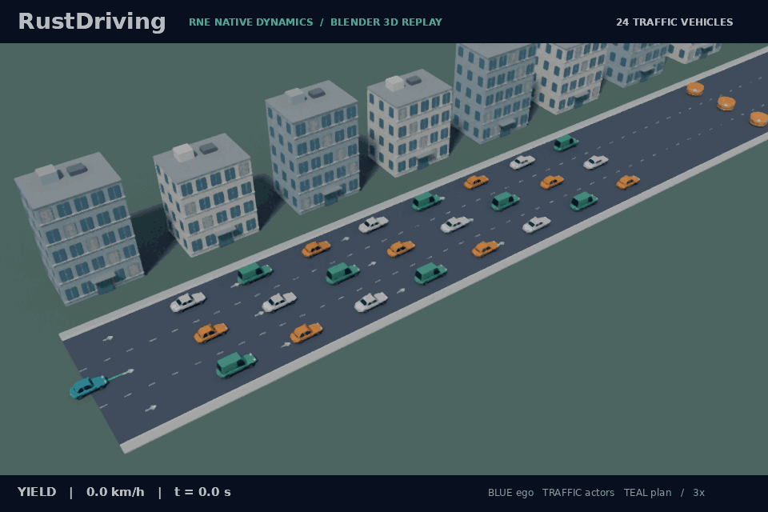

# Dense traffic demonstration

The README opens with **24 reactive vehicles in three eight-vehicle queues**,
plus the blue ego vehicle. Each participant is simulated and recorded by the
pinned native RNE backend. Hatchbacks, sedans and vans are original SI display
meshes; the perspective camera fits every vehicle throughout the recording.



The authored straight test corridor is 20 m wide. Queue centres lie at −7, 0
and +7 m, and three static circular obstructions stop the traffic downstream.
Each actor uses a 2.8 m circular proxy, a finite 45 m proximity observation,
bounded acceleration/braking and a 5 m desired gap. Ego runs the existing
sensor-driven pipeline. The expected outcome is a stopped queue, not arrival
at the road endpoint.
LiDAR uses first returns, so vehicles can occlude one another. The camera shows
recorded simulator-world poses; it does not imply that all 24 cars are tracked.

Lane dividers, arrows and buildings are display geometry. This does not add
lane changing, lane-aware routing, arbitrary junction negotiation, contact
response or calibrated production-vehicle sensing. Actor metadata never enters
the ego driver. The [Japanese-city recording](japanese-city-demo.md) and
[original three-vehicle queue](vehicle-fleet.md) remain available.

## Evidence

[Acceptance](../assets/dense-traffic-demo-results.json) covers native seeds
7, 1 and 42. Each complete 46-second episode retains all 24 reactive identities,
all 27 physical objects, 921 sensor-only replay ticks, fixed queue order and
at least 15 m actual travel per vehicle. Independent checks reconstruct actor
integration and finite-range proximity readings from the recorded positions.
The complete fleet and ego must remain stopped together for five terminal
seconds; collisions and road violations must remain zero.

The checker also sweeps expanded display envelopes between recorded poses,
retaining the 1 m clearance floor with additional inter-sample reserves.
The renderer verifies actual evaluated mesh bounds against these envelopes,
all sampled poses and the complete camera framing. This is bounded planar
simulation evidence, not a full contact-enabled vehicle-body model.

An [initial 40-second trial](../assets/dense-traffic-initial-trial.json) left
seed 1 with only 2.3 terminal stopped seconds and failed the same five-second
gate. The published fixture extends the observation to 46 seconds; driving
algorithms and clearance/stop thresholds are unchanged.

The [GIF provenance](../assets/dense-traffic-demo.json) records the actual trace,
scenario, physical summary, engine revision, rendering parameters and source
hashes. The full timeline is shown at 3× playback.

## Reproduction

Install the pinned Rust toolchains, set up the engine with
`bash scripts/setup-rne.sh`, install Blender, and install
`scripts/requirements-demo.txt` in your Python environment.

```sh
bash scripts/dense-traffic-demo.sh artifacts/dense-traffic-demo
```

This captures and replays all three seeds, runs the independent checker, then
renders `artifacts/dense-traffic-demo/demo.gif` with Cycles CPU. To intentionally
refresh the README GIF, supply `assets/dense-traffic-demo.gif` as the second
argument. Regenerating requires a fresh output directory. The camera and the
`--traffic-lanes` option affect visualization only; old rendering modes retain
their existing layouts.
