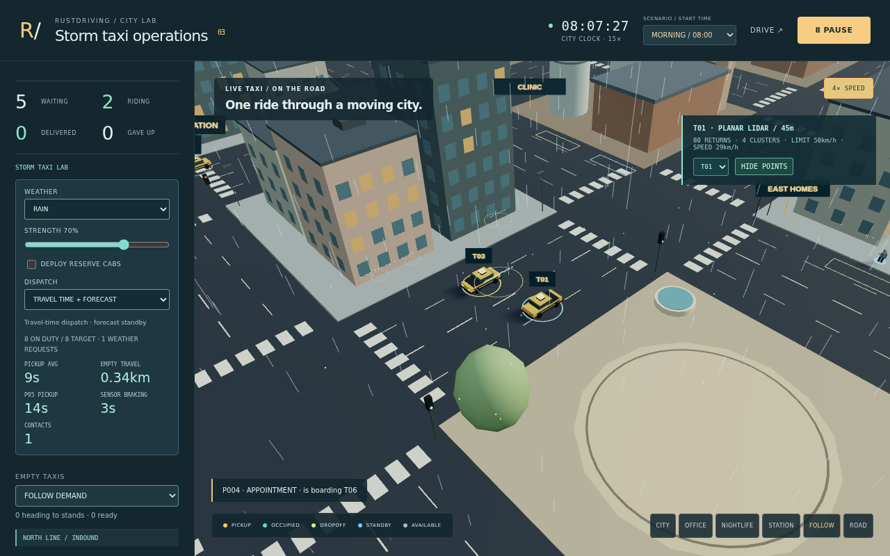

# ETA dispatch and forecast standby

Open [the experimental policy](https://rsasaki0109.github.io/rust_driving/?mode=fleet&lab=1&dispatch=eta&reserve=off).
**DISPATCH** switches between **ROAD DISTANCE** (the existing default) and
**TRAVEL TIME + FORECAST**. Switching preserves current passenger assignments.
P95 pickup wait counts observed boardings; waiting and cancelled riders remain
visible separately. A selected taxi shows its pickup estimate or overdue status.

## Research basis and implementation

[Tavor and Raviv (2023)](https://doi.org/10.1016/j.trc.2023.104196) formulate
anticipatory RoboTaxi rebalancing as repeated rolling-horizon linear programs,
balancing passenger wait and empty travel. This implementation is a smaller
experimental baseline: online road timing, batch matching and one-minute demand
forecasts with capacity-constrained standby assignment. It does not reproduce
their full LP, calibrated demand model or reported performance.

- Completed directed road segments provide elapsed seconds and odometer metres.
  Initial partial segments, intentional boarding/alighting/parking dwell,
  odometer resets and invalid samples are excluded. A 0.25 EWMA updates seconds
  per metre; observations decay toward a 6.5 m/s prior with a 120 s time constant.
- Pickup ETA costs the same directed shortest-distance path used by the current
  steering, including a 5 s approach allowance. It uses completed trip telemetry,
  without weather labels, future traffic or precipitation coefficients.
- Every 0.5 s, a rectangular Hungarian assignment maximizes feasible matches,
  then minimizes ETA minus accrued request wait. At most 16 taxis and the oldest
  64 unassigned requests enter a bounded batch. Assigned passengers retain ownership.
- Request forecasts use exponentially discounted past requests (60 s decay,
  120 s window), two prior-minutes of public time-of-day demand and current rail
  service state. Priors are authored and uncalibrated. Future person schedules
  and future requests are excluded.
- Every 5 s, idle taxis are assigned to distinct existing standby bays or retain
  an idle action. Cost is pickup ETA + 0.02 s/m of empty travel - 45 s per forecast
  request, with 8 s switching hysteresis and a 20 s commitment. One cab fits each
  bay. This is a one-step forecast assignment, not full multi-stage MPC.

The independent assignment tests enumerate every feasible matching on hundreds
of sparse, negative-cost small matrices. A separate timing fixture makes a
farther cab win after an observed road delay. Future-plan interventions preserve
the current operational decision prefix; planning never edits agent poses,
odometers or served counters.

## Driving and sensing boundary

This is the optional authored arcade fleet. Road positions, odometers, arrivals
and clock state come from its existing fleet telemetry/service. They are not
validated GNSS/localization measurements. The research DrivingPipeline remains
separate. The [Storm Taxi Lab](storm-taxi-lab.md) first-return instrument, shared
Rust synthetic-weather model, measured-cloud brake and independent overlap
evaluator remain the driving/sensing path. Dispatch sets service destinations;
it does not pass actor identities or weather coefficients to the brake governor.

Real-weather validation remains future work. [CADC+ (IV 2025)](https://uwaterloo.ca/waterloo-intelligent-systems-engineering-lab/cadc-plus)
provides 74 matched clear/snow sequence pairs, rather than synchronized pointwise
pairs. [MuFoRa (2026)](https://link.springer.com/article/10.1007/s42979-026-04976-9)
provides controlled rain/fog measurements with solid-state 3D LiDARs.
Sensor specifications and a declared 3D-to-planar projection must be reconciled
before using either to validate the current virtual instrument. This study
downloads neither dataset and makes no real-weather accuracy claim.

## Frozen paired study

The protocol is fixed before the first run: seeds **2027 and 4093**, morning and
night, clear/rain/snow at strength 0.7, 300 physical seconds, 60 Hz, and both
policies: **24 full runs / 12 pairs**. All outcome rows, including regressions and
contacts, are retained. The policy stays opt-in; integrity checks do not establish
non-inferiority or driving safety.

Each case starts a fresh Node process and fresh production Wasm, resetting the
same initial traffic state. The browser and render-free runner share world and
cab-spawn setup. The runner uses actual production people, traffic, junction
reservations, sensor acquisition, Rust weather/perception/braking and body-proxy
contact evaluation. Only canvas label painting and GPU rendering are omitted.

Each period has a fixed equal supply within a pair: eight morning / twelve
night cabs, with reserve disabled. The same 24 authored release plans and initial
world are hashed within each pair. Live train/weather-generated demand is
disabled to bound the assay. Shared doors and pedestrian service can cause
realized curb-request times to diverge after treatment; those identities are
reported rather than silently assumed equal.

[Full summary](../assets/fleet-eta-v1/summary.json) and the clear/rain/snow raw
records retain lifecycle events, actual car samples, acquisition counts, timing
profiles, ETA errors, contact episodes, source hashes and tested Wasm identity.
An independent Python audit reconstructs boarding/completion/cancellation and
nearest-rank P95 wait from events. Pooled P95 covers boarded requests only;
unpicked, cancelled and unfinished rides stay separately counted. Two seeds
and these authored priors do not establish population-wide benefit or statistical
significance. The combined policy comparison does not isolate the contribution
of ETA matching from forecast standby.

Reproduce from the repository root after building the playground:

~~~sh
npm ci --prefix web --ignore-scripts
bash scripts/build-playground.sh
npm --prefix web test
node web/scripts/benchmark-fleet-eta.mjs --weather clear --output web/test-results/fleet-eta/clear.json
node web/scripts/benchmark-fleet-eta.mjs --weather rain --output web/test-results/fleet-eta/rain.json
node web/scripts/benchmark-fleet-eta.mjs --weather snow --output web/test-results/fleet-eta/snow.json
~~~

[SUMO taxi](https://sumo.dlr.de/docs/Simulation/Taxi.html) and
[OR-Tools DRT](https://sumo.dlr.de/docs/Tools/Drt.html) are external comparison
candidates. They are not executed in this study; traffic-model differences must
be accounted for before interpreting cross-simulator results.
