# Bounded GNSS recovery after innovation rejection

The shared pipeline can now defer GNSS recovery proposals until several new
acquisitions support a bounded position/heading correction. This optional mode
repairs the previous 16 persistent-bias stopping failures in both plants. All
64 positive episodes pass the frozen accuracy, stopping and original-deadline
requirements; four expiry controls remain stopped after healthy signals return.
Twenty-four no-guard controls retain their measured outcomes separately.

## Operational contract

Add explicit external calibration to a scenario or `PipelineConfig`:

```json
{
  "gnss_recovery": {
    "max_position_correction_m": 0.4,
    "max_yaw_correction_rad": 0.1,
    "confirmation_fixes": 3,
    "max_hold_s": 5.0
  }
}
```

There are no implicit recovery thresholds. Position/yaw bounds must be finite,
positive and at most 1 m / 0.2 rad; confirmation count must be 2–8 and the hold
budget finite, positive and at most 10 seconds. Calibration is copied into the
operational header independently of simulated faults and noise.

The existing brake hold starts after two new rejected GNSS innovations. With
this option, subsequent otherwise accepted fixes first create a complete
correction proposal, including acquisition-time rewind and intervening map/GNSS
event replay. Bounds apply to the Euclidean position change and wrapped yaw
change of the **current** estimate, not to raw acquisition/delivery displacement.

Each bounded new proposal contributes one confirmation. Duplicate/older fixes
cannot contribute. Innovation rejection, malformed observations, an excessive
proposal or stale confirmation evidence breaks the sequence. Confirmation
freshness uses the existing 0.75-second acquisition-age limit. Only the final
confirming fix is committed; earlier probes remain unadmitted observations.

```mermaid
stateDiagram-v2
    Ready --> Holding: two innovation rejections
    Holding --> Confirming: bounded new proposal
    Confirming --> Holding: rejection, excessive proposal or stale evidence
    Confirming --> Ready: required confirmations; commit latest fix
    Holding --> Expired: hold budget or measured-motion gap
    Confirming --> Expired: hold budget or measured-motion gap
```



Deferred accepted proposals have decision `RecoveryHeld`. Their original NIS
and observed acquisition stamp are recorded once, and their rejection count
advances. Pose, covariance, accepted-fix clock/count and complete event history
are restored. Compensated-fix/map-replay counters do not count a probe. Process
noise continues growing uncertainty normally; covariance is neither frozen nor
contracted using withheld observations. Full posterior output is available when
this recovery option, an explicit initial covariance, GNSS shape or antenna
mounting calibration is supplied.

The hold budget starts at the second rejection's delivery time. Expiry is
latched: healthy GNSS cannot reset it. Missing/stale/invalid measured motion or a
control-clock gap also expires an active recovery (unit-tested). Recovery after
expiry requires constructing a new pipeline with externally supplied pose
calibration; automatic global relocalization is not implemented. Default
`gnss_recovery: null`/absence retains the original behavior and omitted fields.

## Frozen evaluation and recorded outcomes

The policy above, all 92 case files and their hashes were fixed before physical
execution. There were no algorithm or physical-criterion changes after trials
began. A subsequent static-check repair removes two needless borrows in test
code; both final runtime binaries match the physical candidates byte for byte.

Both reference-2d and pinned native RNE dynamic plants use the preceding ENU
covariance fixtures, their authored initial prior, identical keyed acquisition
noise, and unchanged physical criteria: RMSE ≤0.2 m, maximum position error
≤0.4 m, clearance ≥1 m and original deadlines. The 0.8 m narrow-axis bias acts
over `[8, 11)` seconds. Recovery cases require an actual stop ≤0.05 m/s during
`[9.5, 11.4)`, healthy recovery after 13 seconds and goal arrival. The original
16 pairs additionally require ≥40% maximum-error reduction against the same
calibrated estimator with only recovery disabled.

| Role | Recorded result |
| --- | --- |
| Previous persistent-bias failures, seeds 1/7/42/313 | 16/16 now pass |
| Nominal straight/curve and both map/GNSS arrival orders | 32/32 pass |
| New map + persistent-bias compositions, seeds 7/42 | 8/8 pass |
| Separate new-seed confirmation, seeds 809/2027 | 8/8 pass |
| Expiry controls: bias through 18 s, original 45 s duration | 4/4 stay stopped from 14 s through healthy return and episode end |
| No-guard controls | 24 retained; all 16 original failures reproduce with all five raw files byte-identical to their parents |
| Independent joint-matrix reconstruction and exact replay | 92/92 recordings, all 44,439 ticks |

Minimum paired maximum-error reduction is **70.128%**. Across all 64 positive
episodes, worst RMSE is **0.148870 m** and maximum position error **0.335360 m**.
Every recovery fault case reaches a measured stop of 0 m/s. The expiry cases
include healthy proposals after 19 seconds that remain `RecoveryHeld`.
The no-guard controls are comparison data, not additional qualified positives.

The independent auditor reconstructs unbounded chronological GNSS/map history
with joint matrix gains and Joseph updates, then folds delivery-owned recovery
events from independently computed complete proposals. It checks every pose,
full covariance, original NIS, freshness clock, count, map acquisition prior,
replay counter and recovery diagnostic. Closed-form tests detect premature
covariance contraction, accepted-clock changes and forged confirmation events.
Truth supplies only observation synthesis and independent physical scoring.

`bash scripts/check.sh` passes 698 Rust and 48 Python tests plus all 49 standard
drive/replay pairs; all 245 standard files retain their previous bytes. Native
release tests (62), all-target clippy and formatting also pass. All 254 previous
recordings retain exact replay outputs, including the original failed controls.
These are Linux x86_64 observations; other configured CI platforms are not
claimed as locally verified. Historical/current raw streams remain in verified
immutable archives; duplicate mutable `artifacts/check` streams are vacated.

## Limits and reproduction

This is recovery policy after an innovation hold, not a GNSS bias estimator.
Bias that never triggers the two-rejection hold, gradual drift, independent
receiver calibration and real-vehicle operation remain unqualified. Proposal
bounds are authored engineering settings, not statistical uncertainty coverage.
Legitimate large corrections can require reinitialization; expiry deliberately
does not automatically resume driving. The comparative engineering estimate
increases modestly to **about 24%**, with the 30% waypoint still unmet.

After the documented pinned engine setup:

```bash
source scripts/env.sh
cargo build --release --locked --bin rustdriving
cargo +1.95.0 build --release --locked --manifest-path integrations/rne/Cargo.toml
python3 scripts/test_gnss_recovery.py
python3 scripts/check_gnss_recovery.py --output artifacts/gnss-recovery-guard
```

The complete checker returns zero only when positive/expiry expectations,
independent reconstruction, replay and paired reduction requirements pass.
`--smoke --plant reference-2d` or `--smoke --plant rne-dynamic` selects a 14-case
CI subset. Each run preserves its first outcomes and comparison metrics.
[Published measurements and provenance](../assets/gnss-recovery-guard-results.json).
Local source/binary receipts and every raw recording remain under
`artifacts/gnss-recovery-guard-v1/`.
