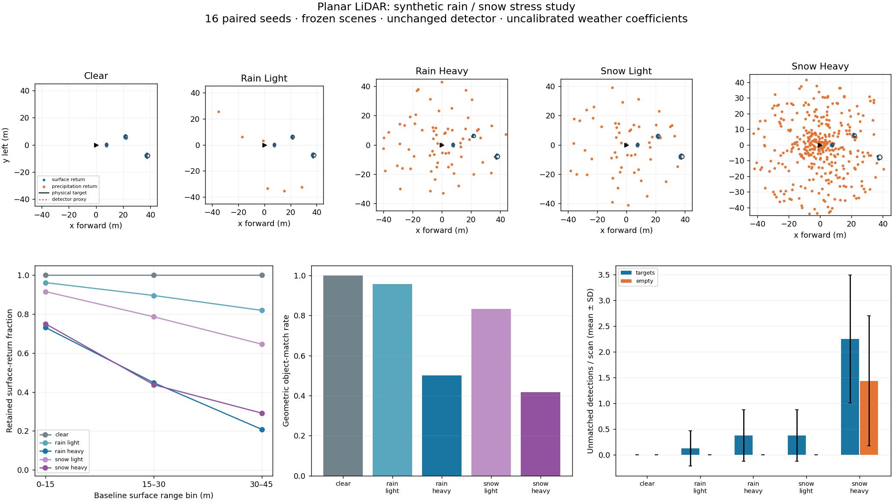

# LiDAR rain / snow stress study

This first study compares frozen **2D first-return LiDAR scans** under clear,
rain and snow presets. It reuses the reference ray/circle sensor and the
unchanged range-adaptive **LidarClusters** detector. It runs offline, outside
the driving pipeline.

[Aggregate results](../assets/lidar-weather-v1/summary.json) ·
[Raw trials](../assets/lidar-weather-v1/report.json.gz) ·
[Source and output hashes](../assets/lidar-weather-v1/provenance.json)

## Model and scope

The presets are **synthetic stress coefficients**, not calibrated rain rates,
snowfall rates, visibility estimates or manufacturer sensor specifications.

| Preset | One-way extinction (1/m) | Effective particle-return rate (1/m) | Added range jitter bound (m) |
|---|---:|---:|---:|
| Clear | 0 | 0 | 0 |
| Rain light | 0.002 | 0.0004 | 0.025 |
| Rain heavy | 0.018 | 0.0025 | 0.12 |
| Snow light | 0.004 | 0.002 | 0.06 |
| Snow heavy | 0.01 | 0.015 | 0.30 |

A surface at range **r** survives an independent draw with probability
**exp(-2 × extinction × r)**. A detectable foreground particle is drawn from
an exponential free path; it replaces a farther surface as the first return.
The particle rate is an effective return rate, not physical particle density.
A separate uniform draw adds bounded range jitter. The three channels share
counter-based draws across presets, so stronger extinction/scatter cannot
restore an earlier lost surface. No rain model coefficients enter perception.

Loss remains **Unavailable** in evaluation ray diagnostics. A weather cloud
carries **no calibrated planar-sweep evidence**: this uncalibrated model cannot
certify that an empty-looking cloud represents an unobstructed scene.
The all-zero configuration preserves the original acquisition bit for bit.

This does not model wavelength, intensity, surface reflectance/wetness,
droplet size, multiple echoes, snow accumulation, persistent flakes, full 3D
scattering or actual driving response. Real-weather sensor data and sensor
calibration are needed before interpreting coefficients as weather severity.

## What is measured

There are 16 paired seeds, two frozen fixtures, and five conditions:
**160 cases / 115,200 rays**. One fixture has three circular targets near
8, 23 and 39 m; the other is physically empty. Each preset uses the exact same
clear acquisition for its seed. Sensor base noise remains ±0.015 m.

The report retains every raw cloud, ray outcome, random draw, source label
and actual detector output. Labels and scene truth remain in evaluation
metadata; the detector receives only the cloud and a fixed known pose.

- Surface-return retention in 0–15, 15–30 and 30–45 m bins.
- Additional surface range RMSE relative to the paired clear measurement.
- One-to-one geometric object matches: center error ≤1 m and radius error
  ≤0.75 m. This is a declared proxy score, not semantic object recognition.
- Unmatched detector outputs per scan, for both target and empty fixtures.

The figure shows one paired seed's clouds and unchanged detector proxies,
plus aggregate scores. False-detection error bars show standard deviation
across the 16 seeds, rather than a real-weather confidence interval.

The independent Python audit reconstructs ray/circle visibility using
cross-product distances, counter draws, attenuation, nearest-return ownership
and noise. It checks clear identity, no false clear-sweep proof, paired
surface inclusion and exhaustive one-to-one scoring. Poor detector scores
remain results; they are not removed to make a weather preset pass.

## Reproduce

With pinned Rust 1.90.0 and Python 3.12:

~~~sh
cargo run --release --locked -p rustdriving-sim --example lidar_weather_study > /tmp/lidar-weather-report.json
python -m pip install numpy==2.3.4 matplotlib==3.10.7 pillow==12.0.0
python scripts/check-lidar-weather.py --report /tmp/lidar-weather-report.json --output /tmp/lidar-weather-results
~~~

The output directory must be new. Raw data is compressed deterministically.
**LiDAR weather study** in Actions formats the new Rust sources, runs the
required core regression, checks deterministic repeated study output, audits
every ray and scores the detector. After both suites pass, it verifies source
and output hashes before publishing evidence to the unchanged feature branch.

This is a first sensing/perception stress experiment. It does not establish
real-weather robustness, safe driving, real-time performance or 3D validity.

The [recorded CADC+ planar diagnostic](cadc-recorded-lidar.md) separately applies
this unchanged detector to real clear/winter scans. It does not fit the
synthetic weather coefficients or establish their physical validity.
