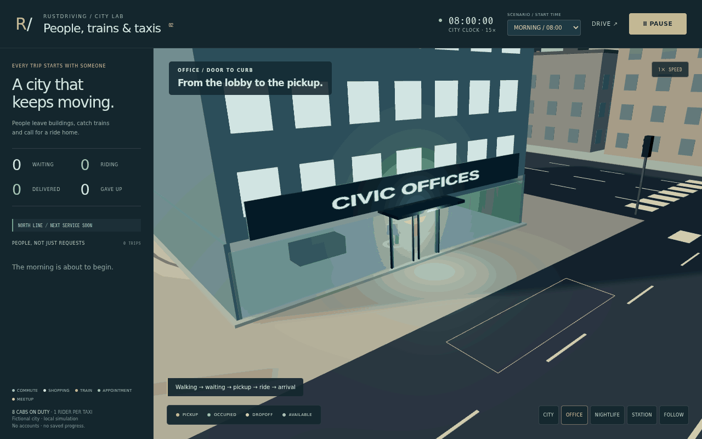
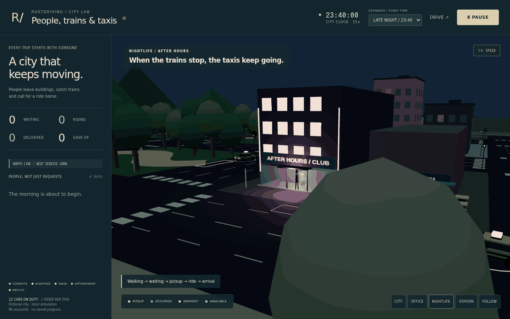

# City life: people, buildings, trains and taxis

[Open City Life](https://rsasaki0109.github.io/rust_driving/?mode=fleet).
Choose **MORNING**, **DUSK** or **LATE NIGHT** in the time-of-day menu.
Changing the scenario starts a new run.

Press **START** to run or pause. Escape also pauses. **1× / 4× SPEED**
changes the simulation playback rate; the GIFs are captured at 1×.
**OFFICE**, **NIGHTLIFE**, **STATION** and **CITY** frame different parts of
the same simulation. Select a person's card and use **FOLLOW** to track their
assigned taxi.

## Buildings and individual demand

Office workers start inside a real lobby. The sliding doors open as they
approach; people walk through the opening, onto the sidewalk and to the taxi
queue. They request a ride after leaving the building. Arriving passengers
can walk back through the entrance. Abandoned office/club requests return
indoors rather than disappearing at the curb.

The nightlife block has a club, late cafe, signs, emissive windows and
local night lighting. Club customers use its actual entrance and walk to the
pickup. Demand mixes commuting, shopping, train connections, appointments and
meetups, with different origins, destinations, departure times, walking
speeds, patience, boarding times, outfits and luggage.

A seeded generator replenishes travel plans as time advances. Late-night
plans have a higher departure rate and concentrate on the nightlife strip.
Queue positions have individual slots; trip requests are independent of
available taxi capacity.

The target fleet is eight taxis by day, ten in the evening and twelve at
night. Additional drivers enter from the city boundary. A retiring driver
finishes an occupied trip, then drives to a depot parking bay. Off-duty
taxis are excluded from dispatch and do not occupy passenger pickup stands.

The dispatcher processes the oldest actual requests first and chooses a
free taxi by legal directed road distance. Taxis use the existing steering,
acceleration, car following and junction admission. Boarding/dropoff require
arrival within 1.1 m at under 0.25 m/s. A person walks to/from the door and
completes their own dwell time. A trip is counted only after real dropoff.

## Empty-cab standby

**EMPTY TAXIS → FOLLOW DEMAND** sends available cabs to separate blue standby
bays, 12 m upstream of passenger pickup points. Each bay has one owner.
Surplus idle cabs continue through the road network instead of stacking in a
pickup bay. Actual requests retain FIFO priority and immediately interrupt
standby; occupied, boarding and retiring drivers are excluded.

Standby uses authored time-of-day preferences, current public rail service,
and actual requests from the last 60 physical seconds. A last train increases
station coverage. Future unreleased travel plans are never consulted.
Targets are reconsidered every five physical seconds; existing targets are
retained for at least 20 seconds to reduce churn, unless a rider needs the cab.

Choose **WAIT AT LAST STOP** to compare the preceding behavior in the same
running city. The mode also persists in the URL as **standby=off**. Changing
strategy preserves passengers and does not move cars instantly. Blue ground
markings and cab rings show standby, and the live status reports cabs heading
to a stand and cabs actually stopped there.

The snapshot records actual empty and standby travel in metres from cab
odometers, along with standby departure/arrival events. This enables comparison
without awarding service or movement merely because time has passed.
The paired Node acceptance uses fresh copies of the same traffic RNG and the
same late-night departure: one cab waits at its previous stop while the other
physically reaches a nightlife standby bay before the person requests a ride.
This narrow scenario is a regression example, not a general performance claim.

## North Line and the last train

The North Line enters from the western boundary, brakes at the platform,
opens its doors, unloads, closes and departs east. Its state drives the
visible train and door panels. Passengers are created inside the stopped
train after its doors open; they walk out onto the platform.

A raised footbridge crosses the northern avenue at 5 m. Continuous
three-dimensional walking paths connect the platform, ramps and station
pickup; no passenger is teleported from the platform to a curb.
A train arrival therefore generates taxi requests only after its riders
have completed the station walk.

Taxi passengers travelling to the station can walk up to the platform and
board a stopped train. Boarding reservations respect capacity and hold doors
while someone is crossing. A rider missing the final service walks back to
the pickup and creates a second taxi leg home.

New services stop spawning at midnight; an already running last train
finishes its journey. Service resumes after 05:00. The train sign and station
status identify the last service.

## Time and lighting

The city clock runs at **15×**: four physical simulation seconds represent
one city minute. People, cars, door actuators and trains retain physical
metres and seconds. Timetables, demand and duty targets use the city clock.
The clock wraps at 24 hours; sunlight, sky, ambient light and venue lighting
change continuously. Morning, dusk and late-night presets expose these
conditions without waiting through a full day.

These are authored scenarios, not a real location, population, railway
schedule or demand model calibrated against travel surveys.

## Reproduce and inspect

Use the pinned Rust/Node toolchains and the normal playground prerequisites:

~~~sh
npm ci --prefix web --ignore-scripts
bash scripts/build-playground.sh
npm --prefix web test
npm --prefix web run preview -- --host 127.0.0.1 --port 4173
~~~

With Python 3.12, Playwright 1.56.0, Pillow 12.0.0 and Chromium installed,
run this in another terminal:

~~~sh
python web/tests/fleet_smoke.py \
  --url http://127.0.0.1:4173/ \
  --output web/test-results/city-life \
  --record assets/taxi-fleet-demo.gif
~~~

The two GIFs contain **two normal-speed recorded intervals each**. They
show office departures followed by city operations, and nightlife followed
by a last-train arrival. Between intervals the actual simulation advances
off camera; the city clock visibly jumps at those edits. The recorder uses
UI start/pause/camera/speed controls and the deterministic frame clock. It never
writes agent poses or counters. A short initial visual check is available
with **--proof-only**.

Each 32-second GIF uses 320 frames at 100 ms. Its JSON receipt records the
source commit, input hashes, frame hashes, segment times, physical playback
rate, 15× city-clock rate, building exits and rail-to-taxi requests.
The PNG posters are unmodified captured frames. The longer browser
acceptance also runs both scenarios to 120 physical seconds and exercises
pause, camera controls, the dusk menu and mobile layout.

The **Taxi fleet evidence** workflow runs core and visual/build checks in
parallel, followed by the two-scenario browser acceptance. The standby feature
branch runs acceptance without re-recording existing media. It verifies the generated media hashes and source hashes before
committing the six media files to the unchanged feature branch. The normal
**Browser playground** workflow runs the city-life suite alongside the
driving suite; both gate Pages deployment.

## Scope

This optional arcade city is independent of the Rust autonomous-driving
research pipeline. It uses authored simulation state for dispatch and
rendering. It does not validate sensing, localization, real-vehicle safety,
real-time performance or a real railway network.

Taxis have one rider each; pooling, parties, fares, batteries and learned
demand forecasting are not implemented. Standby remains a small authored heuristic. Pedestrian routes and a simple
doorway headway are authored; this is not a validated crowd-avoidance or
accessibility model. Rail travel beyond the entry/exit boundary is outside
the model.
